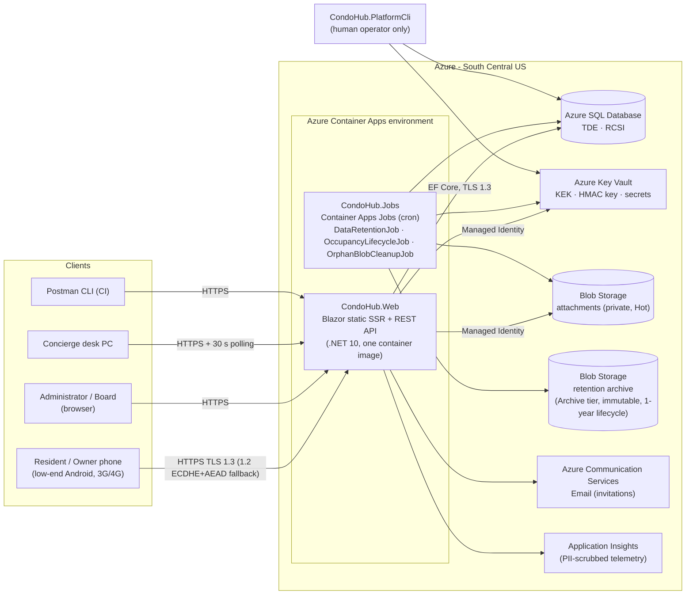
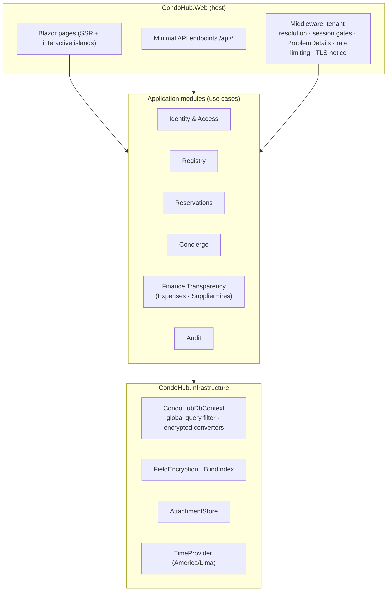
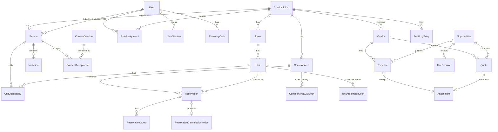

# CondoHub — Arquitectura inicial

> **Fase:** Solución (Agente Architect, BMAD)
> **Fecha:** 2026-11-02
> **Autor:** Jose Bustamante
> **Versión:** v0.5 (2026-11-08): auditoría del Spec Finalizer: proveedor como `Vendor`, Q25 resuelta (RT6), sesión parcial de 300 s, `no-store` en portería, caché de sesión de 5 s en §6.2, catálogo único de códigos y §4.4 (RN-169 a RN-179), ADR-0011 a 0015 transcritos a `docs/adr/`. v0.4 (2026-11-04): resuelve los hallazgos mayores BK-M02, BK-M08, BK-M10, BK-M11, BK-M14, BK-M15 y BK-M16 de la auditoría del backlog
> **Estado:** Aprobado por el autor el 2026-11-04 (cierra el hallazgo BK-C05 de la auditoría del backlog)
> **Documentos relacionados:** [00-constitucion.md](00-constitucion.md) v1.4 · [01-project-brief.md](01-project-brief.md) · [02-alcance.md](02-alcance.md) · [03-reglas-de-negocio.md](03-reglas-de-negocio.md) · [06-user-stories.md](06-user-stories.md) · [docs/security/permissions-matrix.md](docs/security/permissions-matrix.md) · ADR [0001](docs/adr/0001-occupancy-type-instead-of-tenant-role.md) a [0010](docs/adr/0010-defer-arco-and-complaints-book.md)

**Alcance de este documento.** Cubre el MVP (M1–M6, HU-001 a HU-014) y deja preparados los puntos de extensión para S1–S5 y para la app móvil (W1). No repite las decisiones ya aceptadas en los ADR 0001 a 0010: las cita. Las decisiones nuevas están en la sección 5 (ADR-0011 a ADR-0015, aceptados el 2026-11-04 y transcritos en inglés con la plantilla MADR a `docs/adr/` el 2026-11-08, PRINCIPIO-001 y PRINCIPIO-012).

**Idioma.** Este documento pertenece al Spec Pack y está en español. Todo identificador (componentes, entidades, columnas, rutas, códigos de error) y los diagramas Mermaid están en inglés (PRINCIPIO-001).

---

## 1. Overview del sistema

### 1.1 Descripción

CondoHub es una aplicación web multi-tenant, diseñada para celular primero, que permite a los residentes de un condominio de Lima reservar áreas comunes con confirmación automática, a portería verificar a los invitados sin papel, y a los propietarios ver cada gasto y cada contratación con su sustento. Se construye como un **monolito modular en .NET 10**: un solo despliegue que sirve las páginas Blazor (renderizado estático en servidor) y una API REST documentada en OpenAPI 3.1, sobre Azure SQL Database con EF Core. Cada fila de negocio pertenece a un condominio (`CondominiumId`) y un global query filter aísla los datos de cada uno. Los datos personales se cifran por campo con AES-256-GCM y claves en Azure Key Vault, y un worker de jobs programados ejecuta la retención de 90 días y el ciclo de vida de los vínculos. La interfaz se optimiza para Android de gama baja con 3G o 4G lenta: páginas sin WebAssembly, formularios que funcionan sin JavaScript y reintentos seguros mediante idempotencia.

### 1.2 Diagrama de arquitectura



**Vista lógica del monolito modular:**



Las páginas Blazor y los endpoints `/api/*` llaman a los **mismos casos de uso** en proceso. La página no llama a la API por HTTP: así se evita un salto de red y se mantiene una sola fuente de reglas. La API existe para los componentes interactivos, las colecciones Postman (PRINCIPIO-010), el contrato OpenAPI (PRINCIPIO-012) y la futura app React Native (W1).

### 1.3 Principios de diseño

| # | Principio | Cómo se aplica |
|---|---|---|
| P1 | **Tenant primero** | El `CondominiumId` sale de la sesión, nunca del request. El global query filter responde `404` antes de evaluar permisos (RN-017, RN-103). `IgnoreQueryFilters()` solo en la lista cerrada del ADR-0003 |
| P2 | **Privacidad por defecto** | Cifrado de campo por convención en el `DbContext`: una propiedad marcada `[PersonalData]` sin converter cifrado hace fallar un test de arquitectura. Los logs solo contienen identificadores (RN-053) |
| P3 | **Una sola fuente de reglas** | Las reglas viven en el dominio y en los casos de uso, no en la UI ni en la API. Cada rechazo es un código estable con Problem Details (RN-102, RN-118) |
| P4 | **Liviano para 3G** | Resident pages en SSR estático, sin WebAssembly ni circuito SignalR (ADR-0007). Presupuesto por página en la sección 6.3 |
| P5 | **Reintentos seguros** | Toda operación que crea algo y que un residente puede reenviar por un corte de red es idempotente (RN-163). Las lecturas usan `ETag` para responder `304` |
| P6 | **Mínimas dependencias** | Primero la librería base de .NET (AES-GCM, HMAC, ProblemDetails, rate limiting, `TimeProvider`). Cada paquete nuevo pasa por aprobación humana (PRINCIPIO-009.4) |
| P7 | **Tiempo explícito** | Se guarda en UTC (`datetimeoffset`); las reglas de calendario se evalúan en `America/Lima` con un `TimeProvider` inyectado, para poder probar bordes como 19:00:00 exactas |
| P8 | **Monolito modular, no microservicios** | Un equipo de una persona y 16 semanas (R7). Los módulos se separan por namespace y se verifican con tests de arquitectura; se pueden extraer después si hace falta (ADR-0011) |

---

## 2. Componentes principales

### 2.1 Estructura de la solución

```
src/
  CondoHub.Domain/          entities, value objects, domain rules, error codes
  CondoHub.Application/     use cases per module (Identity, Registry, Reservations,
                            Concierge, Expenses, SupplierHires, Audit)
  CondoHub.Infrastructure/  EF Core DbContext + migrations, encryption, Blob, Key Vault, email
  CondoHub.Web/             host: Blazor pages, Minimal API endpoints, middleware, es-PE.resx
  CondoHub.Jobs/            entry point for scheduled jobs (same image, different command)
  CondoHub.PlatformCli/     platform process of ADR-0003 (human operator only)
  CondoHub.Seeder/          synthetic condominium seeder (PRINCIPIO-008)
tests/
  CondoHub.UnitTests/  CondoHub.IntegrationTests/  CondoHub.ArchitectureTests/
  CondoHub.E2E/ (Playwright)  postman/  load/ (Locust)
```

### 2.2 Catálogo de componentes

| # | Componente | Responsabilidad | Tecnología | HU que implementa |
|---|---|---|---|---|
| C1 | **Web UI** (`CondoHub.Web/Components`) | Páginas para residentes, Administrator, Junta Directiva y portería. Formularios con *enhanced form handling* que funcionan sin JavaScript. Textos desde `es-PE.resx`. Aviso de TLS 1.2 en cada inicio de sesión | Blazor (.NET 10), SSR estático; modo Auto solo en componentes donde se justifique, nunca en páginas de residentes (PRINCIPIO-002, ADR-0007); CSS propio sin framework | HU-001 a HU-014 (todas las pantallas) |
| C2 | **REST API** (`CondoHub.Web/Api`) | Endpoints `/api/*` sobre los mismos casos de uso. Problem Details RFC 9457, `Idempotency-Key`, `ETag`, rate limiting. Genera `docs/api/openapi.json` | ASP.NET Core Minimal APIs, `Microsoft.AspNetCore.OpenApi` (OpenAPI 3.1) | HU-001 a HU-014 (contratos de la sección 4) |
| C3 | **Identity & Access** | Invitaciones, cuenta global, Argon2id, lista local de contraseñas filtradas, TOTP y códigos de recuperación, bloqueo, sesiones en servidor (30 min / 12 h), selector de condominio, consentimiento versionado, políticas de autorización (`CanViewCondominiumFinancials`) | Cookie authentication de ASP.NET Core + tabla `UserSession` (ADR-0013); `System.Security.Cryptography`; librería Argon2id y TOTP por aprobar (sección 6.4) | HU-002, HU-002B, HU-003, HU-003B |
| C4 | **Registry** (padrón) | Torres, unidades, fichas `Person` por condominio, vínculos `UnitOccupancy` con `OccupancyType`, asignación de `Resident`/`NonResidentOwner`, unicidad por índice ciego | EF Core; `BlindIndexService` (ADR-0004) | HU-001 |
| C5 | **Reservations** | Configuración de áreas, validación de franjas (`[inicio, fin)`, minutos enteros, horario, duración, anticipación), aforo, cupo mensual, control de concurrencia (ADR-0012), idempotencia (ADR-0014), invitados, cancelación y aviso en la app, estado `Completed` calculado | EF Core con `rowversion`; `TimeProvider` | HU-004, HU-005, HU-006, HU-006B, HU-007, HU-008 |
| C6 | **Concierge** | Vista del día en `America/Lima`, solo reservas `Confirmed`, sin datos personales salvo el nombre del invitado; marca de ingreso única. Refresco por polling cada 30 s con `ETag` | Página SSR + script de polling de ~2 KB; endpoint con `ETag`/`304` | HU-009 |
| C7 | **Finance Transparency** | Gastos inmutables con comprobante, anulación con motivo, vínculo con contratación aprobada, totales por categoría y mes. Contrataciones `Draft → Submitted → Approved`, cotizaciones, decisiones de la Junta mostradas por cargo, contador de pendientes | EF Core; política `CanViewCondominiumFinancials` evaluada contra la base en cada request (RN-105) | HU-010, HU-010B, HU-011, HU-012, HU-013, HU-014 |
| C8 | **Field Encryption & Blind Index** | Cifrado AES-256-GCM por campo con *envelope encryption* (DEK por condominio envuelta por una KEK en Key Vault), HMAC-SHA256 normalizado para correo y DNI | `System.Security.Cryptography.AesGcm`, `HMACSHA256`; `Azure.Security.KeyVault.Keys` (MIT); EF Core value converters (ADR-0015) | HU-001, HU-002, HU-002B, HU-007 (datos de personas e invitados) |
| C9 | **Attachment Store** | Subida en streaming a Blob privado bajo `{CondominiumId}/{kind}/{recordId}/`, validación de tipo por firma de archivo, estado `pending → committed`, descarga solo por API con la política del registro dueño (RN-106, RN-107, RN-166) | `Azure.Storage.Blobs` (MIT), Managed Identity | HU-010, HU-011, HU-012, HU-014 |
| C10 | **Audit** | Log de auditoría append-only de vínculos, roles, decisiones y procesos de plataforma; nunca guarda datos personales en claro (RN-130) | Tabla `AuditLogEntry` sin `UPDATE`/`DELETE` concedidos al usuario de la aplicación | HU-001, HU-013 |
| C11 | **Scheduled Jobs** | `DataRetentionJob` (archivo frío a los 90 días, clave por titular, ADR-0002/0006), `OccupancyLifecycleJob` (fin de vínculos, revocación de roles, desactivación de cuentas), `OrphanBlobCleanupJob` (adjuntos `pending` de más de 1 h) | Azure Container Apps Jobs con cron, misma imagen que C1/C2 | HU-007 (retención de invitados, RN-028/089), HU-011 y HU-014 (fin de vínculo, RN-016/060), HU-010 (RN-166) |
| C12 | **Platform CLI** | Alta de condominio y primer Administrator, asignación de `BoardMember`, reset de MFA, traspaso de administradora (ADR-0003). Solo lo ejecuta un operador humano | Consola .NET 10 con `System.CommandLine` (MIT, por aprobar); Entra ID para el operador | HU-003 (reset de MFA de Administrator/BoardMember), HU-013 (habilita a la Junta Directiva) |
| C13 | **Synthetic Seeder** | Genera los condominios "Residencial Los Olivos" y "Torres del Parque" con las personas y montos de los criterios de aceptación | Consola .NET; `Bogus` (MIT) opcional, por aprobar | Todas (INVEST: las HU se prueban por separado con datos del seeder) |

### 2.3 Flujo crítico: reservar con 3G intermitente (HU-005, HU-006, HU-007)

```mermaid
sequenceDiagram
    autonumber
    participant P as Phone (SSR form)
    participant W as CondoHub.Web
    participant U as CreateReservation use case
    participant DB as Azure SQL

    P->>W: GET /reservations/new?areaId=…
    W-->>P: HTML form + hidden IdempotencyKey (UUIDv7)
    P->>W: POST /api/reservations (Idempotency-Key)
    W->>U: command + tenant + user
    U->>DB: BEGIN TRAN; look up IdempotencyRecord
    alt key already used, same fingerprint
        DB-->>U: existing reservation
        U-->>W: replay (201, Idempotency-Replayed: true)
    else new key
        U->>DB: read area rules, overlaps, unit month count
        U->>DB: INSERT Reservation + Guests + IdempotencyRecord;<br/>touch CommonAreaDayLock and UnitAreaMonthLock (rowversion)
        alt rowversion conflict (concurrent request)
            DB-->>U: DbUpdateConcurrencyException
            U->>U: retry once with fresh context → RESERVATION_OVERLAP (422)
        else ok
            DB-->>U: COMMIT
            U-->>W: 201 Confirmed
        end
    end
    W-->>P: confirmation page (or 422 ProblemDetails → es-PE message)
    Note over P,W: If 3G drops after step 3, the browser re-POSTs<br/>the same form with the same key: no duplicate, quota consumed once.
```

---

## 3. Modelo de datos

### 3.1 Convenciones

- **Claves:** `Guid` generado en la aplicación con UUIDv7 (`Guid.CreateVersion7()`, .NET 9+), ordenable para no fragmentar índices.
- **Tenant:** toda entidad con datos de un condominio tiene `CondominiumId` (no nulo, con índice) y queda bajo el global query filter. Las excepciones, sin `CondominiumId`, son `User`, `UserSession` y `ConsentVersion` cuando es global; solo se acceden desde los procesos de la lista del ADR-0003. `UserSession` guarda el condominio elegido en `SelectedCondominiumId`, que no es una columna de tenant ni implementa `ITenantOwned`: la sesión es global y solo la leen el middleware de sesión y el inicio de sesión.
- **Cifrado:** 🔒 = columna `varbinary` cifrada con AES-256-GCM (C8). 🔑 = índice ciego HMAC-SHA256 (`binary(32)`) con índice único filtrado por condominio.
- **Tiempo:** `datetimeoffset(0)` en UTC. Las fechas de calendario (`StartDate`, `EndDate`, `ExpenseDate`) son `date` en `America/Lima`.
- **Dinero:** `decimal(12,2)`; la moneda es siempre PEN.
- **Concurrencia:** `RowVersion rowversion` en las entidades con transiciones de estado.
- **Auditoría técnica:** `CreatedAt`, `CreatedByUserId` en todas las entidades de negocio.

### 3.2 Diagrama entidad-relación



### 3.3 Entidades

#### Identidad y acceso (C3)

| Entidad | Atributos clave | Notas de seguridad |
|---|---|---|
| `User` (global) | `Id`, `EmailBlindIndex` 🔑 (único global), `Email` 🔒, `PasswordHash` (Argon2id, formato PHC con parámetros), `TotpSecret` 🔒 (nulo si no enroló), `FailedAccessCount`, `LockoutEndsAt`, `IsActive`, `SecurityStamp` | Sin `CondominiumId`: solo lo leen el inicio de sesión y la aceptación de invitaciones (ADR-0003). El contador de fallos suma contraseña y TOTP (RN-111) |
| `RecoveryCode` | `Id`, `UserId`, `CodeHash` (SHA-256 con sal), `UsedAt` | 10 por usuario; regenerarlos invalida los anteriores (RN-112, RN-141) |
| `UserSession` | `Id` (valor opaco de 256 bits, se guarda solo su hash), `UserId`, `SelectedCondominiumId?` (condominio elegido, no es tenant), `CreatedAt`, `LastActivityAt`, `RevokedAt`, `TlsProtocol` | Expira a los 1,800 s de inactividad o 43,200 s desde su creación (RN-113, RN-114). Se revoca al revocar un rol o desactivar la cuenta |
| `RoleAssignment` | `Id`, `CondominiumId`, `UserId`, `Role` (`Administrator`, `BoardMember`, `Resident`, `NonResidentOwner`, `Concierge`, `Supplier`), `AssignedAt`, `RevokedAt` | Restricción: `Administrator` y `BoardMember` no coinciden por usuario y condominio (RN-067); se valida en el caso de uso y con un índice único filtrado sobre una columna calculada `IsManagementRole` |
| `Invitation` | `Id`, `CondominiumId`, `PersonId`, `Role`, `TokenHash`, `IssuedAt`, `ExpiresAt` (+604,800 s), `AcceptedAt`, `RevokedAt` | El token viaja solo en el correo; se guarda su hash. Un solo uso (RN-165) |
| `ConsentVersion` | `Id`, `Version` (`2026-11-01.v1`), `PublishedAt`, `TextResourceKey`, `DeclaresInternationalTransfer` (siempre `true`) | El texto vive en `es-PE.resx`; la versión vigente es la última publicada |
| `ConsentAcceptance` | `Id`, `CondominiumId`, `PersonId`, `ConsentVersionId`, `Decision` (`Accepted`/`Rejected`), `DecidedAt` | Append-only. La puerta de sesión exige una aceptación de la versión vigente por condominio (RN-010, RN-071) |

#### Padrón (C4)

| Entidad | Atributos clave | Notas de seguridad |
|---|---|---|
| `Condominium` | `Id`, `Name`, `TimeZone` (`America/Lima`), `DataKeyWrapped` (DEK envuelta por la KEK) | La DEK solo existe en claro en memoria (ADR-0015) |
| `Tower` | `Id`, `CondominiumId`, `Code` (`A`, `B`) | Único `(CondominiumId, Code)` |
| `Unit` | `Id`, `CondominiumId`, `TowerId`, `Number` (3 o 4 dígitos, `^\d{3,4}$`) | Único `(TowerId, Number)` → `UNIT_NUMBER_DUPLICATE` |
| `Person` | `Id`, `CondominiumId`, `UserId?`, `FullName` 🔒, `Email` 🔒, `EmailBlindIndex` 🔑, `DocumentType?`, `DocumentNumber?` 🔒, `DocumentBlindIndex?` 🔑, `PhoneNumber?` 🔒, `RequiresAccessibleElevator` (bool), `RetentionStartsAt?` (`date`), `ArchivedAt?` | `RetentionStartsAt` es el inicio del plazo de 90 días (RN-005), y se anula si la persona vuelve antes de que venza (RN-131). Antes del consentimiento solo existen nombre, correo y vínculo (HU-001). DNI y teléfono los escribe solo el titular (`PERSONAL_DATA_OWNER_ONLY`). Al archivar quedan solo `Id` y `CondominiumId` (RN-127). Prohibido cualquier campo de diagnóstico (PRINCIPIO-004.3) |
| `UnitOccupancy` | `Id`, `CondominiumId`, `UnitId`, `PersonId`, `OccupancyType` (`Owner`/`Tenant`), `StartDate`, `EndDate?` | Modelo del ADR-0001. "Activo" se evalúa en `America/Lima`. Base de `CanViewCondominiumFinancials` |

#### Reservas y portería (C5, C6)

| Entidad | Atributos clave | Notas de seguridad |
|---|---|---|
| `CommonArea` | `Id`, `CondominiumId`, `Name`, `OpensAt`/`ClosesAt` (`time`, `OpensAt < ClosesAt`), `MaxDurationSeconds`, `Capacity`, `MaxAdvanceSeconds`, `MaxReservationsPerUnitPerMonth`, `RowVersion` | Enteros > 0; duración y anticipación múltiplos de 60 (RN-160). No cruza medianoche, así una reserva siempre cae en un solo día local |
| `Reservation` | `Id`, `CondominiumId`, `CommonAreaId`, `UnitId`, `HostPersonId`, `BookedByUserId`, `StartAt`, `EndAt`, `LocalDate`, `HouseholdCount` (≥ 1), `Status` (`Confirmed`/`Cancelled`), `CancelledByUserId?`, `CancelledByRole?`, `CancelledAt?`, `RowVersion` | `Completed` no se guarda: se calcula al leer cuando `EndAt ≤ now` (RN-085). Índice `(CommonAreaId, LocalDate, Status)`. Índice único filtrado `(CommonAreaId, StartAt) WHERE Status = 'Confirmed'` como red de seguridad |
| `ReservationGuest` | `Id`, `CondominiumId`, `ReservationId`, `FullName` 🔒, `CheckedInAt?`, `CheckedInByUserId?` | Dato de tercero: se archiva y elimina a los 90 días de la visita (RN-028, RN-089). El Concierge ve solo el nombre |
| `CommonAreaDayLock` | `CommonAreaId`, `LocalDate` (PK compuesta), `CondominiumId`, `RowVersion` | Fila testigo para serializar reservas del mismo área y día (ADR-0012). Sin datos de negocio |
| `UnitAreaMonthLock` | `UnitId`, `CommonAreaId`, `YearMonth` (PK compuesta), `CondominiumId`, `RowVersion` | Fila testigo para el cupo mensual (ADR-0012) |
| `IdempotencyRecord` | `Id`, `CondominiumId`, `UserId`, `Key` (UUID), `Fingerprint` (SHA-256 de área + unidad + franja), `ResourceId`, `ExpiresAt` (+86,400 s) | Único `(UserId, Key)`. `OrphanBlobCleanupJob` también purga los registros vencidos (ADR-0014) |
| `ReservationCancellationNotice` | `Id`, `CondominiumId`, `ReservationId`, `RecipientPersonId`, `CreatedAt`, `SeenAt?` | Solo si cancela alguien distinto del anfitrión (HU-008). Se muestra una vez al iniciar sesión |

#### Transparencia financiera (C7)

| Entidad | Atributos clave | Notas de seguridad |
|---|---|---|
| `Vendor` | `Id`, `CondominiumId`, `Ruc` (11 dígitos), `LegalName`, `IsNaturalPerson`, `NaturalPersonName?` 🔒, `NaturalPersonRuc?` 🔒 | Sin cuenta de usuario (W6). El RUC 10 y el nombre de persona natural se cifran (RN-052) |
| `Expense` | `Id`, `CondominiumId`, `Description` (≤ 200), `Amount`, `ExpenseDate`, `Category` (enum configurable), `VendorId`, `SupplierHireId?`, `ReceiptAttachmentId`, `RegisteredAt`, `VoidedAt?`, `VoidReason?`, `VoidedByUserId?`, `RowVersion` | Inmutable salvo la anulación (`EXPENSE_IMMUTABLE`). Nunca referencia unidades ni personas residentes (RN-036). Índice `(CondominiumId, ExpenseDate)` para totales por mes |
| `SupplierHire` | `Id`, `CondominiumId`, `Title`, `Justification`, `Status` (`Draft`/`Submitted`/`Approved`), `SubmittedAt?`, `RowVersion` | Editable solo en `Draft` (`HIRE_NOT_EDITABLE`) |
| `Quote` | `Id`, `CondominiumId`, `SupplierHireId`, `VendorId`, `Amount`, `AttachmentId?` | El envío exige ≥ 2 proveedores distintos (RN-037) |
| `HireDecision` | `Id`, `CondominiumId`, `SupplierHireId`, `Outcome` (`Approved`/`Rejected`), `Reason?`, `DecidedByUserId`, `DecidedByRole` (`BoardMember`), `DecidedAt` | Append-only. La vista de propietarios proyecta solo `DecidedByRole` y `DecidedAt`, nunca el nombre (HU-014). El `DecidedByUserId` sobrevive al archivado (ADR-0002) |
| `Attachment` | `Id`, `CondominiumId`, `OwnerKind` (`ExpenseReceipt`/`QuoteDocument`), `BlobPath`, `FileName`, `ContentType`, `SizeBytes`, `Sha256`, `State` (`Pending`/`Committed`) | Sin URL pública. Descarga por `/api/.../receipt` con la política del dueño (RN-107) |

#### Transversal (C10)

| Entidad | Atributos clave | Notas de seguridad |
|---|---|---|
| `AuditLogEntry` | `Id`, `CondominiumId?` (nulo para eventos de plataforma), `ActorUserId?`, `ActorRole`, `EventType`, `EntityType`, `EntityId`, `OldValue`, `NewValue` (JSON sin datos personales: `A-301 · Tenant`), `OccurredAt` | Append-only: el usuario SQL de la aplicación tiene solo `INSERT` y `SELECT` sobre esta tabla. La vista de la Junta proyecta cargo, no nombre (RN-124) |

### 3.4 Notas de seguridad del modelo

1. **Global query filter** en `OnModelCreating`, aplicado por convención a toda entidad que implementa `ITenantOwned`. Un test de arquitectura falla si una entidad con `CondominiumId` no tiene filtro, y otro falla si `IgnoreQueryFilters()` aparece fuera de los namespaces autorizados (ADR-0003).
2. **Escrituras:** un `SaveChangesInterceptor` asigna `CondominiumId` desde `ITenantContext` y lanza una excepción si una entidad modificada tiene otro valor (defensa ante un `Id` manipulado).
3. **Cifrado:** el converter usa el formato `version(1) | keyId(16) | nonce(12) | ciphertext | tag(16)`. El nonce es aleatorio por escritura. Rotar la KEK solo re-envuelve la DEK; rotar la DEK es un job de re-cifrado.
4. **Sin búsquedas parciales** sobre campos cifrados (ADR-0004): el Administrator busca por correo o DNI exactos, o navega por torre y unidad.
5. **Usuario SQL de la aplicación** sin permisos DDL; las migraciones corren en el pipeline con otra identidad. Ningún agente ejecuta migraciones contra producción (PRINCIPIO-009.2).
6. **Read Committed Snapshot** (activo por defecto en Azure SQL Database) para que las lecturas no bloqueen escrituras en horas pico de reservas.

---

## 4. API Contracts

### 4.1 Convenciones comunes

| Tema | Regla |
|---|---|
| Base | `https://{host}/api`. Versión por encabezado `Api-Version: 1` (por defecto 1); un cambio incompatible crea la versión 2 en paralelo |
| Autenticación | Cookie de sesión `__Host-condohub` (`HttpOnly`, `Secure`, `SameSite=Lax`) + token antiforgery `X-CSRF-TOKEN` en métodos no seguros (ADR-0013). Sin sesión → `401` |
| Puertas de sesión | Sin consentimiento vigente → `403` con `CONSENT_REQUIRED`; MFA pendiente → `403` con `MFA_REQUIRED` (matriz de permisos, regla 2) |
| Tenant | El `CondominiumId` sale de la sesión. Recurso de otro condominio → `404` antes de evaluar permisos (RN-103) |
| Errores | `application/problem+json` (RFC 9457) con `type`, `title`, `status`, `code`, `traceId` y, si aplica, `errors`. `403` sin permiso (RN-118); `422` validación, estado o tiempo (RN-102). El `title` es el texto `es-PE` del código. **Catálogo único:** los códigos de 03-reglas-de-negocio.md, más los transversales de esta tabla (`CONSENT_REQUIRED`, `MFA_REQUIRED`, `AUTH_RATE_LIMITED`, `IDEMPOTENCY_KEY_MISSING`) y los de adjuntos de API-06 (`ATTACHMENT_TOO_LARGE`, `ATTACHMENT_TYPE_NOT_ALLOWED`, ADR-0019); §4.4 lista los que se agregaron después de v0.4 |
| Fechas | ISO 8601 con offset; la API responde siempre con `-05:00` |
| Dinero | Número JSON con hasta 2 decimales (`1200.5` se acepta y se devuelve `1200.50`); más decimales → `AMOUNT_INVALID_PRECISION` |
| Idempotencia | `Idempotency-Key: <uuid>` obligatorio en `POST /api/reservations`; opcional en los demás `POST` de creación |
| Caché | `GET` de listas devuelve `ETag`; con `If-None-Match` igual responde `304` sin cuerpo |
| Rate limiting | `POST /api/auth/*`: 10 solicitudes por minuto por IP y por índice ciego del correo → `429` con `Retry-After` y el código `AUTH_RATE_LIMITED` (RN-177) |
| Sesión parcial | Tras la contraseña y antes del MFA, la selección de condominio o el consentimiento, la sesión es **parcial**: solo permite `/api/auth/*`, `/api/consents/current*` y las páginas P-002 a P-005 y P-007, y vence a los **300 s** sin completar el paso (valor por defecto de Q56). Vencida → `401` y vuelta a P-001 |
| Caché sensible | `/concierge` y `GET /api/concierge/today` responden con `Cache-Control: no-store` (además del `ETag` del polling), para que "Atrás" no muestre la lista después de cerrar sesión en la PC compartida (10-validation-log fila 45) |
| Paginación | `?page=1&pageSize=20` (máximo 50); respuesta con `items`, `page`, `pageSize`, `totalCount` |

**Ejemplo de error:**

```json
{
  "type": "https://condohub.pe/errors/reservation-overlap",
  "title": "El área ya está reservada en ese horario.",
  "status": 422,
  "code": "RESERVATION_OVERLAP",
  "traceId": "00-4bf92f3577b34da6a3ce929d0e0e4736-00f067aa0ba902b7-01"
}
```

### 4.2 Mapa de endpoints del MVP

| Método y ruta | Política | HU |
|---|---|---|
| `POST /api/towers` · `GET /api/towers` · `GET /api/towers/{id}/units` | Administrator | HU-001 |
| `POST /api/units` | Administrator | HU-001 |
| `POST /api/persons` · `POST /api/persons/{id}/occupancies` · `PUT /api/occupancies/{id}` | Administrator | HU-001 |
| `GET /api/persons?email=` · `GET /api/persons/{id}` | Administrator (Concierge → `403 PERSONAL_DATA_FORBIDDEN`, RN-158) | HU-001, HU-009 |
| `POST /api/persons/{id}/invitations` | Administrator | Emisión (RN-007, RN-157; T-049) |
| `POST /api/invitations/{token}/accept` | Anónimo (o sesión si el correo ya tiene cuenta) | HU-002 |
| `GET /api/consents/current` · `POST /api/consents/current/decision` | Sesión sin puerta de consentimiento | HU-002B |
| `POST /api/auth/sign-in` · `POST /api/auth/mfa` · `POST /api/auth/mfa/enroll` · `POST /api/auth/condominium` · `POST /api/auth/sign-out` | Anónimo / sesión parcial | HU-003, HU-003B |
| `POST /api/common-areas` · `PUT /api/common-areas/{id}` · `GET /api/common-areas` | Administrator (escritura); usuarios del condominio (lectura) | HU-004 |
| `GET /api/common-areas/{id}/availability?date=` | Resident, NonResidentOwner, Administrator | HU-005 |
| `POST /api/reservations` | Resident, NonResidentOwner (unidad vinculada), Administrator | HU-005, HU-006, HU-006B, HU-007 |
| `GET /api/reservations` · `GET /api/reservations/{id}` | Anfitrión de la reserva, Administrator | HU-005, HU-008 |
| `POST /api/reservations/{id}/guests` (con `Idempotency-Key`) · `DELETE /api/reservations/{id}/guests/{guestId}` | Anfitrión de la reserva | HU-007 |
| `POST /api/reservations/{id}/cancellation` | Anfitrión o Administrator | HU-008 |
| `GET /api/me/notices` · `POST /api/me/notices/{id}/seen` | Sesión | HU-008, HU-013 |
| `GET /api/concierge/today` · `POST /api/concierge/guests/{guestId}/check-in` | Concierge | HU-009 |
| `POST /api/expenses` (multipart, con `Idempotency-Key`) · `POST /api/expenses/{id}/void` · `PUT /api/expenses/{id}/supplier-hire` | Administrator | HU-010, HU-010B |
| `PUT /api/expenses/{id}` · `DELETE /api/expenses/{id}` | Administrator; responden siempre `422 EXPENSE_IMMUTABLE` (RN-091) | HU-010B |
| `GET /api/expenses?month=` · `GET /api/expenses/{id}` · `GET /api/expenses/{id}/receipt` | `CanViewCondominiumFinancials` | HU-011 |
| `POST /api/vendors` · `GET /api/vendors` | Administrator | HU-012 |
| `POST /api/supplier-hires` · `PUT /api/supplier-hires/{id}` · `POST /api/supplier-hires/{id}/quotes` · `PUT /api/supplier-hires/{id}/quotes/{quoteId}` · `POST /api/supplier-hires/{id}/submission` | Administrator (edición solo en `Draft`) | HU-012 |
| `POST /api/supplier-hires/{id}/decisions` | BoardMember | HU-013 |
| `GET /api/supplier-hires?status=` · `GET /api/supplier-hires/{id}` · `GET /api/supplier-hires/{id}/quotes/{quoteId}/document` | `CanViewCondominiumFinancials` | HU-013, HU-014 |

### 4.3 Contratos detallados

#### API-01 · `POST /api/auth/sign-in` (HU-003, HU-003B)

Primer paso del inicio de sesión. Responde siempre igual ante correo inexistente, contraseña incorrecta o cuenta bloqueada (RN-111, RN-153).

**Request**

```json
{
  "email": "marco.salazar@example.pe",
  "password": "mi edificio tiene piscina"
}
```

**Response `200 OK`** — se emite una cookie de sesión **parcial** que solo permite el siguiente paso:

```json
{
  "nextStep": "MfaRequired",
  "condominiums": null
}
```

`nextStep` ∈ `MfaRequired` · `MfaEnrollmentRequired` · `CondominiumSelectionRequired` · `ConsentRequired` · `SignedIn`. Cuando es `CondominiumSelectionRequired`, `condominiums` trae `[{ "id": "7f3c9a10-…", "name": "Residencial Los Olivos" }]` y el cliente llama a `POST /api/auth/condominium`. Con `SignedIn`, la respuesta incluye además:

```json
{
  "nextStep": "SignedIn",
  "session": {
    "condominiumId": "7f3c9a10-0000-7000-8000-000000000001",
    "roles": ["BoardMember"],
    "canViewFinancials": true,
    "tlsUpgradeNotice": false,
    "pendingHireDecisions": 1,
    "unseenNoticeCount": 0
  }
}
```

| Código | Cuándo |
|---|---|
| `200` | Credenciales válidas (con el paso siguiente) |
| `422` `SIGN_IN_FAILED` | Correo sin cuenta, contraseña incorrecta, cuenta bloqueada o desactivada: mismo cuerpo en todos los casos |
| `429` `AUTH_RATE_LIMITED` | Rate limit superado, con `Retry-After` (RN-177) |

`POST /api/auth/mfa` recibe `{ "code": "492817" }` o `{ "recoveryCode": "7KQ2-M9XD" }` y responde igual (`200` con `nextStep`, o `422` `SIGN_IN_FAILED`, que también suma al contador de bloqueo).

---

#### API-02 · `PUT /api/common-areas/{id}` (HU-004)

**Request**

```json
{
  "name": "Parrilla",
  "opensAt": "11:00",
  "closesAt": "22:00",
  "maxDurationSeconds": 14400,
  "capacity": 15,
  "maxAdvanceSeconds": 2592000,
  "maxReservationsPerUnitPerMonth": 4
}
```

Encabezado obligatorio `If-Match: "<etag>"` para no pisar un cambio concurrente.

**Response `200 OK`**

```json
{
  "id": "0192f1a4-5c2e-7b10-9a33-2f6b1c0d4e01",
  "name": "Parrilla",
  "opensAt": "11:00",
  "closesAt": "22:00",
  "maxDurationSeconds": 14400,
  "capacity": 15,
  "maxAdvanceSeconds": 2592000,
  "maxReservationsPerUnitPerMonth": 4
}
```

| Código | Cuándo |
|---|---|
| `200` | Actualizada; las reservas `Confirmed` existentes no cambian (RN-162) |
| `403` `COMMON_AREA_CONFIG_FORBIDDEN` | Quien no es Administrator (incluye BoardMember) |
| `404` | Área de otro condominio o inexistente |
| `412` | `If-Match` no coincide |
| `422` `COMMON_AREA_INVALID_OPENING_HOURS` | `opensAt >= closesAt` (incluye 20:00–02:00 y 11:00–11:00) |
| `422` `COMMON_AREA_INVALID_LIMITS` | Algún límite ≤ 0, o duración/anticipación no múltiplo de 60 |

`POST /api/common-areas` usa el mismo cuerpo y responde `201 Created` con `Location`.

---

#### API-03 · `POST /api/reservations` (HU-005, HU-006, HU-006B, HU-007)

**Encabezados:** `Idempotency-Key: 0192f1a4-7e3b-7c55-8a10-5f1c2b3d4e5f` (obligatorio).

**Request**

```json
{
  "commonAreaId": "0192f1a4-5c2e-7b10-9a33-2f6b1c0d4e02",
  "unitId": "0192f1a4-5c2e-7b10-9a33-2f6b1c0d4a50",
  "hostPersonId": null,
  "startAt": "2026-12-12T19:00:00-05:00",
  "endAt": "2026-12-12T23:00:00-05:00",
  "householdCount": 2,
  "guests": [
    { "fullName": "Pedro Ramos" },
    { "fullName": "Lucía Torres" }
  ],
  "guestPrivacyNoticeAccepted": true
}
```

- `hostPersonId` solo lo envía el Administrator al reservar a nombre de una unidad (RN-076); para residentes el anfitrión es la persona de la sesión.
- `guestPrivacyNoticeAccepted` es obligatorio si `guests` no está vacío (aviso de HU-007).

**Response `201 Created`** · `Location: /api/reservations/{id}`

```json
{
  "id": "0192f1a5-0a11-7d20-8b44-9e7c6d5f4a01",
  "commonArea": { "id": "0192f1a4-5c2e-7b10-9a33-2f6b1c0d4e02", "name": "Salón de fiestas" },
  "unit": { "id": "0192f1a4-5c2e-7b10-9a33-2f6b1c0d4a50", "label": "A-502" },
  "startAt": "2026-12-12T19:00:00-05:00",
  "endAt": "2026-12-12T23:00:00-05:00",
  "status": "Confirmed",
  "householdCount": 2,
  "totalPeople": 4,
  "guests": [
    { "id": "0192f1a5-0a11-7d20-8b44-9e7c6d5f4b01", "fullName": "Pedro Ramos", "checkedInAt": null },
    { "id": "0192f1a5-0a11-7d20-8b44-9e7c6d5f4b02", "fullName": "Lucía Torres", "checkedInAt": null }
  ],
  "createdAt": "2026-12-01T10:00:03-05:00"
}
```

Un reenvío con la misma clave y la misma área, unidad y franja dentro de 86,400 s devuelve **el mismo `201` y el mismo cuerpo** con el encabezado `Idempotency-Replayed: true`, sin reevaluar reglas (RN-163).

| Código | Código de error | Cuándo |
|---|---|---|
| `201` | — | Reserva `Confirmed` (o reenvío idempotente) |
| `400` | `IDEMPOTENCY_KEY_MISSING` | Falta el encabezado o no es un UUID |
| `403` | `RESERVATION_UNIT_NOT_LINKED` | Sin vínculo activo con la unidad (RN-075) |
| `403` | `RESERVATION_UNIT_RENTED` | Propietario de una unidad con inquilino activo (RN-077) |
| `403` | — | Rol sin permiso (Concierge, BoardMember sin vínculo) |
| `404` | — | Área o unidad de otro condominio |
| `422` | `RESERVATION_INVALID_TIME_SLOT` | `endAt <= startAt` |
| `422` | `RESERVATION_SLOT_NOT_WHOLE_MINUTES` | Segundos distintos de 0 |
| `422` | `RESERVATION_IN_THE_PAST` | `startAt < now` |
| `422` | `RESERVATION_TOO_FAR_AHEAD` | `startAt - now > maxAdvanceSeconds` |
| `422` | `RESERVATION_OUTSIDE_OPENING_HOURS` | Fuera de `[opensAt, closesAt]` en `America/Lima` |
| `422` | `RESERVATION_EXCEEDS_MAX_DURATION` | Duración > `maxDurationSeconds` |
| `422` | `RESERVATION_HOST_REQUIRED` | `householdCount < 1` |
| `422` | `GUEST_PRIVACY_NOTICE_REQUIRED` | `guests` no está vacío y `guestPrivacyNoticeAccepted` no es `true` (RN-087) |
| `422` | `RESERVATION_EXCEEDS_CAPACITY` | `householdCount + guests.length > capacity` |
| `422` | `RESERVATION_OVERLAP` | Otra reserva `Confirmed` se cruza (incluye la carrera de RN-081) |
| `422` | `RESERVATION_MONTHLY_LIMIT_REACHED` | La unidad agotó su cupo del mes para esa área |
| `422` | `IDEMPOTENCY_KEY_REUSED` | Misma clave con otra área, unidad o franja |

**Orden de evaluación** (determinista, para que los tests sean estables): forma y franja → permisos sobre la unidad (`403`) → reglas del área → aforo → cruce → cupo.

---

#### API-04 · `POST /api/reservations/{id}/cancellation` (HU-008)

**Request**

```json
{ "reason": null }
```

**Response `200 OK`**

```json
{
  "id": "0192f1a5-0a11-7d20-8b44-9e7c6d5f4a01",
  "status": "Cancelled",
  "cancelledBy": { "role": "Administrator" },
  "cancelledAt": "2026-12-12T15:00:00-05:00"
}
```

Si cancela alguien distinto del anfitrión, se crea un `ReservationCancellationNotice`, y la reserva desaparece de `GET /api/concierge/today` en el siguiente polling (≤ 30 s, RN-026).

| Código | Código de error | Cuándo |
|---|---|---|
| `200` | — | Cancelada |
| `403` | — | No es el anfitrión ni Administrator |
| `404` | — | Reserva de otro condominio |
| `422` | `RESERVATION_CANCELLATION_TOO_LATE` | `now >= startAt` (RN-083, RN-161) |
| `422` | `RESERVATION_ALREADY_CANCELLED` | Ya estaba `Cancelled` (RN-168) |

---

#### API-05 · `GET /api/concierge/today` y `POST /api/concierge/guests/{guestId}/check-in` (HU-009)

**`GET /api/concierge/today`** — con `If-None-Match` responde `304` si nada cambió (polling barato).

**Response `200 OK`** · `ETag: "c0a8-2026-12-12-17"`

```json
{
  "date": "2026-12-12",
  "reservations": [
    {
      "id": "0192f1a5-0a11-7d20-8b44-9e7c6d5f4a01",
      "unitLabel": "A-502",
      "commonAreaName": "Salón de fiestas",
      "startAt": "2026-12-12T19:00:00-05:00",
      "endAt": "2026-12-12T23:00:00-05:00",
      "guests": [
        { "id": "0192f1a5-0a11-7d20-8b44-9e7c6d5f4b01", "fullName": "Pedro Ramos", "checkedInAt": null }
      ]
    }
  ]
}
```

No incluye DNI, teléfono, correo ni nombre del anfitrión (RN-158). Solo reservas `Confirmed` cuya `LocalDate` es hoy en `America/Lima`.

**`POST /api/concierge/guests/{guestId}/check-in`** — sin cuerpo.

**Response `200 OK`**

```json
{ "guestId": "0192f1a5-0a11-7d20-8b44-9e7c6d5f4b01", "checkedInAt": "2026-12-12T19:07:42-05:00" }
```

| Código | Código de error | Cuándo |
|---|---|---|
| `200` / `304` | — | OK / sin cambios |
| `403` | — | Rol distinto de Concierge (incluye Administrator, celda G1 de la matriz) |
| `404` | — | Invitado de otro condominio |
| `422` | `GUEST_ALREADY_CHECKED_IN` | Ya tiene `CheckedInAt` (RN-164) |
| `422` | `GUEST_CHECK_IN_NOT_ALLOWED` | Reserva `Cancelled` o de otro día |

---

#### API-06 · `POST /api/expenses` (HU-010)

`Content-Type: multipart/form-data` con dos partes: `metadata` (JSON) y `receipt` (archivo).

**Parte `metadata`**

```json
{
  "description": "Limpieza de cisterna",
  "amount": 1200.00,
  "expenseDate": "2026-11-08",
  "category": "Cleaning",
  "vendorId": "0192f1a4-9a01-7e00-8c11-1d2e3f4a5b60"
}
```

**Parte `receipt`:** `factura-F001-0458.pdf` (`application/pdf`). Provisional hasta Q28: PDF, JPEG o PNG validados por firma de archivo, máximo 10 MB.

**Response `201 Created`** · `Location: /api/expenses/{id}`

```json
{
  "id": "0192f1b0-3c44-7a90-9d21-6e5f4a3b2c01",
  "description": "Limpieza de cisterna",
  "amount": 1200.00,
  "currency": "PEN",
  "expenseDate": "2026-11-08",
  "category": "Cleaning",
  "supplier": { "id": "0192f1a4-9a01-7e00-8c11-1d2e3f4a5b60", "name": "Hidroclean SAC" },
  "registeredAt": "2026-11-20T09:12:00-05:00",
  "status": "Active",
  "receipt": { "fileName": "factura-F001-0458.pdf", "sizeBytes": 184320, "downloadUrl": "/api/expenses/0192f1b0-3c44-7a90-9d21-6e5f4a3b2c01/receipt" },
  "supplierHireId": null
}
```

| Código | Código de error | Cuándo |
|---|---|---|
| `201` | — | Registrado y adjunto `Committed` |
| `403` | — | Quien no es Administrator (RN-032) |
| `413` | `ATTACHMENT_TOO_LARGE` | Archivo sobre el límite |
| `415` | `ATTACHMENT_TYPE_NOT_ALLOWED` | Firma de archivo no permitida |
| `422` | `EXPENSE_RECEIPT_REQUIRED` | Falta la parte `receipt` |
| `422` | `EXPENSE_AMOUNT_NOT_POSITIVE` | `amount <= 0` |
| `422` | `AMOUNT_INVALID_PRECISION` | Más de 2 decimales |
| `422` | `EXPENSE_DATE_OUT_OF_RANGE` | Fecha futura o anterior a 12 meses (RN-094) |

Si la carga del archivo se corta o la transacción falla, el registro no se guarda y el caso de uso borra el blob en ese momento. Si ese borrado también falla, el blob queda `Pending`, nunca se puede descargar y `OrphanBlobCleanupJob` lo borra en 1 h o menos (RN-166; ver 6.2).

---

#### API-07 · `GET /api/expenses?month=2026-11` (HU-011)

**Response `200 OK`** · `ETag`

```json
{
  "month": "2026-11",
  "totalsByCategory": [
    { "category": "Maintenance", "total": 6300.00 },
    { "category": "Cleaning", "total": 3200.00 },
    { "category": "Security", "total": 9800.00 }
  ],
  "items": [
    {
      "id": "0192f1b0-3c44-7a90-9d21-6e5f4a3b2c01",
      "description": "Limpieza de cisterna",
      "amount": 1200.00,
      "expenseDate": "2026-11-08",
      "registeredAt": "2026-11-20T09:12:00-05:00",
      "category": "Cleaning",
      "supplierName": "Hidroclean SAC",
      "status": "Voided",
      "void": { "reason": "Monto mal digitado; se registra de nuevo por S/ 1,000.00", "voidedAt": "2026-11-21T09:00:00-05:00" }
    }
  ],
  "page": 1, "pageSize": 20, "totalCount": 14
}
```

Los totales excluyen los anulados (RN-142) y agrupan por `expenseDate` (RN-143). Mes sin gastos: `totalsByCategory: []`, `items: []`, y la UI muestra el texto de `es-PE.resx`.

| Código | Cuándo |
|---|---|
| `200` / `304` | OK / sin cambios |
| `400` | `month` con formato distinto de `YYYY-MM` |
| `403` | No cumple `CanViewCondominiumFinancials` (inquilino, Concierge, propietario con vínculo vencido) |

---

#### API-08 · `POST /api/supplier-hires/{id}/decisions` (HU-013)

**Request**

```json
{ "outcome": "Rejected", "reason": "Falta la garantía por escrito de Pinturas Lima SAC" }
```

**Response `201 Created`**

```json
{
  "supplierHireId": "0192f1c2-1b22-7f40-8a55-4c3d2e1f0a01",
  "status": "Draft",
  "decision": {
    "id": "0192f1c2-77aa-7c10-9b66-1a2b3c4d5e01",
    "outcome": "Rejected",
    "reason": "Falta la garantía por escrito de Pinturas Lima SAC",
    "decidedByRole": "BoardMember",
    "decidedAt": "2026-11-22T20:15:00-05:00"
  }
}
```

Con `outcome: "Approved"`, `reason` es opcional y `status` pasa a `Approved`.

| Código | Código de error | Cuándo |
|---|---|---|
| `201` | — | Decisión registrada |
| `403` | — | Quien no es BoardMember (incluye Administrator) |
| `404` | — | Contratación de otro condominio |
| `409` | `HIRE_DECISION_CONFLICT` | `RowVersion` cambió durante la decisión (dos miembros a la vez); el cliente recarga (RN-179) |
| `422` | `HIRE_NOT_SUBMITTED` | Estado distinto de `Submitted` |
| `422` | `HIRE_REJECTION_REASON_REQUIRED` | Rechazo sin motivo o solo con espacios |

### 4.4 Códigos de error agregados después de v0.4

Códigos que nacieron en la validación de prototipos (RN-169 a RN-175) y en la auditoría del Spec Finalizer (RN-176 a RN-179), el 2026-11-08. Todos responden con Problem Details (§4.1); T-004 los incluye en el catálogo y cada tarea indicada los produce.

| HTTP | Código | Regla | Endpoint | Tarea |
|---|---|---|---|---|
| `422` | `VENDOR_RUC_INVALID_FORMAT` | RN-169 | `POST /api/vendors` | T-031.1, T-079 |
| `422` | `VENDOR_RUC_DUPLICATE` | RN-169 | `POST /api/vendors` | T-031.1 |
| `422` | `TOWER_CODE_DUPLICATE` | RN-170 | `POST /api/towers` | T-075 |
| `422` | `COMMON_AREA_NAME_DUPLICATE` | RN-171 | `POST /api/common-areas`, `PUT /api/common-areas/{id}` | T-076 |
| `422` | `FIELD_REQUIRED` (un error por campo en `errors`) | RN-172 | Todo `POST`/`PUT` con campos obligatorios | T-077 |
| `422` | `AMOUNT_INVALID_FORMAT` | RN-173 | `POST /api/expenses`, cotizaciones | T-077 |
| `422` | `OCCUPANCY_END_BEFORE_START` | RN-174 | `POST /api/persons/{id}/occupancies`, `PUT /api/occupancies/{id}` | T-075 |
| `422` | `OCCUPANCY_NOT_ACTIVE` | RN-175 | `POST /api/persons/{id}/invitations` | T-078 |
| `422` | `OCCUPANCY_OVERLAP` | RN-176 | `POST /api/persons/{id}/occupancies`, `PUT /api/occupancies/{id}` | T-075 |
| `429` | `AUTH_RATE_LIMITED` | RN-177 | `POST /api/auth/*` | T-013.4 |
| `422` | `RESERVATION_HOST_NOT_SELECTED`, `RESERVATION_HOST_NOT_LINKED` | RN-178 | `POST /api/reservations` (Administrator) | T-067 |
| `409` | `HIRE_DECISION_CONFLICT` | RN-179 | `POST /api/supplier-hires/{id}/decisions` | T-034 |

---

## 5. ADRs

Decisiones nuevas de esta fase. Las vigentes (0001–0010) no se repiten. Estado de todas: **Aceptado** por el autor el 2026-11-04. Desde el 2026-11-08 están transcritas en inglés con la plantilla MADR en `docs/adr/0011-…` a `docs/adr/0015-…` (PRINCIPIO-012); ante una diferencia, manda el archivo de `docs/adr/`. Las reglas que esta arquitectura no implementa en el MVP están diferidas por el [ADR-0020](docs/adr/0020-defer-account-self-service-and-handover.md).

### ADR-0011: Monolito modular con Blazor SSR y API REST en un solo despliegue

- **Contexto.** Una persona, 16 semanas, un costo de nube sin definir (Q20) y un piso de calidad alto (PRINCIPIO-010). Hace falta una API documentada (OpenAPI, Postman) y una web liviana para 3G. W1 deja la app móvil para después, pero la API debe servirle.
- **Decisión.** Una solución .NET 10 con un host `CondoHub.Web` que sirve Blazor (SSR estático con islas interactivas) y Minimal APIs. Las páginas llaman a los casos de uso en proceso; la API los expone por HTTP. Los módulos se separan por namespace y se protegen con tests de arquitectura (ArchUnitNET, Apache-2.0). Los jobs usan la misma imagen con otro comando.
- **Alternativas.** (a) Blazor + API en dos despliegues: duplica pipeline, costo y latencia. (b) Microservicios por módulo: inviable para una persona y sin necesidad de escala independiente (~480 unidades). (c) Blazor WebAssembly como SPA sobre la API: descarga pesada en Android de gama baja, contra ADR-0007.
- **Consecuencias.** ➕ Un solo pipeline y un solo artefacto; las reglas no se duplican; la API queda lista para W1. ➖ Un fallo de memoria del job puede afectar al web si comparten plan (por eso los jobs son Container Apps Jobs separados). ➖ La disciplina modular depende de los tests de arquitectura.

### ADR-0012: Concurrencia de reservas con filas testigo y `rowversion`

- **Contexto.** RN-081 exige que, ante dos reservas superpuestas simultáneas, solo se confirme la primera; RN-080 exige respetar el cupo mensual también bajo concurrencia. SQL Server no tiene restricciones de exclusión por rango, y la constitución prohíbe Dapper (PRINCIPIO-002), así que la solución debe expresarse con EF Core.
- **Decisión.** Dos tablas testigo sin datos de negocio: `CommonAreaDayLock (CommonAreaId, LocalDate)` y `UnitAreaMonthLock (UnitId, CommonAreaId, YearMonth)`, ambas con `rowversion` como token de concurrencia. Crear o cancelar una reserva lee ambas filas (creándolas si no existen), evalúa cruces y cupo con consultas normales y "toca" las dos filas en la misma transacción. Si otra transacción las tocó antes, EF Core lanza `DbUpdateConcurrencyException`; el caso de uso reintenta una vez con un contexto nuevo, y la reevaluación produce `RESERVATION_OVERLAP` o `RESERVATION_MONTHLY_LIMIT_REACHED`. Como defensa extra, un índice único filtrado `(CommonAreaId, StartAt) WHERE Status='Confirmed'`. Que el área no cruce medianoche (RN-021 y HU-004) garantiza que una reserva toca una sola fila de día.
- **Alternativas.** (a) Transacción `SERIALIZABLE`: correcta, pero los bloqueos de rango producen deadlocks en horas pico y requieren reintentos menos predecibles. (b) `sp_getapplock` con SQL crudo: funciona, pero acopla el dominio a T-SQL y dificulta las pruebas. (c) Validación solo en la aplicación: viola la nota de HU-006.
- **Consecuencias.** ➕ Solo EF Core y LINQ; el test de HU-006 (dos envíos con 200 ms de diferencia) es determinista. ➕ Bloquea solo el área-día y la unidad-mes afectados. ➖ Dos tablas técnicas extra y un reintento que debe estar cubierto por tests.

### ADR-0013: Sesión en servidor con cookie, no JWT, para la web del MVP

- **Contexto.** RN-113 y RN-114 fijan 30 min de inactividad y 12 h máximas; RN-105 exige evaluar el acceso financiero contra la base en cada request; revocar un rol o traspasar la administradora debe cortar las sesiones abiertas (RN-063). El único cliente del MVP es la web del mismo origen.
- **Decisión.** Autenticación por cookie de ASP.NET Core (`__Host-`, `HttpOnly`, `Secure`, `SameSite=Lax`) cuyo valor es un identificador opaco de una fila `UserSession`. Cada request valida la sesión (caché en memoria de 5 s para la fila, que la réplica que revoca una sesión invalida al instante; nunca para la política financiera) y, solo si la solicitud es una acción del usuario, actualiza `LastActivityAt` como máximo una vez por minuto. Una solicitud automática NO renueva la sesión (RN-113, decisión del autor del 2026-11-08): el polling de portería (`GET /api/concierge/today` que el script envía con la cabecera `X-CondoHub-Background: poll`) y el `meta refresh` sin JS (`/concierge?auto=1`) validan la sesión, pero no tocan `LastActivityAt`; "Actualizar ahora" se envía sin esa cabecera y sí cuenta. Antiforgery en métodos no seguros. Para W1 se añadirá un flujo de tokens con su propio ADR. *Enmienda del 2026-11-08: la regla de las solicitudes automáticas; queda registrada en `docs/adr/0013-server-side-session-cookie.md`.*
- **Alternativas.** (a) JWT con expiración corta + refresh token: la revocación inmediata necesita una lista negra, que es una sesión en servidor con más piezas. (b) ASP.NET Core Identity completo: guarda el correo en claro (`NormalizedEmail`), contra PRINCIPIO-005 y ADR-0004; se usan solo sus abstracciones de hashing y cookies.
- **Consecuencias.** ➕ Revocación inmediata, tiempos de RN-113/114 exactos y testeables con `TimeProvider`. ➕ Sin tokens en el almacenamiento del navegador. ➖ Una lectura de sesión por request (mitigada con la caché corta y un índice por hash). ➖ La app móvil futura necesitará otro mecanismo.

### ADR-0014: Idempotencia de reservas con clave generada al renderizar el formulario

- **Contexto.** RN-163 y PRINCIPIO-011: en 3G el residente puede reenviar sin saber si la reserva se creó. Con SSR estático no hay JavaScript que genere la clave antes del envío, y un reenvío del navegador repite el mismo `POST`.
- **Decisión.** El servidor genera un UUIDv7 y lo pone como campo oculto del formulario al hacer `GET`; el handler SSR lo pasa como `Idempotency-Key` al caso de uso. Los clientes de la API lo envían en el encabezado. Se guarda `IdempotencyRecord (UserId, Key, Fingerprint, ResourceId, ExpiresAt)` en la **misma transacción** que la reserva; la huella es SHA-256 de área + unidad + franja. Mismo par clave–huella → se devuelve la reserva original; misma clave con otra huella → `IDEMPOTENCY_KEY_REUSED`. Los registros se purgan a las 24 h.
- **Alternativas.** (a) Detectar duplicados por "misma unidad, área y franja": confunde un reenvío con un intento legítimo y no distingue la carrera de RN-081. (b) Clave solo del cliente con JavaScript: no funciona con el formulario sin JS. (c) Patrón Post/Redirect/Get sin clave: no cubre la pérdida de la respuesta del `POST`.
- **Consecuencias.** ➕ El cupo se consume una sola vez y el criterio de HU-005 es verificable. ➕ El mismo mecanismo se aplica a `POST /api/reservations/{id}/guests` (huella: reserva + nombre) y a `POST /api/expenses` (huella: descripción + monto + fecha + SHA-256 del comprobante), y sirve para W1. ➖ Un formulario abierto más de 24 h genera una reserva nueva al enviarse (comportamiento aceptable y documentado).

### ADR-0015: Cifrado de campo con *envelope encryption* y DEK por condominio en caché

- **Contexto.** PRINCIPIO-005 exige AES-256-GCM con claves en Key Vault para cada dato personal; el p95 de la API debe ser < 500 ms (PRINCIPIO-010). Una llamada a Key Vault por campo (~20–50 ms) haría imposible listar 40 invitados. ADR-0002 ya exige una clave por titular **solo** para el archivo frío.
- **Decisión.** Cada condominio tiene una DEK de 256 bits guardada envuelta (`Condominium.DataKeyWrapped`) por una KEK RSA-HSM o AES en Key Vault. La DEK se desenvuelve con Managed Identity y se mantiene en memoria hasta 1 h. Un `ValueConverter` de EF Core cifra y descifra con `System.Security.Cryptography.AesGcm`; las propiedades se marcan con `[PersonalData]` y un test de arquitectura verifica que todas tienen el converter. El índice ciego usa una clave HMAC distinta (ADR-0004). `DataRetentionJob` re-cifra con la clave del titular al archivar (ADR-0002).
- **Alternativas.** (a) Always Encrypted de SQL Server: el driver cifra en el cliente, pero limita consultas y su soporte en EF Core y en contenedores Linux de CI es frágil. (b) Una llamada a Key Vault por operación: incumple el p95. (c) Una sola DEK global: un incidente expone a todos los condominios.
- **Consecuencias.** ➕ Cumple PRINCIPIO-005 sin dependencias nuevas, con costo de Key Vault bajo (Q20). ➕ Rotar la KEK es barato. ➖ La DEK vive en memoria del proceso (mitigado: Managed Identity, sin volcados de memoria en producción, contenedor sin shell). ➖ Rotar una DEK exige un job de re-cifrado.

> **ADR pendientes que esta arquitectura necesita** (exigidos por 02-alcance §6 o por esta propuesta), cada uno con su tarea en el backlog: ADR-0016, librería Argon2id (T-053); ADR-0017, librería TOTP (T-054); ADR-0018, hosting en Container Apps con verificación de TLS en el ingress (T-048.4); ADR-0019, formatos, tamaño y escaneo de adjuntos, Q28 (T-055). El [ADR-0020](docs/adr/0020-defer-account-self-service-and-handover.md) (aceptado) difiere las reglas de autoservicio de cuenta y el traspaso de administradora.

---

## 6. Restricciones técnicas

### 6.1 Alineación con la constitución

| Principio | Restricción técnica | Cómo se verifica |
|---|---|---|
| 001 Idioma | Identificadores, rutas, códigos de error, OpenAPI y Mermaid en inglés; toda UI desde `es-PE.resx` | Analizador Roslyn propio que prohíbe literales de texto en `.razor`; revisión de PR |
| 002 Stack | .NET 10, Blazor, EF Core único ORM, Azure SQL Database (prod) y SQL Server 2025 en contenedor (local/CI), Azure South Central US, GitHub + Actions. Sin Dapper. Runtime solo MIT/Apache-2.0/BSD/MS-PL/ISC; dependencias directas con release en los últimos 12 meses | Escaneo de licencias en el CI; Dependabot; revisión humana de cada paquete nuevo |
| 003 Multi-tenancy | `CondominiumId` + global query filter; `IgnoreQueryFilters()` solo en la lista del ADR-0003; `404` antes de `403` | Test `*_CrossTenantAccess_Returns404` por endpoint; test de arquitectura sobre `IgnoreQueryFilters` |
| 004 Ley 29733 | Consentimiento versionado con transferencia internacional antes de cualquier tratamiento; solo `RequiresAccessibleElevator`; sin imágenes de videovigilancia ni biometría en el MVP; `DataRetentionJob` a los 90 días hacia Blob Archive inmutable con clave por titular; lectura del archivo → `403` (ADR-0006) | Test de 91 días con `FakeTimeProvider`; test de `403` del archivo |
| 005 Cifrado | AES-256-GCM por campo (ADR-0015), TDE, TLS 1.3 interno, TLS 1.2 solo con ECDHE + AES-GCM/ChaCha20 hacia clientes, Argon2id (≥ 64 MiB, ≥ 3 iteraciones, ≥ 1 hilo), MFA TOTP para Administrator y BoardMember | Test de columna cifrada; escaneo `tlsx -version-enum -cipher-enum`; test de parámetros Argon2id |
| 006 Roles | Exactamente los seis roles; políticas por endpoint según la matriz de permisos; `CanViewCondominiumFinancials` contra la base | Un test de autorización por fila de la matriz |
| 007 Pagos | Ningún SDK de pasarela ni campo de tarjeta; adjuntos solo como constancia | Escaneo de dependencias con lista de denegación |
| 008 Secretos | Solo `KeyVaultUri` en `appsettings.json`; Managed Identity; logs sin datos personales (redactor de OpenTelemetry); solo datos del seeder fuera de prod | gitleaks; test que busca patrones de DNI/teléfono en los logs de los tests de integración |
| 009 Agentes | Migraciones solo por el pipeline con identidad separada; agentes despliegan solo a dev; sin envío de correos reales (en dev, buzón de prueba) | Rulesets de GitHub; entorno `production` con aprobación humana |
| 010 Calidad | Cobertura 70 % (90 % en Identity & Access); xUnit, Playwright, axe, CodeQL, Postman CLI, commitlint; p95 < 500 ms (Locust), LCP < 2.5 s 4G y < 4 s Slow 3G (Lighthouse CI) | Status checks obligatorios en `main` |
| 011 Accesibilidad | WCAG 2.1 AA, texto al 200 %, fuente base 16 px, objetivos de 44×44 px | axe en Playwright; prueba visual al 200 % |
| 012 Docs como código | `docs/api/openapi.json` generado y comparado en el CI; Postman en `tests/postman/`; CHANGELOG; ADR MADR | Check de diferencia de OpenAPI |

### 6.2 Restricciones propias de esta arquitectura

1. **Zona horaria:** toda regla de calendario usa `TimeProvider` y `America/Lima`; está prohibido `DateTime.Now` (analizador de Roslyn `BannedApiAnalyzers`).
2. **Adjuntos:** se suben en streaming por la API (nunca SAS de escritura al cliente), se crean como `Pending`, se marcan `Committed` después del commit de la base, se borran en el momento si la transacción falla, y `OrphanBlobCleanupJob` borra como red de seguridad los `Pending` de más de 1 h (RN-166).
3. **Sin estado en el proceso web** salvo cachés reconstruibles (DEK, sesión de 5 s, ADR-0013): el web puede escalar a 2 réplicas sin afinidad.
4. **Jobs idempotentes y reanudables:** cada job procesa por lotes de 100 personas o registros, con un registro de ejecución, y puede reintentarse sin duplicar archivos.
5. **Sin comunicación directa entre módulos por tablas ajenas:** un módulo lee datos de otro solo a través de su interfaz de aplicación (verificado con ArchUnitNET).

### 6.3 Presupuesto para Android de gama baja y conectividad intermitente

| Medida | Valor objetivo | Motivo |
|---|---|---|
| Peso de una página de residente (HTML + CSS + JS, comprimido con Brotli) | ≤ 150 KB en la primera carga; ≤ 30 KB en navegaciones siguientes | LCP < 4 s en Slow 3G (ADR-0007) |
| WebAssembly en páginas de residentes | 0 | Descarga de varios MB y CPU limitada |
| Circuito SignalR en páginas de residentes | 0 (solo SSR + *enhanced forms*) | Un corte de red rompe el circuito y pierde el estado |
| Fuentes | Fuentes del sistema | Evitar descargas y respetar el tamaño de fuente del sistema |
| Formularios | Funcionan sin JavaScript; los errores `422` se muestran en la misma página con el texto de `es-PE.resx` | Navegadores antiguos y JS que no llega a cargar |
| Reintentos | Toda creación por residente es idempotente (ADR-0014) | Respuesta perdida en 3G |
| Lecturas | `ETag` + `304`; `Cache-Control: private, max-age=0, must-revalidate` | Ahorro de datos móviles |
| Portería | Polling de 30 s con `ETag`, tolerante a cortes (reintenta en el siguiente ciclo y muestra "última actualización hh:mm") | RN-026 (≤ 60 s) sin conexión persistente |
| Imágenes de comprobantes | No se incrustan en listas; se descargan a pedido | Ahorro de datos |
| Compatibilidad | Chrome para Android ≥ 90 y Android 9 con aviso de TLS 1.2 (PRINCIPIO-005) | Base instalada de gama baja en Lima |

### 6.4 Dependencias previstas (requieren aprobación humana en el PR, PRINCIPIO-009.4)

| Paquete | Uso | Licencia | Nota |
|---|---|---|---|
| `Microsoft.EntityFrameworkCore.SqlServer` | ORM | MIT | Obligatorio por PRINCIPIO-002 |
| `Azure.Identity`, `Azure.Security.KeyVault.Keys/Secrets`, `Azure.Storage.Blobs`, `Azure.Communication.Email` | Managed Identity, claves, adjuntos, correo | MIT | |
| `OpenTelemetry.*` + exportador de Azure Monitor | Telemetría con redacción de datos personales | Apache-2.0 / MIT | |
| Librería Argon2id (candidata: `Konscious.Security.Cryptography.Argon2`) | Hash de contraseñas | MIT | **Verificar release en los últimos 12 meses** antes de aprobar; ADR pendiente |
| Librería TOTP (candidata: `Otp.NET`) | MFA | MIT | Verificar mantenimiento; ADR pendiente |
| `TngTech.ArchUnitNET.xUnit` | Tests de arquitectura | Apache-2.0 | Se descarta `NetArchTest.Rules` por no tener releases recientes |
| `Microsoft.Extensions.TimeProvider.Testing` | `FakeTimeProvider` en tests | MIT | |
| `Testcontainers.MsSql` | SQL Server 2025 en los tests de integración | MIT | |
| `System.CommandLine` | Platform CLI (C12) | MIT | Verificar release en los últimos 12 meses |
| `Bogus` (opcional) | Seeder sintético (C13) | MIT | Solo si los datos fijos de los criterios no bastan |

**Descartados explícitamente:** Dapper (PRINCIPIO-002); MediatR y AutoMapper, porque sus versiones actuales requieren licencia comercial (dependencia de pago); k6 (AGPL-3.0, ADR-0007); `NetArchTest.Rules` (sin mantenimiento).

### 6.5 Riesgos técnicos y preguntas abiertas que afectan la arquitectura

| # | Riesgo o pregunta | Impacto | Acción |
|---|---|---|---|
| RT1 | El ingress de Container Apps (o App Service) termina TLS: la aplicación podría no ver la versión TLS del cliente para el aviso de RN-014 (Q31) | Aviso de PRINCIPIO-005 imposible de implementar en servidor | Semana 1: verificar si el ingress expone la versión TLS; si no, detectar en el cliente (versión de Android/navegador) y documentarlo en un ADR |
| RT2 | Confirmar que el ingress permite fijar TLS 1.2 mínimo con solo cifrados AEAD y que Azure SQL acepta TLS 1.3 como mínimo | Incumplimiento de PRINCIPIO-005 | Escaneo `tlsx` contra dev en la semana 1; si falla, evaluar Azure Front Door (costo, Q20) |
| RT3 | Azure SQL serverless con auto-pausa ahorra costo pero el primer request tarda ~1 min | p95 < 500 ms y K2 | Sin auto-pausa en el entorno de demo; auto-pausa solo en dev |
| RT4 | Q24: si la aprobación exige mayoría de la Junta, `HireDecision` cambia a votos individuales | Modelo de M6 | El modelo ya guarda cada decisión con su autor; agregar `HireVote` sin romper la API |
| RT5 | Q28: formatos, tamaño y escaneo de malware de los adjuntos | C9 y API-06 | Límites provisionales de 10 MB y PDF/JPEG/PNG; Microsoft Defender for Storage como opción con costo |
| RT6 | ~~Q25: visibilidad de contrataciones en `Draft`/`Submitted` para propietarios~~ **Resuelta el 2026-11-08** | Filtro de `GET /api/supplier-hires` y HU-014 | Administrator: todos los estados; BoardMember: `Submitted` y `Approved`; propietarios: solo `Approved`. Lo que el usuario no puede ver responde `404` (RN-041). El filtro vive en una sola consulta del módulo |
