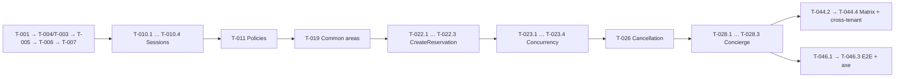

# CondoHub — Backlog técnico

> **Fase:** Solución (Agente Backlog Builder, BMAD)
> **Fecha:** 2026-11-02
> **Autor:** Jose Bustamante
> **Versión:** v0.5 (2026-11-08)
> **Estado:** Aprobado por el autor el 2026-11-04
> **Revisión 2026-11-03:** correcciones de la auditoría QA del backlog ([auditoria-backlog-qa.md](auditoria-qa/auditoria-backlog-qa.md)): T-011 (BK-C03), T-047 (BK-C02), T-048 (BK-C04), T-049 (BK-C01) y la ampliación de T-041. Los hallazgos mayores están en [05-preguntas-abiertas.md](05-preguntas-abiertas.md) como Q35 a Q50.
> **Revisión v0.4 (2026-11-04):** resueltos los hallazgos mayores BK-M02 a BK-M16 (Q36 a Q50): endpoints faltantes, división de T-038, trazabilidad de los jobs, definición de terminado con OpenAPI, Postman y CHANGELOG, puertas del CI, verificación de la GitHub App, `UserSession` sin tenant, valores de borde, caché de sesión de 5 s, borrado inmediato de adjuntos, dos relojes de retención de invitados, datos del seeder, idempotencia de invitados y gastos, tareas de los ADR-0016 a 0019 y criterios de HU sin tarea.
> **Revisión v0.5 (2026-11-08, auditoría del Spec Finalizer):** campo "Pantallas" en las tareas de páginas; tareas T-066 a T-074 para las pantallas que no tenían tarea; T-075 a T-079 para RN-169 a RN-176; T-063 (pruebas derivadas de la validación de prototipos) y T-056 a T-065 sugeridas por [10-validation-log.md](10-validation-log.md); proveedor renombrado a `Vendor` (`/api/vendors`); P-033 y P-034 como páginas propias; citas de RN-052, RN-129, RN-177 y RN-179.
> **Documentos relacionados:** [02-alcance.md](02-alcance.md) · [06-user-stories.md](06-user-stories.md) · [07-architecture.md](07-architecture.md) · [docs/security/permissions-matrix.md](docs/security/permissions-matrix.md)

## Convenciones

- **Alcance.** Solo el MVP (M1–M6, HU-001 a HU-014, con HU-001B) y las piezas transversales que [02-alcance.md](02-alcance.md) §0 vuelve obligatorias (retención de 90 días, seeder, pipeline). No hay tareas para S1–S5, C1–C4 ni W1–W13, ni para ARCO o Libro de Reclamaciones (ADR-0010), ni para las reglas diferidas por el ADR-0020 (perfil del titular, cambio de correo, recuperación de contraseña, regeneración de códigos, aviso de TLS 1.2, log para la Junta y traspaso de administradora).
- **Prioridad.** Todas las HU del lote son Must ([06-user-stories.md](06-user-stories.md), *Priorización*), así que casi todo el backlog es Must. La única tarea Should es T-050 (reinicio de MFA desde el Platform CLI): la demo funciona sin ella. Va al final de la lista.
- **Tareas L divididas.** Cada tarea L se dividió en subtareas S (`T-NNN.n`). La tarea L queda como **contenedora**: no se ejecuta por sí misma, se da por terminada cuando todas sus subtareas lo están y su criterio de completitud sirve como verificación de integración. Las únicas tareas ejecutables son las subtareas S y las tareas S o M sin dividir.
- **Dependencias.** Una dependencia a una subtarea (`T-022.3`) espera solo a esa subtarea. Una dependencia a una tarea contenedora (`T-022`) espera a todas sus subtareas.
- **Orden.** La lista está en orden topológico: cada tarea aparece después de todas sus dependencias. Los IDs no se renumeraron para no romper referencias, así que el orden de la lista no siempre es el numérico (por ejemplo, T-045 y T-051 a T-055 están en la Fase 0, T-038 aparece antes de T-013 y T-009 después de T-013).
- **Componentes.** Los nombres C1 a C13 son los del catálogo de [07-architecture.md](07-architecture.md) §2.2. "CondoHubDbContext", "CondoHub.Domain", "Solución", "Pipeline CI" e "Infra de pruebas" son piezas de §2.1 y §6.1 sin número de catálogo, e "Infraestructura Azure" son los recursos del diagrama de §1.2. "ADR (docs/adr)" son las tareas que producen una decisión de arquitectura.
- **Ejecuta: autor humano.** Las tareas que crean o modifican archivos en `.github/workflows/` las ejecuta el autor, porque los agentes no pueden tocar esa carpeta (ADR-0005).
- **Definición de terminado (aplica a toda tarea con endpoint, sin repetirse en cada criterio).** Test `*_CrossTenantAccess_Returns404`, textos desde `es-PE.resx`, errores como Problem Details con su código estable, `TimeProvider` en lugar de `DateTime.Now`, datos personales con `[PersonalData]` y sin datos personales en los logs (PRINCIPIO-003, 001, 005 y 008). Además, cada endpoint aparece en `docs/api/openapi.json`, tiene un request positivo y uno de rechazo en la colección Postman de su módulo (ejecutada en el CI por T-045), y deja una entrada en `CHANGELOG.md` (PRINCIPIO-012).
- **Pantallas.** Toda tarea que construye una página lleva el campo **Pantallas** con los IDs de [09-ui-spec.md](09-ui-spec.md) §1.1. Una pantalla sin tarea es un hallazgo crítico (auditoría del Spec Finalizer, 2026-11-08).
- **Estimación.** Los tamaños son **horas de trabajo de un agente** (S < 30 min, M 30 min – 1 h). No incluyen la revisión y aprobación humana de cada PR (PRINCIPIO-009), ni las esperas de las puertas humanas (aprobación de dependencias y ADR-0016 a ADR-0019); el autor calcula ese tiempo aparte.
- **Dependencias nuevas.** Las tareas que agregan un paquete (Argon2id, TOTP, ArchUnitNET, `System.CommandLine`, Testcontainers) quedan bloqueadas hasta la aprobación humana en el PR (PRINCIPIO-009.4, [07-architecture.md](07-architecture.md) §6.4).

---

## Fase 0 · Setup

### T-001: Crear la solución .NET 10 con la estructura de proyectos
- **HU relacionada:** Infraestructura
- **Componente:** Solución (§2.1)
- **Prioridad:** Must
- **Tamaño:** M
- **Dependencias:** Ninguna
- **Descripción:** Crear `CondoHub.sln` con los 7 proyectos de `src/` y los 3 de `tests/` de §2.1, un `Directory.Build.props` con `Nullable`, `TreatWarningsAsErrors` y `BannedApiAnalyzers` que prohíba `DateTime.Now` y `DateTime.UtcNow`. Agregar `.editorconfig`, `.gitignore` y el `CHANGELOG.md` vacío.
- **Criterio de completitud:** `dotnet build` termina sin errores y una línea con `DateTime.Now` en cualquier proyecto hace fallar la compilación.

### T-002: Configurar el pipeline de CI con las puertas de calidad
- **HU relacionada:** Infraestructura
- **Componente:** Pipeline CI (§6.1)
- **Prioridad:** Must
- **Tamaño:** L → contenedora de T-002.1 a T-002.6 · **Ejecuta:** autor humano (ADR-0005)
- **Dependencias:** T-001
- **Descripción:** Crear `.github/workflows/ci.yml` con build, tests, cobertura mínima del 70 % (90 % en Identity & Access), CodeQL, gitleaks, commitlint, escaneo de licencias de runtime, dependencias vulnerables y la lista de denegación de pasarelas, y verificar los rulesets de `main` con la GitHub App. Lo abre el autor humano, porque los agentes no pueden modificar `.github/workflows/` (ADR-0005).
- **Criterio de completitud:** Un PR de prueba con un secreto falso y un commit sin formato Conventional Commits deja el pipeline en rojo, y un PR limpio lo deja en verde.

#### T-002.1: Crear el workflow de build, tests y cobertura
- **HU relacionada:** Infraestructura · **Componente:** Pipeline CI (§6.1) · **Prioridad:** Must · **Tamaño:** S · **Ejecuta:** autor humano (ADR-0005)
- **Dependencias:** T-001
- **Descripción:** Crear `ci.yml` con `dotnet build`, `dotnet test` y la recolección de cobertura, con un umbral global del 70 % y otro del 90 % para los ensamblados de Identity & Access, que fallan el job (PRINCIPIO-010).
- **Criterio de completitud:** El workflow corre en un PR y falla si la cobertura global es menor al 70 % o la de Identity & Access es menor al 90 %.

#### T-002.2: Agregar CodeQL y gitleaks al workflow
- **HU relacionada:** Infraestructura · **Componente:** Pipeline CI (§6.1) · **Prioridad:** Must · **Tamaño:** S · **Ejecuta:** autor humano (ADR-0005)
- **Dependencias:** T-002.1
- **Descripción:** Agregar el análisis CodeQL para C# y el escaneo de secretos con gitleaks como jobs obligatorios.
- **Criterio de completitud:** Un commit con una cadena con forma de connection string de Azure hace fallar el job de gitleaks.

#### T-002.3: Agregar commitlint y el escaneo de licencias de runtime
- **HU relacionada:** Infraestructura · **Componente:** Pipeline CI (§6.1) · **Prioridad:** Must · **Tamaño:** S · **Ejecuta:** autor humano (ADR-0005)
- **Dependencias:** T-002.1
- **Descripción:** Agregar commitlint con la configuración de Conventional Commits y un paso que falla si una dependencia de runtime no tiene licencia MIT, Apache-2.0, BSD-2/3-Clause, MS-PL o ISC.
- **Criterio de completitud:** Un commit con el mensaje `arreglos` y un paquete de runtime con licencia GPL hacen fallar sus jobs.

#### T-002.4: Verificar el pipeline con un PR negativo y uno limpio
- **HU relacionada:** Infraestructura · **Componente:** Pipeline CI (§6.1) · **Prioridad:** Must · **Tamaño:** S · **Ejecuta:** autor humano (ADR-0005)
- **Dependencias:** T-002.2, T-002.3
- **Descripción:** Abrir un PR con un secreto falso y un commit mal formado, y otro PR limpio, y marcar los jobs como status checks obligatorios en el ruleset de `main`.
- **Criterio de completitud:** El PR negativo queda en rojo y no se puede mergear, y el PR limpio queda en verde.

#### T-002.5: Agregar el escaneo de dependencias vulnerables y la lista de denegación de pasarelas
- **HU relacionada:** Infraestructura · **Componente:** Pipeline CI (§6.1) · **Prioridad:** Must · **Tamaño:** S · **Ejecuta:** autor humano (ADR-0005)
- **Dependencias:** T-002.1
- **Descripción:** Activar Dependabot para NuGet y GitHub Actions, agregar un paso `dotnet list package --vulnerable --include-transitive` que falla con vulnerabilidades altas o críticas, y un paso que falla si un proyecto referencia un SDK de pasarela de pago de la lista de denegación (RN-045, PRINCIPIO-007).
- **Criterio de completitud:** Un paquete con una vulnerabilidad crítica conocida y una referencia a un SDK de la lista de denegación hacen fallar sus pasos.

#### T-002.6: Crear la GitHub App y verificar los rulesets de main
- **HU relacionada:** Infraestructura · **Componente:** Pipeline CI (§6.1) · **Prioridad:** Must · **Tamaño:** S · **Ejecuta:** autor humano (ADR-0005)
- **Dependencias:** T-002.4
- **Descripción:** Crear la GitHub App de los agentes con permisos mínimos y configurar los dos rulesets de `main` (status checks obligatorios sin bypass; 1 aprobación con bypass solo para el autor) y el check de rutas protegidas que corre desde la definición de `main` ([02-alcance.md](02-alcance.md) §0 y §5, D2, ADR-0005).
- **Criterio de completitud:** Un PR de la App que toca `.github/workflows/` queda rechazado por el check, la App no puede aprobar un PR del autor, y un PR del autor con los checks en verde se mergea sin aprobación.

### T-003: Preparar la infraestructura de pruebas de integración con SQL Server 2025
- **HU relacionada:** Infraestructura
- **Componente:** Infra de pruebas
- **Prioridad:** Must
- **Tamaño:** M
- **Dependencias:** T-001
- **Descripción:** Agregar `docker-compose.yml` con SQL Server 2025 para desarrollo local y un fixture de xUnit con `Testcontainers.MsSql` que levante la base, aplique las migraciones y exponga un `FakeTimeProvider` fijado en `America/Lima`.
- **Criterio de completitud:** Un test de integración de ejemplo abre una conexión a la base del contenedor y pasa en local y en el CI.

### T-004: Definir la base del dominio y el mapeo de errores a Problem Details
- **HU relacionada:** Infraestructura
- **Componente:** CondoHub.Domain
- **Prioridad:** Must
- **Tamaño:** M
- **Dependencias:** T-001
- **Descripción:** Crear la entidad base con `Id` UUIDv7 (`Guid.CreateVersion7()`), `CreatedAt` y `CreatedByUserId`, la interfaz `ITenantOwned`, el catálogo único de códigos de error ([03-reglas-de-negocio.md](03-reglas-de-negocio.md) más [07-architecture.md](07-architecture.md) §4.1, §4.3 y §4.4) y un manejador que traduzca cada error de dominio a `application/problem+json` con `code`, `status` y el `title` desde `es-PE.resx`.
- **Criterio de completitud:** Un endpoint de prueba que lanza `RESERVATION_OVERLAP` responde `422` con `code = "RESERVATION_OVERLAP"` y el `title` "El área ya está reservada en ese horario.".

### T-045: Preparar el contrato OpenAPI y las colecciones Postman en el CI
- **HU relacionada:** Infraestructura
- **Componente:** C2 REST API
- **Prioridad:** Must
- **Tamaño:** M · **Ejecuta:** autor humano (ADR-0005)
- **Dependencias:** T-002.4, T-004
- **Descripción:** Generar `docs/api/openapi.json` (OpenAPI 3.1) desde los endpoints, agregar al CI el check que falla si el archivo generado difiere del versionado, y crear en `tests/postman/` una colección por módulo con el job de Postman CLI que las ejecuta en el CI contra la API levantada en el job (con el seeder, desde T-009). Cada tarea con endpoint agrega después sus requests, según la definición de terminado (PRINCIPIO-010, PRINCIPIO-012).
- **Criterio de completitud:** En el CI, `postman collection run` ejecuta la colección de ejemplo sin fallos, y cambiar la firma de un endpoint sin regenerar `openapi.json` deja el CI en rojo.

### T-051: Crear el analizador de textos literales en las páginas
- **HU relacionada:** Infraestructura
- **Componente:** Solución (§2.1)
- **Prioridad:** Must
- **Tamaño:** S
- **Dependencias:** T-001
- **Descripción:** Crear un analizador Roslyn que revisa el C# generado de los `.razor` y falla si una página contiene texto visible literal fuera de `es-PE.resx` (RN-054, PRINCIPIO-001), con una lista de excepciones para símbolos y valores técnicos.
- **Criterio de completitud:** Un `<p>Reservar</p>` en una página hace fallar `dotnet build`, y `<p>@L["Reserve"]</p>` compila.

### T-053: Redactar el ADR-0016 de la librería Argon2id
- **HU relacionada:** Infraestructura
- **Componente:** ADR (docs/adr)
- **Prioridad:** Must
- **Tamaño:** S
- **Dependencias:** Ninguna
- **Descripción:** Comparar al menos dos librerías Argon2id para .NET (licencia, última release, mantenedores y soporte del formato PHC) y registrar la propuesta en `docs/adr/0016-*.md` (MADR, en inglés) para la aprobación humana que desbloquea T-013.1 ([02-alcance.md](02-alcance.md) §6, PRINCIPIO-002, PRINCIPIO-009.4).
- **Criterio de completitud:** El ADR existe en estado Propuesto con al menos dos opciones, y cada una indica su licencia y la fecha de su última release.

### T-054: Redactar el ADR-0017 de la librería TOTP
- **HU relacionada:** Infraestructura
- **Componente:** ADR (docs/adr)
- **Prioridad:** Must
- **Tamaño:** S
- **Dependencias:** Ninguna
- **Descripción:** Comparar al menos dos librerías TOTP (RFC 6238) para .NET con los mismos criterios de T-053 y registrar la propuesta en `docs/adr/0017-*.md` para la aprobación humana que desbloquea T-014.1 (RN-008, PRINCIPIO-009.4).
- **Criterio de completitud:** El ADR existe en estado Propuesto con al menos dos opciones, y cada una indica su licencia y la fecha de su última release.

### T-055: Redactar el ADR-0019 de formatos, tamaño y escaneo de adjuntos
- **HU relacionada:** Infraestructura
- **Componente:** ADR (docs/adr)
- **Prioridad:** Must
- **Tamaño:** S
- **Dependencias:** Ninguna
- **Descripción:** Proponer en `docs/adr/0019-*.md` los formatos aceptados, el tamaño máximo y el escaneo de malware de comprobantes y cotizaciones, con su costo mensual (Q28, RN-033), para fijar los valores provisionales de T-029.2.
- **Criterio de completitud:** El ADR existe en estado Propuesto y nombra los formatos, el tamaño máximo en bytes y el servicio de escaneo o su ausencia justificada.

### T-005: Implementar el DbContext con aislamiento por condominio
- **HU relacionada:** Infraestructura
- **Componente:** CondoHubDbContext
- **Prioridad:** Must
- **Tamaño:** L → contenedora de T-005.1 a T-005.4
- **Dependencias:** T-003, T-004
- **Descripción:** Crear `CondoHubDbContext` con un global query filter por convención, un `SaveChangesInterceptor` que protege el `CondominiumId` y los tests de arquitectura del ADR-0003.
- **Criterio de completitud:** Con dos condominios en la base, una consulta desde el contexto del primero no devuelve filas del segundo, y los dos tests de arquitectura fallan al introducir la violación correspondiente.

#### T-005.1: Crear el DbContext con el filtro global por convención
- **HU relacionada:** Infraestructura · **Componente:** CondoHubDbContext · **Prioridad:** Must · **Tamaño:** S
- **Dependencias:** T-003, T-004
- **Descripción:** Crear `CondoHubDbContext` e `ITenantContext`, y en `OnModelCreating` aplicar `HasQueryFilter(e => e.CondominiumId == tenant.CondominiumId)` a toda entidad que implementa `ITenantOwned`.
- **Criterio de completitud:** Un test con dos condominios y una entidad de prueba devuelve solo las filas del condominio del `ITenantContext`.

#### T-005.2: Implementar el interceptor de escritura del CondominiumId
- **HU relacionada:** Infraestructura · **Componente:** CondoHubDbContext · **Prioridad:** Must · **Tamaño:** S
- **Dependencias:** T-005.1
- **Descripción:** Crear un `SaveChangesInterceptor` que asigna el `CondominiumId` del `ITenantContext` a las entidades nuevas y lanza una excepción si una entidad modificada tiene otro valor.
- **Criterio de completitud:** Guardar una entidad modificada con el `CondominiumId` de otro condominio lanza la excepción y no escribe en la base.

#### T-005.3: Escribir el test de arquitectura del filtro obligatorio
- **HU relacionada:** Infraestructura · **Componente:** CondoHubDbContext · **Prioridad:** Must · **Tamaño:** S
- **Dependencias:** T-005.1
- **Descripción:** Escribir un test que recorre el modelo de EF Core y falla si una entidad con propiedad `CondominiumId` no tiene query filter. `UserSession` no tiene `CondominiumId`: guarda el condominio elegido en `SelectedCondominiumId`, que el test no trata como tenant ([07-architecture.md](07-architecture.md) §3.1).
- **Criterio de completitud:** El test falla al agregar una entidad con `CondominiumId` que no implementa `ITenantOwned`, y pasa al quitarla.

#### T-005.4: Escribir el test de arquitectura de IgnoreQueryFilters
- **HU relacionada:** Infraestructura · **Componente:** CondoHubDbContext · **Prioridad:** Must · **Tamaño:** S
- **Dependencias:** T-005.1
- **Descripción:** Escribir un test con ArchUnitNET que falla si `IgnoreQueryFilters()` se usa fuera de la lista cerrada de namespaces del ADR-0003. Bloqueada hasta aprobar ArchUnitNET.
- **Criterio de completitud:** El test falla con una llamada a `IgnoreQueryFilters()` en un namespace de `Reservations`, y pasa al quitarla.

### T-052: Escribir el test de límites entre módulos
- **HU relacionada:** Infraestructura
- **Componente:** Solución (§2.1)
- **Prioridad:** Must
- **Tamaño:** S
- **Dependencias:** T-005.4
- **Descripción:** Escribir con ArchUnitNET un test que falla si el namespace de un módulo (Registry, Reservations, Concierge, Finance) usa tipos internos de otro módulo en lugar de sus casos de uso públicos ([07-architecture.md](07-architecture.md) §6.2.5, ADR-0011).
- **Criterio de completitud:** Una referencia de `Reservations` a un tipo interno de `Finance` hace fallar el test, y la solución actual pasa.

### T-006: Implementar el cifrado de campo y el índice ciego
- **HU relacionada:** HU-001, HU-002, HU-007
- **Componente:** C8 Field Encryption & Blind Index
- **Prioridad:** Must
- **Tamaño:** L → contenedora de T-006.1 a T-006.4
- **Dependencias:** T-005
- **Descripción:** Implementar el converter AES-256-GCM con *envelope encryption* y DEK por condominio (ADR-0015) y el índice ciego HMAC-SHA256 (ADR-0004).
- **Criterio de completitud:** Un valor guardado se lee en claro desde EF Core pero la columna en SQL contiene bytes que no incluyen el texto original, y `Ana.Quispe@Example.pe` y `ana.quispe@example.pe` producen el mismo índice ciego.

#### T-006.1: Implementar el converter AES-256-GCM
- **HU relacionada:** HU-001, HU-002, HU-007 · **Componente:** C8 Field Encryption & Blind Index · **Prioridad:** Must · **Tamaño:** S
- **Dependencias:** T-005
- **Descripción:** Crear el `ValueConverter` que cifra con `AesGcm`, nonce aleatorio por escritura y el formato `version(1) | keyId(16) | nonce(12) | ciphertext | tag(16)`, con un proveedor de claves local para dev y CI. Cumple RN-052 (nombre y RUC 10 de un proveedor persona natural incluidos).
- **Criterio de completitud:** Cifrar dos veces el mismo texto produce bytes distintos, y ambos se descifran al texto original.

#### T-006.2: Implementar la DEK por condominio envuelta por la KEK
- **HU relacionada:** HU-001, HU-002, HU-007 · **Componente:** C8 Field Encryption & Blind Index · **Prioridad:** Must · **Tamaño:** S
- **Dependencias:** T-006.1
- **Descripción:** Implementar el proveedor de claves que desenvuelve `Condominium.DataKeyWrapped` con la KEK de Key Vault mediante Managed Identity y mantiene la DEK en memoria hasta 1 h.
- **Criterio de completitud:** Con `FakeTimeProvider`, dos lecturas dentro de la misma hora llaman una sola vez al proveedor de la KEK, y una lectura a los 3,601 s lo llama otra vez.

#### T-006.3: Implementar el índice ciego HMAC-SHA256
- **HU relacionada:** HU-001, HU-002 · **Componente:** C8 Field Encryption & Blind Index · **Prioridad:** Must · **Tamaño:** S
- **Dependencias:** T-005
- **Descripción:** Crear `BlindIndexService` que normaliza el correo (recorte y minúsculas) y el DNI (solo dígitos) y calcula HMAC-SHA256 con una clave distinta de la de cifrado.
- **Criterio de completitud:** `Ana.Quispe@Example.pe` y ` ana.quispe@example.pe ` producen el mismo valor de 32 bytes.

#### T-006.4: Escribir el test de arquitectura de [PersonalData]
- **HU relacionada:** Infraestructura · **Componente:** C8 Field Encryption & Blind Index · **Prioridad:** Must · **Tamaño:** S
- **Dependencias:** T-006.1
- **Descripción:** Escribir un test que recorre el modelo de EF Core y falla si una propiedad marcada `[PersonalData]` no tiene el converter de cifrado.
- **Criterio de completitud:** El test falla al quitar el converter de una propiedad `[PersonalData]` de prueba, y pasa al restaurarlo.

### T-007: Modelar las entidades de identidad, padrón y auditoría
- **HU relacionada:** HU-001, HU-002, HU-002B, HU-003, HU-003B
- **Componente:** CondoHubDbContext
- **Prioridad:** Must
- **Tamaño:** L → contenedora de T-007.1 a T-007.4
- **Dependencias:** T-006
- **Descripción:** Crear las entidades y configuraciones de identidad, padrón y auditoría según §3.3, con sus índices únicos y la migración inicial.
- **Criterio de completitud:** La migración se aplica en una base vacía y el índice único rechaza a un mismo usuario con `Administrator` y `BoardMember` activos en el mismo condominio.

#### T-007.1: Modelar las entidades del padrón
- **HU relacionada:** HU-001 · **Componente:** CondoHubDbContext · **Prioridad:** Must · **Tamaño:** S
- **Dependencias:** T-006
- **Descripción:** Crear `Condominium`, `Tower`, `Unit`, `Person` y `UnitOccupancy` con sus configuraciones, los campos cifrados e índices ciegos de `Person`, y los únicos `(CondominiumId, Code)` y `(TowerId, Number)`.
- **Criterio de completitud:** El modelo compila, `Person.FullName`, `Email`, `DocumentNumber` y `PhoneNumber` usan el converter de T-006.1, y un test de modelo falla si `Person` tiene un campo de salud o discapacidad distinto de `RequiresAccessibleElevator` (RN-006).

#### T-007.2: Modelar las entidades de usuario, sesión y roles
- **HU relacionada:** HU-003, HU-003B · **Componente:** CondoHubDbContext · **Prioridad:** Must · **Tamaño:** S
- **Dependencias:** T-007.1
- **Descripción:** Crear `User`, `UserSession`, `RecoveryCode` y `RoleAssignment`, con `EmailBlindIndex` único global y el índice único filtrado sobre la columna calculada `IsManagementRole` (RN-067).
- **Criterio de completitud:** El modelo compila, `User` y `UserSession` no tienen `CondominiumId` (la sesión usa `SelectedCondominiumId`), y `RoleAssignment` sí lo tiene con filtro.

#### T-007.3: Modelar las entidades de invitación, consentimiento y auditoría
- **HU relacionada:** HU-002, HU-002B · **Componente:** CondoHubDbContext · **Prioridad:** Must · **Tamaño:** S
- **Dependencias:** T-007.1
- **Descripción:** Crear `Invitation` (con `TokenHash`), `ConsentVersion`, `ConsentAcceptance` y `AuditLogEntry` (con `CondominiumId` nulo para eventos de plataforma).
- **Criterio de completitud:** El modelo compila y `Invitation` no tiene ninguna columna con el token en claro.

#### T-007.4: Generar y probar la migración inicial
- **HU relacionada:** Infraestructura · **Componente:** CondoHubDbContext · **Prioridad:** Must · **Tamaño:** S
- **Dependencias:** T-007.2, T-007.3
- **Descripción:** Generar la migración inicial y un test de integración que la aplica y verifica el índice de RN-067.
- **Criterio de completitud:** La migración se aplica en una base vacía y un segundo `RoleAssignment` activo `BoardMember` para un `Administrator` del mismo condominio falla por el índice único.

### T-008: Modelar las entidades de reservas y transparencia financiera
- **HU relacionada:** HU-004 a HU-014
- **Componente:** CondoHubDbContext
- **Prioridad:** Must
- **Tamaño:** L → contenedora de T-008.1 a T-008.4
- **Dependencias:** T-007
- **Descripción:** Crear las entidades y configuraciones de reservas, portería y finanzas según §3.3, con `rowversion`, `decimal(12,2)` y el índice único filtrado de reservas.
- **Criterio de completitud:** La migración se aplica sobre la de T-007 y la base rechaza una segunda reserva `Confirmed` con el mismo `CommonAreaId` y `StartAt`.

#### T-008.1: Modelar las áreas, reservas, invitados y avisos
- **HU relacionada:** HU-004 a HU-009 · **Componente:** CondoHubDbContext · **Prioridad:** Must · **Tamaño:** S
- **Dependencias:** T-007.4
- **Descripción:** Crear `CommonArea`, `Reservation`, `ReservationGuest` y `ReservationCancellationNotice`, con `rowversion`, el índice `(CommonAreaId, LocalDate, Status)` y el único filtrado `(CommonAreaId, StartAt) WHERE Status = 'Confirmed'`.
- **Criterio de completitud:** El modelo compila y `ReservationGuest.FullName` usa el converter de cifrado.

#### T-008.2: Modelar las filas testigo y la idempotencia
- **HU relacionada:** HU-005, HU-006 · **Componente:** CondoHubDbContext · **Prioridad:** Must · **Tamaño:** S
- **Dependencias:** T-008.1
- **Descripción:** Crear `CommonAreaDayLock`, `UnitAreaMonthLock` (PK compuestas y `rowversion`) e `IdempotencyRecord` con el único `(UserId, Key)`.
- **Criterio de completitud:** El modelo compila y las tres entidades están bajo el filtro de condominio.

#### T-008.3: Modelar las entidades financieras y los adjuntos
- **HU relacionada:** HU-010 a HU-014 · **Componente:** CondoHubDbContext · **Prioridad:** Must · **Tamaño:** S
- **Dependencias:** T-007.4
- **Descripción:** Crear `Vendor`, `Expense`, `SupplierHire`, `Quote`, `HireDecision` y `Attachment`, con `decimal(12,2)`, `rowversion` en `Expense` y `SupplierHire`, y el índice `(CondominiumId, ExpenseDate)`.
- **Criterio de completitud:** El modelo compila y `Expense` no tiene ninguna propiedad que referencie `Unit` ni `Person`.

#### T-008.4: Generar y probar la migración de reservas y finanzas
- **HU relacionada:** Infraestructura · **Componente:** CondoHubDbContext · **Prioridad:** Must · **Tamaño:** S
- **Dependencias:** T-008.2, T-008.3
- **Descripción:** Generar la migración y un test de integración que verifica el índice único filtrado de reservas.
- **Criterio de completitud:** Una segunda reserva `Confirmed` con el mismo `CommonAreaId` y `StartAt` falla, y una `Cancelled` con los mismos valores se guarda.

### T-048: Aprovisionar la infraestructura de Azure como código y desplegar a dev
- **HU relacionada:** Infraestructura
- **Componente:** Infraestructura Azure (§1.2)
- **Prioridad:** Must
- **Tamaño:** L → contenedora de T-048.1 a T-048.6
- **Dependencias:** T-002.4, T-004, T-006.2
- **Descripción:** Crear en `infra/` la plantilla Bicep de los recursos de §1.2 en South Central US, el workflow de CD a dev, la verificación de TLS (RN-013, RT1 y RT2 de §6.5) y la exportación de telemetría sin datos personales (RN-053). Sin este entorno no se pueden medir el LCP ni el p95 de T-046 (PRINCIPIO-010). Las subtareas que tocan `.github/workflows/` las ejecuta el autor humano (ADR-0005).
- **Criterio de completitud:** Un push a `main` despliega la imagen en dev, la aplicación desenvuelve una DEK con la KEK de Key Vault mediante Managed Identity, y una conexión con TLS 1.1 al ingress es rechazada.

#### T-048.1: Escribir la plantilla Bicep de los recursos de Azure
- **HU relacionada:** Infraestructura · **Componente:** Infraestructura Azure (§1.2) · **Prioridad:** Must · **Tamaño:** S
- **Dependencias:** T-001
- **Descripción:** Escribir en `infra/main.bicep` el entorno de Container Apps (web y jobs con cron), Azure SQL Database, Key Vault con la KEK, la clave HMAC del índice ciego y la clave de titular, los dos contenedores de Blob (adjuntos privados y archivo inmutable con ciclo de vida de 1 año), Azure Communication Services Email, Application Insights y las Managed Identity con permisos mínimos, todo en South Central US y sin secretos en `appsettings.json` (PRINCIPIO-005, PRINCIPIO-008).
- **Criterio de completitud:** `az deployment group what-if` sobre un grupo vacío lista todos los recursos de §1.2 en `southcentralus`, y la búsqueda de `Password=` o `AccountKey=` en el repositorio no devuelve resultados.

#### T-048.2: Crear el workflow de CD a dev
- **HU relacionada:** Infraestructura · **Componente:** Pipeline CI (§6.1) · **Prioridad:** Must · **Tamaño:** S · **Ejecuta:** autor humano (ADR-0005)
- **Dependencias:** T-048.1, T-002.4
- **Descripción:** Crear `.github/workflows/cd-dev.yml` que, tras el CI en verde en `main`, construye la imagen, la publica, aplica la plantilla Bicep con OIDC (sin secretos de larga duración) y ejecuta las migraciones de EF Core y el seeder en dev.
- **Criterio de completitud:** Un merge a `main` deja la versión nueva respondiendo en la URL de dev, y un CI en rojo no dispara el despliegue.

#### T-048.3: Verificar Key Vault con Managed Identity en dev
- **HU relacionada:** HU-001, HU-002, HU-007 · **Componente:** C8 Field Encryption & Blind Index · **Prioridad:** Must · **Tamaño:** S
- **Dependencias:** T-048.2, T-006.2
- **Descripción:** Reemplazar en dev el proveedor local de T-006.1 por el de Key Vault y escribir un smoke test que crea un condominio, envuelve su DEK con la KEK y la desenvuelve mediante Managed Identity.
- **Criterio de completitud:** El smoke test pasa en dev, y al quitar el permiso `unwrapKey` a la identidad del web falla con un error de autorización de Key Vault.

#### T-048.4: Resolver RT1 y RT2 con un spike y su ADR
- **HU relacionada:** Infraestructura · **Componente:** Infraestructura Azure (§1.2) · **Prioridad:** Must · **Tamaño:** S
- **Dependencias:** T-048.2
- **Descripción:** Comprobar en dev qué versiones de TLS acepta el ingress de Container Apps y Azure SQL, y si la versión negociada llega a la aplicación (RT1, Q31). Registrar el resultado en el ADR-0018 en `docs/adr/` (MADR, en inglés), que también confirma el hosting en Container Apps,, incluido cómo se cumple RN-013 y si RN-014 es implementable.
- **Criterio de completitud:** El ADR-0018 existe con estado Propuesto y adjunta la salida de `tlsx` contra el ingress y contra Azure SQL.

#### T-048.5: Agregar el escaneo TLS como check del pipeline
- **HU relacionada:** Infraestructura · **Componente:** Pipeline CI (§6.1) · **Prioridad:** Must · **Tamaño:** S · **Ejecuta:** autor humano (ADR-0005)
- **Dependencias:** T-048.4
- **Descripción:** Agregar a `cd-dev.yml` un paso posterior al despliegue que ejecuta `tlsx` contra el ingress y Azure SQL y falla si aceptan TLS 1.0 o 1.1, o TLS 1.2 con una suite sin AEAD (RN-013, PRINCIPIO-005).
- **Criterio de completitud:** El paso falla al habilitar TLS 1.1 en un entorno de prueba y pasa con la configuración de la plantilla.

#### T-048.6: Exportar la telemetría a Application Insights sin datos personales
- **HU relacionada:** Infraestructura · **Componente:** Infraestructura Azure (§1.2) · **Prioridad:** Must · **Tamaño:** S
- **Dependencias:** T-048.1, T-004
- **Descripción:** Configurar OpenTelemetry con el exportador de Azure Monitor y un procesador que elimina de trazas, logs y atributos los valores de propiedades marcadas con `[PersonalData]`, los correos y los tokens de la URL de invitación (RN-053, PRINCIPIO-008).
- **Criterio de completitud:** Un test que registra un log con `ana.quispe@example.pe` y una traza de `/api/invitations/{token}/accept` exporta `[redacted]` en ambos campos.

---

## Fase 1 · Identidad y acceso (M2)

### T-010: Implementar la sesión en servidor con cookie y las puertas de sesión
- **HU relacionada:** HU-003B
- **Componente:** C3 Identity & Access
- **Prioridad:** Must
- **Tamaño:** L → contenedora de T-010.1 a T-010.4
- **Dependencias:** T-007
- **Descripción:** Implementar la sesión en servidor del ADR-0013 con sus tiempos de expiración, la resolución del condominio desde la sesión y las puertas de consentimiento y MFA.
- **Criterio de completitud:** Con `FakeTimeProvider`, una solicitud a los 1,799 s de inactividad se atiende y otra a los 1,800 s responde `401`.

#### T-010.1: Implementar el almacén de sesiones
- **HU relacionada:** HU-003B · **Componente:** C3 Identity & Access · **Prioridad:** Must · **Tamaño:** S
- **Dependencias:** T-007.4
- **Descripción:** Crear `ISessionStore` que genera un identificador opaco de 256 bits, guarda solo su hash en `UserSession` con el `SelectedCondominiumId` y permite revocar una sesión o todas las de un usuario.
- **Criterio de completitud:** La fila guardada no contiene el identificador en claro, y una sesión revocada no se encuentra al buscarla por su identificador.

#### T-010.2: Implementar la cookie y la expiración de la sesión
- **HU relacionada:** HU-003B · **Componente:** C3 Identity & Access · **Prioridad:** Must · **Tamaño:** S
- **Dependencias:** T-010.1
- **Descripción:** Configurar la cookie `__Host-condohub` (`HttpOnly`, `Secure`, `SameSite=Lax`) y validar en cada request la expiración por 1,800 s de inactividad y 43,200 s desde la creación, con `LastActivityAt` actualizado como máximo una vez por minuto y una caché de 5 s para la fila que la réplica que revoca una sesión invalida al instante (ADR-0013, RN-137).
- **Criterio de completitud:** Con `FakeTimeProvider`, la solicitud a los 1,799 s de inactividad se atiende, a los 1,800 s exactos responde `401` (RN-113), y a los 43,201 s con actividad continua responde `401`. Con dos instancias del host, una sesión revocada en la primera responde `401` de inmediato en ella y a los 5 s en la segunda.

#### T-010.3: Resolver el condominio desde la sesión
- **HU relacionada:** HU-003B · **Componente:** C3 Identity & Access · **Prioridad:** Must · **Tamaño:** S
- **Dependencias:** T-010.2
- **Descripción:** Crear el middleware que llena `ITenantContext` con el `SelectedCondominiumId` de la sesión e ignora cualquier `CondominiumId` que venga en el request.
- **Criterio de completitud:** Un request con un encabezado o parámetro `condominiumId` de otro condominio sigue leyendo solo datos del condominio de la sesión.

#### T-010.4: Implementar las puertas de consentimiento, MFA y antiforgery
- **HU relacionada:** HU-002B, HU-003 · **Componente:** C3 Identity & Access · **Prioridad:** Must · **Tamaño:** S
- **Dependencias:** T-010.3
- **Descripción:** Agregar el middleware que responde `403 MFA_REQUIRED` a una sesión parcial y `403 CONSENT_REQUIRED` sin consentimiento vigente, salvo en las rutas de esos pasos, y exigir antiforgery en métodos no seguros.
- **Criterio de completitud:** Una sesión parcial recibe `403 MFA_REQUIRED` en `/api/reservations`, y un `POST` sin token antiforgery responde `400`.

### T-011: Implementar las políticas de autorización de la matriz de permisos
- **HU relacionada:** HU-011, HU-014 (y todas las HU con `403`)
- **Componente:** C3 Identity & Access
- **Prioridad:** Must
- **Tamaño:** M
- **Dependencias:** T-010
- **Descripción:** Registrar las políticas por rol de [docs/security/permissions-matrix.md](docs/security/permissions-matrix.md) y la política `CanViewCondominiumFinancials` (Administrator y BoardMember; `NonResidentOwner` o `Resident` con al menos un vínculo `Owner` activo en `America/Lima` en el condominio actual), evaluada contra la base en cada request y nunca desde la caché (RN-015, RN-016, RN-105, ADR-0001). El rol `NonResidentOwner` por sí solo no basta: sin un vínculo `Owner` activo la política es falsa aunque `OccupancyLifecycleJob` todavía no haya revocado el rol.
- **Criterio de completitud:** La política devuelve verdadero para Luis Rojas a las 2026-12-15T23:59:00-05:00 y falso a las 2026-12-16T00:00:00-05:00 con `EndDate = 2026-12-15` (con su rol `NonResidentOwner` todavía sin revocar), falso para Carla Díaz (`Tenant`), y verdadero para el Administrator sin vínculos.

### T-012: Implementar el registro de auditoría append-only
- **HU relacionada:** HU-001, HU-013
- **Componente:** C10 Audit
- **Prioridad:** Must
- **Tamaño:** S
- **Dependencias:** T-007
- **Descripción:** Crear el servicio `IAuditLog` que inserta `AuditLogEntry` con valores sin datos personales (por ejemplo `A-301 · Tenant`) y el script de permisos que concede al usuario SQL de la aplicación solo `INSERT` y `SELECT` sobre esa tabla. Como las entradas no guardan datos personales en claro, RN-129 se cumple por diseño; si una entrada necesitara uno, se marca `[PersonalData]` y usa el converter de T-006.1.
- **Criterio de completitud:** Un `UPDATE` sobre `AuditLogEntry` ejecutado con el usuario SQL de la aplicación falla por permisos.

### T-038: Implementar el Platform CLI para alta de condominio y roles de gestión
- **HU relacionada:** — (proceso de plataforma; trazabilidad: RN-007, RN-062, RN-066, RN-067, ADR-0003)
- **Componente:** C12 Platform CLI
- **Prioridad:** Must
- **Tamaño:** M
- **Dependencias:** T-007, T-012
- **Descripción:** Crear `CondoHub.PlatformCli` con los comandos `condominium create` (genera y envuelve la DEK), `administrator assign` (con la primera invitación del Administrator) y `board-member assign`, cada uno con su entrada de auditoría de plataforma y respetando la exclusión Administrator–BoardMember (RN-067, ADR-0003). Solo para un operador humano; bloqueada hasta aprobar `System.CommandLine`. El reinicio de MFA es T-050 (Should) y el traspaso de administradora está diferido (ADR-0020).
- **Criterio de completitud:** `board-member assign` sobre un usuario que ya es Administrator del mismo condominio termina con error y no crea el rol, y cada comando exitoso deja una `AuditLogEntry` con `CondominiumId` nulo o el del condominio.

### T-013: Implementar el inicio de sesión con Argon2id, bloqueo y rate limiting
- **HU relacionada:** HU-003B
- **Componente:** C3 Identity & Access
- **Prioridad:** Must
- **Tamaño:** L → contenedora de T-013.1 a T-013.5
- **Dependencias:** T-004, T-010
- **Descripción:** Implementar `POST /api/auth/sign-in` (API-01) y `POST /api/auth/sign-out` con Argon2id, el bloqueo combinado de RN-111, la respuesta uniforme de RN-153 y el rate limiting. Bloqueada hasta aprobar la librería Argon2id.
- **Criterio de completitud:** Tras 5 fallos a las 10:00:00, credenciales correctas a las 10:14:59 responden `422 SIGN_IN_FAILED` con el mismo cuerpo que una contraseña incorrecta, y a las 10:15:00 responden `200`.

#### T-013.1: Implementar el hasher Argon2id
- **HU relacionada:** HU-002, HU-003B · **Componente:** C3 Identity & Access · **Prioridad:** Must · **Tamaño:** S
- **Dependencias:** T-004, T-053
- **Descripción:** Crear `IPasswordHasher` con Argon2id (memoria ≥ 64 MiB, iteraciones ≥ 3, paralelismo ≥ 1) que guarda el hash en formato PHC con sus parámetros y verifica en tiempo constante.
- **Criterio de completitud:** El hash generado empieza con `$argon2id$` y sus parámetros leídos del PHC cumplen los tres mínimos de RN-009.

#### T-013.2: Implementar el primer paso del inicio de sesión
- **HU relacionada:** HU-003B · **Componente:** C3 Identity & Access · **Prioridad:** Must · **Tamaño:** S
- **Dependencias:** T-013.1, T-010.4
- **Descripción:** Implementar `POST /api/auth/sign-in` que busca al usuario por índice ciego, verifica la contraseña y emite una sesión parcial con `nextStep`, respondiendo `422 SIGN_IN_FAILED` con el mismo cuerpo ante correo inexistente, contraseña incorrecta o cuenta desactivada.
- **Criterio de completitud:** Los cuerpos de respuesta para un correo inexistente y para una contraseña incorrecta son idénticos byte a byte salvo el `traceId`.

#### T-013.3: Implementar el bloqueo por intentos fallidos
- **HU relacionada:** HU-003B · **Componente:** C3 Identity & Access · **Prioridad:** Must · **Tamaño:** S
- **Dependencias:** T-013.2
- **Descripción:** Implementar el contador `FailedAccessCount` que se reinicia con un acceso exitoso y fija `LockoutEndsAt` a 900 s tras el quinto fallo consecutivo; mientras dura el bloqueo, responde `SIGN_IN_FAILED` aunque las credenciales sean correctas.
- **Criterio de completitud:** Con 4 fallos el quinto intento correcto crea la sesión, y con 5 fallos a las 10:00:00 el intento correcto a las 10:14:59 responde `422` y a las 10:15:00 responde `200`.

#### T-013.4: Implementar el rate limiting de autenticación
- **HU relacionada:** HU-003B · **Componente:** C3 Identity & Access · **Prioridad:** Must · **Tamaño:** S
- **Dependencias:** T-013.2
- **Descripción:** Configurar el rate limiter de ASP.NET Core en `POST /api/auth/*` con 10 solicitudes por minuto por IP y por índice ciego del correo, respondiendo `429` con `Retry-After` y el código `AUTH_RATE_LIMITED` (RN-177).
- **Criterio de completitud:** La solicitud número 11 dentro del mismo minuto desde la misma IP responde `429` con el encabezado `Retry-After` y `code = "AUTH_RATE_LIMITED"`.

#### T-013.5: Implementar el cierre de sesión
- **HU relacionada:** HU-003B · **Componente:** C3 Identity & Access · **Prioridad:** Must · **Tamaño:** S
- **Dependencias:** T-013.2
- **Descripción:** Implementar `POST /api/auth/sign-out`, que revoca la `UserSession` actual, borra la cookie e invalida la caché de sesión de la réplica, y el botón "Cerrar sesión" del layout (PC compartida de portería, HU-003B).
- **Criterio de completitud:** Tras cerrar sesión, una solicitud con la cookie anterior responde `401`.

### T-009: Construir el seeder de condominios sintéticos
- **HU relacionada:** Infraestructura (todas las HU)
- **Componente:** C13 Synthetic Seeder
- **Prioridad:** Must
- **Tamaño:** L → contenedora de T-009.1 a T-009.4
- **Dependencias:** T-008, T-013.1
- **Descripción:** Implementar `CondoHub.Seeder` con "Residencial Los Olivos" y "Torres del Parque" y los datos de los criterios de aceptación (PRINCIPIO-008). Aparece después de T-013 porque las cuentas sintéticas necesitan el hasher de T-013.1.
- **Criterio de completitud:** Ejecutar el seeder dos veces deja exactamente un registro de Ana Quispe como `Owner` de A-502 y falla con `ASPNETCORE_ENVIRONMENT=Production`, y cada criterio de [06-user-stories.md](06-user-stories.md) que dice "con el seeder" encuentra su dato en la tabla de T-009.4.

#### T-009.1: Crear el proyecto del seeder con su protección de entorno
- **HU relacionada:** Infraestructura · **Componente:** C13 Synthetic Seeder · **Prioridad:** Must · **Tamaño:** S
- **Dependencias:** T-008.4
- **Descripción:** Crear la consola `CondoHub.Seeder` con inserciones idempotentes por clave natural, que termina con error si `ASPNETCORE_ENVIRONMENT` es `Production`.
- **Criterio de completitud:** El seeder termina con código distinto de 0 en `Production` sin abrir conexión a la base.

#### T-009.2: Sembrar condominios, torres, unidades, personas y vínculos
- **HU relacionada:** HU-001 · **Componente:** C13 Synthetic Seeder · **Prioridad:** Must · **Tamaño:** S
- **Dependencias:** T-009.1
- **Descripción:** Crear los dos condominios con su DEK, las torres A y B, las unidades de los criterios (A-301, A-302, A-502, A-704, A-1104, B-1203) y las personas Ana Quispe, Marco Salazar, Luis Rojas, Carla Díaz, Jorge Paredes, Rosa Huamán, Pedro Salas, Raúl Mendoza y Sofía Torres con sus vínculos. Incluye la ficha de Ana en "Torres del Parque", la `EndDate = 2026-12-15` del vínculo `Owner` de Luis, el vínculo futuro de Carla con A-305 y el único vínculo de Sofía (`Tenant` de A-305 con `StartDate = 2027-08-01`).
- **Criterio de completitud:** Tras dos ejecuciones, existe un solo vínculo `Owner` de Ana con A-502 y uno `Tenant` de Pedro con B-1203.

#### T-009.3: Sembrar áreas, reservas, gastos y contrataciones
- **HU relacionada:** HU-004 a HU-014 · **Componente:** C13 Synthetic Seeder · **Prioridad:** Must · **Tamaño:** S
- **Dependencias:** T-009.2
- **Descripción:** Crear el Salón de fiestas y la Parrilla con la configuración de [06-user-stories.md](06-user-stories.md), las 3 reservas de la parrilla de A-1104 en 2026-12, las reservas del salón del 2026-12-12 con Pedro Ramos como invitado, los proveedores, los gastos de 2026-11 (incluida "Limpieza de cisterna" anulada) y las contrataciones "Pintura de fachada" (`Approved`, con sus dos decisiones) "Mantenimiento de bombas" (`Draft`) y "Cambio de luminarias" (`Approved` con una sola decisión).
- **Criterio de completitud:** La suma de gastos no anulados de 2026-11 da Mantenimiento S/ 6,300.00, Limpieza S/ 3,200.00 y Seguridad S/ 9,800.00.

#### T-009.4: Sembrar las cuentas de usuario y sus roles
- **HU relacionada:** HU-002, HU-003, HU-003B · **Componente:** C13 Synthetic Seeder · **Prioridad:** Must · **Tamaño:** S
- **Dependencias:** T-009.2, T-013.1
- **Descripción:** Crear las cuentas con contraseña Argon2id, los roles de cada persona (Marco como BoardMember, Ana como BoardMember en "Residencial Los Olivos" y Resident en "Torres del Parque", Raúl Mendoza como Concierge, un Administrator por condominio), el TOTP de Marco y una invitación vigente y otra vencida para las pruebas de HU-002.
- **Criterio de completitud:** Marco puede iniciar sesión con la contraseña sintética documentada en el README del seeder, y ningún usuario tiene a la vez `Administrator` y `BoardMember` en el mismo condominio.

Datos del seeder y criterios que los usan:

| Dato | HU que lo usa |
|---|---|
| Ana BoardMember en "Residencial Los Olivos" y Resident en "Torres del Parque" | HU-002, HU-003 |
| Raúl Mendoza, Concierge | HU-002, HU-009 |
| Sofía Torres con un único vínculo futuro | HU-001B |
| Vínculo futuro de Carla con A-305 | HU-006B |
| `EndDate = 2026-12-15` del vínculo `Owner` de Luis | HU-011, HU-014 |
| 3 reservas de la parrilla de A-1104 en 2026-12 | HU-006 |
| Reservas del salón del 2026-12-12 con Pedro Ramos como invitado | HU-005, HU-009 |
| "Pintura de fachada" y "Cambio de luminarias" `Approved` | HU-010B, HU-013, HU-014 |

### T-014: Implementar el MFA con TOTP, los códigos de recuperación y el selector de condominio
- **HU relacionada:** HU-003
- **Componente:** C3 Identity & Access
- **Prioridad:** Must
- **Tamaño:** L → contenedora de T-014.1 a T-014.4
- **Dependencias:** T-013.2, T-013.3
- **Descripción:** Implementar el enrolamiento y la verificación TOTP, los códigos de recuperación y el selector de condominio. Bloqueada hasta aprobar la librería TOTP.
- **Criterio de completitud:** Marco Salazar inicia sesión con un código de recuperación, y el mismo código usado una segunda vez responde `422 SIGN_IN_FAILED`.

#### T-014.1: Implementar el enrolamiento TOTP
- **HU relacionada:** HU-003 · **Componente:** C3 Identity & Access · **Prioridad:** Must · **Tamaño:** S
- **Dependencias:** T-013.2, T-054
- **Descripción:** Implementar `POST /api/auth/mfa/enroll`, que genera el secreto, devuelve la URI `otpauth://` y guarda `TotpSecret` cifrado solo después de verificar un primer código válido.
- **Criterio de completitud:** Un usuario sin TOTP recibe `nextStep = MfaEnrollmentRequired`, y tras el enrolamiento la columna `TotpSecret` contiene bytes cifrados.

#### T-014.2: Implementar la verificación TOTP
- **HU relacionada:** HU-003 · **Componente:** C3 Identity & Access · **Prioridad:** Must · **Tamaño:** S
- **Dependencias:** T-014.1, T-013.3
- **Descripción:** Implementar `POST /api/auth/mfa` con `{ "code" }`, donde un código incorrecto responde `422 SIGN_IN_FAILED` y suma al mismo contador de bloqueo que la contraseña.
- **Criterio de completitud:** 3 fallos de contraseña y 2 de TOTP bloquean la cuenta, y el siguiente intento correcto responde `422 SIGN_IN_FAILED`.

#### T-014.3: Implementar los códigos de recuperación
- **HU relacionada:** HU-003 · **Componente:** C3 Identity & Access · **Prioridad:** Must · **Tamaño:** S
- **Dependencias:** T-014.2
- **Descripción:** Generar 10 códigos al confirmar el enrolamiento, guardarlos como SHA-256 con sal, devolverlos una sola vez y aceptar `{ "recoveryCode" }` en `POST /api/auth/mfa`, marcando `UsedAt`.
- **Criterio de completitud:** El décimo código sin usar crea la sesión, y un código ya usado responde `422 SIGN_IN_FAILED`.

#### T-014.4: Implementar el selector de condominio y la exigencia de MFA
- **HU relacionada:** HU-003 · **Componente:** C3 Identity & Access · **Prioridad:** Must · **Tamaño:** S
- **Dependencias:** T-014.2
- **Descripción:** Implementar `POST /api/auth/condominium` para usuarios con roles en más de un condominio, y exigir MFA a quien tenga `Administrator` o `BoardMember` en cualquier condominio, aunque elija uno donde solo es Resident (RN-008).
- **Criterio de completitud:** Ana (BoardMember en "Residencial Los Olivos" y Resident en "Torres del Parque") recibe `MfaRequired` antes de elegir "Torres del Parque", y un condominio donde la persona no tiene vínculos activos ni roles no aparece en el selector y elegirlo por su `Id` responde `404` (RN-064, RN-072).

### T-015: Implementar la aceptación de invitaciones y la política de contraseñas
- **HU relacionada:** HU-002
- **Componente:** C3 Identity & Access
- **Prioridad:** Must
- **Tamaño:** L → contenedora de T-015.1 a T-015.4
- **Dependencias:** T-004, T-007.4, T-010.4, T-013.1
- **Descripción:** Implementar `POST /api/invitations/{token}/accept` con la validación del token, la política de contraseñas y el caso de una cuenta existente. Las invitaciones de prueba las crea el seeder; la emisión desde la aplicación es T-049.
- **Criterio de completitud:** La invitación usada a los 604,800 s exactos crea la cuenta, a los 604,801 s responde `422 INVITATION_EXPIRED`, y `password1234` responde `422 PASSWORD_BREACHED`.

#### T-015.1: Implementar la política de contraseñas
- **HU relacionada:** HU-002 · **Componente:** C3 Identity & Access · **Prioridad:** Must · **Tamaño:** S
- **Dependencias:** T-004
- **Descripción:** Crear el validador de contraseñas de 12 a 64 caracteres sin reglas de composición (`PASSWORD_LENGTH_INVALID`) contra una lista local de contraseñas filtradas incluida como recurso (`PASSWORD_BREACHED`).
- **Criterio de completitud:** 11 y 65 caracteres dan `PASSWORD_LENGTH_INVALID`, `password1234` da `PASSWORD_BREACHED`, y `edificio2026` y `mi edificio tiene piscina` se aceptan.

#### T-015.2: Implementar la validación del token de invitación
- **HU relacionada:** HU-002 · **Componente:** C3 Identity & Access · **Prioridad:** Must · **Tamaño:** S
- **Dependencias:** T-007.4
- **Descripción:** Buscar la invitación por el hash del token y rechazarla con `INVITATION_EXPIRED` cuando han pasado más de 604,800 s, `INVITATION_ALREADY_USED` si tiene `AcceptedAt` e `INVITATION_REVOKED` si tiene `RevokedAt` (RN-165).
- **Criterio de completitud:** Con `FakeTimeProvider`, a los 604,800 s la invitación es válida y a los 604,801 s da `INVITATION_EXPIRED`.

#### T-015.3: Implementar la creación de la cuenta desde la invitación
- **HU relacionada:** HU-002 · **Componente:** C3 Identity & Access · **Prioridad:** Must · **Tamaño:** S
- **Dependencias:** T-015.1, T-015.2, T-013.1, T-010.4
- **Descripción:** Implementar `POST /api/invitations/{token}/accept` que crea el `User` con la contraseña Argon2id, lo vincula a la `Person`, asigna el rol de la invitación, marca `AcceptedAt` y abre una sesión con `nextStep = ConsentRequired`, todo en una transacción.
- **Criterio de completitud:** Aceptar la invitación de Ana crea su cuenta y responde `ConsentRequired`, y un segundo uso del mismo enlace responde `422 INVITATION_ALREADY_USED` sin crear otra cuenta.

#### T-015.4: Implementar la aceptación con una cuenta existente
- **HU relacionada:** HU-002 · **Componente:** C3 Identity & Access · **Prioridad:** Must · **Tamaño:** S
- **Dependencias:** T-015.3
- **Descripción:** Si el índice ciego del correo ya tiene cuenta, exigir una sesión de esa cuenta para aceptar y vincularla a la `Person` del nuevo condominio, sin crear un segundo `User` (RN-122).
- **Criterio de completitud:** Ana, con cuenta en "Residencial Los Olivos", acepta la invitación de "Torres del Parque" y la tabla `User` sigue teniendo una sola fila para su correo.

### T-016: Implementar el consentimiento versionado por condominio
- **HU relacionada:** HU-002B
- **Componente:** C3 Identity & Access
- **Prioridad:** Must
- **Tamaño:** M
- **Dependencias:** T-010
- **Descripción:** Implementar `GET /api/consents/current` y `POST /api/consents/current/decision`, que registran `ConsentAcceptance` append-only con la versión vigente (`2026-11-01.v1`), y conectar la puerta de sesión para que exija una aceptación de la última versión publicada en el condominio de la sesión (RN-010, RN-071). El texto, con la declaración de transferencia a Azure South Central US, vive en `es-PE.resx`.
- **Criterio de completitud:** Tras publicar `2027-01-10.v2`, Ana (que aceptó `2026-11-01.v1`) recibe `403 CONSENT_REQUIRED` en `/api/reservations` hasta aceptar la nueva versión.

### T-017: Construir las páginas SSR de inicio de sesión, MFA y consentimiento
- **HU relacionada:** HU-002, HU-002B, HU-003, HU-003B
- **Componente:** C1 Web UI
- **Prioridad:** Must
- **Tamaño:** L → contenedora de T-017.1 a T-017.4
- **Dependencias:** T-010.4, T-013.4, T-014.3, T-014.4, T-015.4, T-016
- **Descripción:** Crear el layout común y las páginas Blazor en SSR estático de invitación, inicio de sesión, MFA, selector de condominio y consentimiento, con formularios que funcionan sin JavaScript.
- **Criterio de completitud:** Con JavaScript deshabilitado en Playwright, Ana completa invitación, inicio de sesión y consentimiento y llega al inicio, y `/reservations` sin consentimiento la redirige a la pantalla de consentimiento.

#### T-017.1: Crear el layout común y la base de estilos
- **HU relacionada:** Infraestructura · **Componente:** C1 Web UI · **Prioridad:** Must · **Tamaño:** S
- **Dependencias:** T-010.4
- **Descripción:** Crear el layout SSR estático con CSS propio (fuentes del sistema, base de 16 px, objetivos táctiles de 44×44 px), un componente de formulario con *enhanced form handling* que muestra errores `422` en la misma página y la carga de textos desde `es-PE.resx`.
- **Criterio de completitud:** Una página de prueba se renderiza sin `blazor.web.js` interactivo ni WebAssembly, y su botón mide al menos 44×44 px en Playwright.

#### T-017.2: Construir las páginas de invitación e inicio de sesión
- **HU relacionada:** HU-002, HU-003B · **Componente:** C1 Web UI · **Prioridad:** Must · **Tamaño:** S
- **Pantallas:** P-001, P-006
- **Dependencias:** T-017.1, T-013.4, T-015.4
- **Descripción:** Crear la página de aceptación de invitación (definir contraseña) y la de inicio de sesión, que llaman a los casos de uso en proceso y muestran el mensaje uniforme de `SIGN_IN_FAILED`.
- **Criterio de completitud:** Con JavaScript deshabilitado, Ana acepta su invitación y Carla inicia sesión desde el formulario.

#### T-017.3: Construir las páginas de MFA y selector de condominio
- **HU relacionada:** HU-003 · **Componente:** C1 Web UI · **Prioridad:** Must · **Tamaño:** S
- **Pantallas:** P-002, P-003, P-004, P-005
- **Dependencias:** T-017.2, T-014.3, T-014.4
- **Descripción:** Crear las páginas de enrolamiento TOTP (con el QR y los 10 códigos mostrados una vez), de verificación con código o código de recuperación y de selección de condominio.
- **Criterio de completitud:** Con JavaScript deshabilitado, Marco enrola su TOTP, ve los 10 códigos y al recargar la página ya no los ve.

#### T-017.4: Construir la página de consentimiento y su redirección
- **HU relacionada:** HU-002B · **Componente:** C1 Web UI · **Prioridad:** Must · **Tamaño:** S
- **Pantallas:** P-007
- **Dependencias:** T-017.1, T-016
- **Descripción:** Crear la página que muestra el texto vigente con la declaración de transferencia internacional y los botones de aceptar y rechazar, y redirigir a ella desde cualquier página protegida sin consentimiento vigente.
- **Criterio de completitud:** Ana sin consentimiento abre `/reservations` y termina en la página de consentimiento, y tras aceptarla `/reservations` se abre.

---

## Fase 2 · Padrón y áreas comunes (M1, M3)

### T-018: Implementar el registro de unidades, personas y vínculos
- **HU relacionada:** HU-001
- **Componente:** C4 Registry
- **Prioridad:** Must
- **Tamaño:** L → contenedora de T-018.1 a T-018.5
- **Dependencias:** T-011, T-012
- **Descripción:** Implementar el registro de torres, unidades, personas y vínculos, las consultas del padrón y la modificación de vínculos, solo para Administrator (§4.2).
- **Criterio de completitud:** Registrar `502` dos veces en la torre A responde `422 UNIT_NUMBER_DUPLICATE`, `5-02` responde `422 UNIT_NUMBER_INVALID_FORMAT`, y el vínculo de Carla con A-301 deja una entrada de auditoría con el valor nuevo `A-301 · Tenant`.

#### T-018.1: Implementar el registro de unidades
- **HU relacionada:** HU-001 · **Componente:** C4 Registry · **Prioridad:** Must · **Tamaño:** S
- **Dependencias:** T-011, T-012
- **Descripción:** Implementar `POST /api/units` con el formato `^\d{3,4}$` (`UNIT_NUMBER_INVALID_FORMAT`) y la unicidad por torre (`UNIT_NUMBER_DUPLICATE`), solo para Administrator.
- **Criterio de completitud:** `1203` en la torre A y `502` en la torre B se registran, `52`, `12345` y `5-02` dan `UNIT_NUMBER_INVALID_FORMAT`, y Marco (BoardMember) recibe `403`.

#### T-018.2: Implementar el registro de personas con unicidad por índice ciego
- **HU relacionada:** HU-001 · **Componente:** C4 Registry · **Prioridad:** Must · **Tamaño:** S
- **Dependencias:** T-011, T-012
- **Descripción:** Implementar `POST /api/persons` con solo nombre y correo, rechazando un correo repetido por índice ciego con el mensaje neutro `PERSON_REGISTRATION_REJECTED` y reutilizando la ficha no archivada del mismo correo (mismo `PersonId`).
- **Criterio de completitud:** `Ana.Quispe@Example.pe` con `ana.quispe@example.pe` ya registrado responde `422 PERSON_REGISTRATION_REJECTED`, y el registro de `carla.diaz@example.pe` con ficha no archivada devuelve su `PersonId` existente.

#### T-018.3: Implementar el registro de vínculos con auditoría
- **HU relacionada:** HU-001 · **Componente:** C4 Registry · **Prioridad:** Must · **Tamaño:** S
- **Dependencias:** T-018.1, T-018.2
- **Descripción:** Implementar `POST /api/persons/{id}/occupancies` con `OccupancyType`, `StartDate` y `EndDate`, rechazando un vínculo `Tenant` para un `NonResidentOwner` (`OCCUPANCY_TENANT_NOT_ALLOWED`) y escribiendo una entrada de auditoría por vínculo.
- **Criterio de completitud:** El vínculo `Tenant` de Luis responde `422 OCCUPANCY_TENANT_NOT_ALLOWED`, y el de Carla con A-301 deja una entrada con valor anterior vacío y valor nuevo `A-301 · Tenant`.

#### T-018.4: Implementar las torres y las consultas del padrón
- **HU relacionada:** HU-001, HU-009 · **Componente:** C4 Registry · **Prioridad:** Must · **Tamaño:** S
- **Dependencias:** T-018.2
- **Descripción:** Implementar `POST /api/towers`, `GET /api/towers`, `GET /api/towers/{id}/units`, `GET /api/persons?email=` (búsqueda exacta por índice ciego, ADR-0004) y `GET /api/persons/{id}`, solo para Administrator. El Concierge recibe `403 PERSONAL_DATA_FORBIDDEN` en las rutas de personas (RN-158).
- **Criterio de completitud:** El Administrator crea la torre C y lista sus unidades, `GET /api/persons?email=ana.quispe` sin el dominio devuelve una lista vacía, y Raúl Mendoza (Concierge) recibe `403 PERSONAL_DATA_FORBIDDEN` al pedir la ficha de Ana.

#### T-018.5: Implementar la modificación y el fin de un vínculo
- **HU relacionada:** HU-001 · **Componente:** C4 Registry · **Prioridad:** Must · **Tamaño:** S
- **Dependencias:** T-018.3
- **Descripción:** Implementar `PUT /api/occupancies/{id}` (Administrator) para fijar o cambiar la `EndDate`, incluido terminar el vínculo, con las validaciones de T-018.3 y una entrada de auditoría con el valor anterior y el nuevo (RN-059).
- **Criterio de completitud:** Fijar `EndDate = 2027-01-31` en el vínculo de Carla con A-301 deja una entrada de auditoría con el valor anterior y el nuevo, y Marco (BoardMember) recibe `403`.

### T-019: Implementar la configuración de áreas comunes
- **HU relacionada:** HU-004
- **Componente:** C5 Reservations
- **Prioridad:** Must
- **Tamaño:** M
- **Dependencias:** T-008, T-011
- **Descripción:** Implementar `POST /api/common-areas`, `PUT /api/common-areas/{id}` con `If-Match` y `GET /api/common-areas` (API-02), con `COMMON_AREA_INVALID_OPENING_HOURS` cuando `opensAt >= closesAt`, `COMMON_AREA_INVALID_LIMITS` cuando un límite es ≤ 0 o la duración o la anticipación no son múltiplos de 60, y `403 COMMON_AREA_CONFIG_FORBIDDEN` para quien no es Administrator.
- **Criterio de completitud:** El horario 20:00–02:00 responde `422 COMMON_AREA_INVALID_OPENING_HOURS`, 11:00–11:01 se guarda, un `If-Match` desactualizado responde `412`, Marco Salazar (BoardMember) recibe `403 COMMON_AREA_CONFIG_FORBIDDEN`, y bajar el aforo del salón de 40 a 20 deja `Confirmed` una reserva existente de 30 personas (RN-162).

### T-020: Construir las páginas SSR del Administrator para padrón y áreas comunes
- **HU relacionada:** HU-001, HU-004
- **Componente:** C1 Web UI
- **Prioridad:** Must
- **Tamaño:** L → contenedora de T-020.1 a T-020.3
- **Dependencias:** T-017.1, T-018, T-019
- **Descripción:** Crear las páginas del Administrator para torres y unidades, fichas de personas con sus vínculos y configuración de áreas comunes.
- **Criterio de completitud:** En Playwright, el Administrator registra la unidad 1203 en la torre A y vincula a Ana, y la ficha de Ana no tiene campos de DNI ni teléfono.

#### T-020.1: Construir las páginas de torres y unidades
- **HU relacionada:** HU-001 · **Componente:** C1 Web UI · **Prioridad:** Must · **Tamaño:** S
- **Pantallas:** P-050, P-051, P-052
- **Dependencias:** T-017.1, T-018.1, T-018.4
- **Descripción:** Crear la navegación por torre con la lista de unidades y el formulario de nueva unidad.
- **Criterio de completitud:** En Playwright, el Administrator registra la unidad 1203 en la torre A y la ve en la lista, y `5-02` muestra el mensaje de `UNIT_NUMBER_INVALID_FORMAT`.

#### T-020.2: Construir la ficha de persona con sus vínculos
- **HU relacionada:** HU-001 · **Componente:** C1 Web UI · **Prioridad:** Must · **Tamaño:** S
- **Pantallas:** P-053, P-054
- **Dependencias:** T-017.1, T-018.3, T-018.4
- **Descripción:** Crear el formulario de nueva persona, la búsqueda por correo exacto (sin búsqueda parcial, ADR-0004) y la ficha con sus vínculos, que antes del consentimiento muestra solo nombre, correo y vínculo.
- **Criterio de completitud:** La ficha de Ana sin consentimiento no tiene campos de DNI ni teléfono, y buscar `ana.quispe` sin el dominio no devuelve resultados.

#### T-020.3: Construir la página de configuración de áreas comunes
- **HU relacionada:** HU-004 · **Componente:** C1 Web UI · **Prioridad:** Must · **Tamaño:** S
- **Pantallas:** P-060, P-061
- **Dependencias:** T-017.1, T-019
- **Descripción:** Crear la lista de áreas y el formulario con horario, duración máxima, aforo, anticipación máxima y reservas por unidad al mes, enviando el `ETag` como `If-Match`.
- **Criterio de completitud:** En Playwright, el Administrator crea la parrilla con los cinco valores de HU-004 y al reabrirla ve esos valores, y el horario 11:00–11:00 muestra el mensaje de `COMMON_AREA_INVALID_OPENING_HOURS`.

### T-049: Implementar la emisión de invitaciones y el envío del correo
- **HU relacionada:** HU-001B
- **Componente:** C3 Identity & Access
- **Prioridad:** Must
- **Tamaño:** L → contenedora de T-049.1 a T-049.3
- **Dependencias:** T-007.4, T-011, T-012, T-018.3, T-020.2, T-048.1
- **Descripción:** Implementar `POST /api/persons/{id}/invitations` (Administrator), el adaptador de correo y el botón "Invitar" de la ficha de persona, para que el Administrator incorpore personas desde la aplicación (RN-007, RN-157, alcance M2 y §3).
- **Criterio de completitud:** En Playwright, el Administrator invita a Ana desde su ficha, el buzón de prueba recibe un correo con un enlace de un solo uso, y Ana crea su cuenta con ese enlace (T-015).

#### T-049.1: Implementar el adaptador de correo con un buzón de prueba
- **HU relacionada:** HU-001B · **Componente:** C3 Identity & Access · **Prioridad:** Must · **Tamaño:** S
- **Dependencias:** T-048.1
- **Descripción:** Crear `IEmailSender` con dos implementaciones: Azure Communication Services Email para producción y un buzón de prueba que guarda los mensajes en memoria para tests y en archivos locales para desarrollo. Ningún entorno distinto de producción envía correos reales (PRINCIPIO-009). El texto del correo vive en `es-PE.resx`.
- **Criterio de completitud:** Con la configuración de dev, enviar un correo lo deja en el buzón de prueba y no llama a Azure Communication Services.

#### T-049.2: Implementar la emisión de la invitación
- **HU relacionada:** HU-001B · **Componente:** C3 Identity & Access · **Prioridad:** Must · **Tamaño:** S
- **Dependencias:** T-049.1, T-007.4, T-011, T-012, T-018.3
- **Descripción:** Implementar `POST /api/persons/{id}/invitations`, solo para Administrator, con el `Role` elegido (`Resident` o `NonResidentOwner`). Rechaza `NonResidentOwner` para quien solo tiene vínculos `Tenant` (`OCCUPANCY_TENANT_NOT_ALLOWED`), genera un token aleatorio de 256 bits, guarda solo su `TokenHash` con `ExpiresAt` a +604,800 s (RN-110) y envía el enlace por `IEmailSender`. Responde `422 OCCUPANCY_NOT_STARTED` si la persona solo tiene vínculos futuros y ningún rol (RN-157), y escribe una entrada de auditoría sin el token.
- **Criterio de completitud:** Invitar a Ana guarda una `Invitation` cuyo token no aparece en la base ni en los logs y deja un correo en el buzón; invitar el 2027-03-01 a Sofía Torres, con `StartDate = 2027-08-01`, responde `422 OCCUPANCY_NOT_STARTED`; invitar a Carla (`Tenant`) como `NonResidentOwner` responde `422 OCCUPANCY_TENANT_NOT_ALLOWED`; y Marco (BoardMember) recibe `403`.

#### T-049.3: Agregar el botón "Invitar" a la ficha de persona
- **HU relacionada:** HU-001B · **Componente:** C1 Web UI · **Prioridad:** Must · **Tamaño:** S
- **Pantallas:** P-054
- **Dependencias:** T-049.2, T-020.2
- **Descripción:** Agregar a la ficha de T-020.2 el botón "Invitar" con la fecha de vencimiento de la invitación vigente, y mostrar en la misma página el mensaje de `OCCUPANCY_NOT_STARTED`.
- **Criterio de completitud:** Con JavaScript deshabilitado, el Administrator invita a Ana y la ficha muestra "Invitación pendiente" con su fecha de vencimiento.

---

## Fase 3 · Reservas y portería (M3, M4)

### T-021: Implementar el validador de franjas y reglas del área
- **HU relacionada:** HU-005, HU-007
- **Componente:** C5 Reservations
- **Prioridad:** Must
- **Tamaño:** M
- **Dependencias:** T-008
- **Descripción:** Implementar en el dominio la validación de una solicitud de reserva en el orden de API-03 (forma y franja, reglas del área, aforo), con franjas `[inicio, fin)` evaluadas en `America/Lima` mediante `TimeProvider`: `RESERVATION_INVALID_TIME_SLOT`, `RESERVATION_SLOT_NOT_WHOLE_MINUTES`, `RESERVATION_IN_THE_PAST`, `RESERVATION_TOO_FAR_AHEAD`, `RESERVATION_OUTSIDE_OPENING_HOURS`, `RESERVATION_EXCEEDS_MAX_DURATION`, `RESERVATION_HOST_REQUIRED` y `RESERVATION_EXCEEDS_CAPACITY`. Solo lógica pura con tests unitarios de los bordes de HU-005 y HU-007.
- **Criterio de completitud:** Los tests unitarios de los bordes de HU-005 pasan: 18:00–23:00 del salón es válida, 10:59–12:00 de la parrilla da `RESERVATION_OUTSIDE_OPENING_HOURS` y 7,776,060 s de anticipación da `RESERVATION_TOO_FAR_AHEAD`.

### T-022: Implementar la creación de reservas con idempotencia
- **HU relacionada:** HU-005
- **Componente:** C5 Reservations
- **Prioridad:** Must
- **Tamaño:** L → contenedora de T-022.1 a T-022.4
- **Dependencias:** T-019, T-021
- **Descripción:** Implementar el caso de uso `CreateReservation`, `POST /api/reservations` y la idempotencia del ADR-0014.
- **Criterio de completitud:** Dos `POST` con la misma clave y el mismo cuerpo devuelven el mismo `201` y el mismo `id` y dejan una sola fila en `Reservation`, y la misma clave con otra franja responde `422 IDEMPOTENCY_KEY_REUSED`.

#### T-022.1: Implementar el caso de uso CreateReservation
- **HU relacionada:** HU-005 · **Componente:** C5 Reservations · **Prioridad:** Must · **Tamaño:** S
- **Dependencias:** T-019, T-021
- **Descripción:** Crear el caso de uso que carga el área, ejecuta el validador de T-021, calcula `LocalDate` en `America/Lima` y guarda la reserva como `Confirmed` sin aprobación manual.
- **Criterio de completitud:** Un test de integración crea la reserva de Ana del salón de 19:00 a 23:00 del 2026-12-12 con estado `Confirmed` y `LocalDate = 2026-12-12`.

#### T-022.2: Exponer el endpoint de creación de reservas
- **HU relacionada:** HU-005 · **Componente:** C5 Reservations · **Prioridad:** Must · **Tamaño:** S
- **Dependencias:** T-022.1
- **Descripción:** Implementar `POST /api/reservations` con el cuerpo de API-03, `201` con `Location`, y `400 IDEMPOTENCY_KEY_MISSING` si falta el encabezado `Idempotency-Key` o no es un UUID.
- **Criterio de completitud:** Un `POST` válido responde `201` con el cuerpo de API-03, y sin `Idempotency-Key` responde `400 IDEMPOTENCY_KEY_MISSING`.

#### T-022.3: Implementar la idempotencia de la creación
- **HU relacionada:** HU-005 · **Componente:** C5 Reservations · **Prioridad:** Must · **Tamaño:** S
- **Dependencias:** T-022.2
- **Descripción:** Guardar `IdempotencyRecord` en la misma transacción que la reserva con la huella SHA-256 de área + unidad + franja, devolver la reserva original con `Idempotency-Replayed: true` ante la misma clave y huella dentro de 86,400 s, y responder `IDEMPOTENCY_KEY_REUSED` con otra huella.
- **Criterio de completitud:** Dos `POST` con la misma clave y cuerpo devuelven el mismo `id` y dejan una sola fila, y la misma clave con la franja de 18:00 a 22:00 responde `422 IDEMPOTENCY_KEY_REUSED`.

#### T-022.4: Exponer la consulta de reservas propias
- **HU relacionada:** HU-005, HU-008 · **Componente:** C5 Reservations · **Prioridad:** Must · **Tamaño:** S
- **Dependencias:** T-022.1
- **Descripción:** Implementar `GET /api/reservations` (reservas de las unidades del usuario, con su estado) y `GET /api/reservations/{id}` (el recurso del encabezado `Location` de API-03), para el anfitrión y el Administrator.
- **Criterio de completitud:** Ana ve su reserva del salón del 2026-12-12 en la lista y en el detalle, y Jorge (A-704) recibe `403` al pedir el detalle de la reserva de A-502.

### T-023: Implementar el control de cruces y del cupo mensual bajo concurrencia
- **HU relacionada:** HU-006
- **Componente:** C5 Reservations
- **Prioridad:** Must
- **Tamaño:** L → contenedora de T-023.1 a T-023.4
- **Dependencias:** T-022
- **Descripción:** Agregar a `CreateReservation` la detección de cruces, el cupo mensual y el control de concurrencia con filas testigo del ADR-0012.
- **Criterio de completitud:** Con una reserva del salón de 18:00 a 22:00, 21:00–23:00 responde `422 RESERVATION_OVERLAP` y 22:00–23:00 queda `Confirmed`, y A-502 con 2 reservas del salón en diciembre recibe `422 RESERVATION_MONTHLY_LIMIT_REACHED` en la tercera.

#### T-023.1: Implementar la detección de cruces
- **HU relacionada:** HU-006 · **Componente:** C5 Reservations · **Prioridad:** Must · **Tamaño:** S
- **Dependencias:** T-022.3
- **Descripción:** Agregar la consulta de reservas `Confirmed` del mismo área y `LocalDate` que se cruzan con `[startAt, endAt)`, respondiendo `RESERVATION_OVERLAP`.
- **Criterio de completitud:** Con el salón `Confirmed` de 18:00 a 22:00, 21:00–23:00 da `RESERVATION_OVERLAP`, 22:00–23:00 y 14:00–18:00 quedan `Confirmed`, y la parrilla de 18:00 a 22:00 queda `Confirmed`.

#### T-023.2: Implementar el cupo mensual por unidad
- **HU relacionada:** HU-006 · **Componente:** C5 Reservations · **Prioridad:** Must · **Tamaño:** S
- **Dependencias:** T-023.1
- **Descripción:** Contar las reservas `Confirmed` de la unidad en el área dentro del mes local de la reserva, sin contar las `Cancelled`, y responder `RESERVATION_MONTHLY_LIMIT_REACHED` al alcanzar el máximo.
- **Criterio de completitud:** A-502 con 2 reservas del salón en diciembre recibe `RESERVATION_MONTHLY_LIMIT_REACHED` para el 2026-12-26, y queda `Confirmed` para el 2027-01-02.

#### T-023.3: Tocar las filas testigo dentro de la transacción
- **HU relacionada:** HU-006 · **Componente:** C5 Reservations · **Prioridad:** Must · **Tamaño:** S
- **Dependencias:** T-023.2
- **Descripción:** Leer o crear `CommonAreaDayLock` y `UnitAreaMonthLock` y actualizarlas en la misma transacción que la reserva para que su `rowversion` cambie (ADR-0012).
- **Criterio de completitud:** Tras crear una reserva, el `RowVersion` de ambas filas testigo es distinto del que tenían antes.

#### T-023.4: Reintentar una vez ante un conflicto de concurrencia
- **HU relacionada:** HU-006 · **Componente:** C5 Reservations · **Prioridad:** Must · **Tamaño:** S
- **Dependencias:** T-023.3
- **Descripción:** Capturar `DbUpdateConcurrencyException`, reintentar una sola vez con un contexto nuevo y dejar que la reevaluación produzca `RESERVATION_OVERLAP` o `RESERVATION_MONTHLY_LIMIT_REACHED`.
- **Criterio de completitud:** Un test que fuerza el conflicto en el primer intento termina con `422 RESERVATION_OVERLAP` y registra exactamente un reintento.

### T-024: Restringir la reserva a unidades permitidas
- **HU relacionada:** HU-006B
- **Componente:** C5 Reservations
- **Prioridad:** Must
- **Tamaño:** M
- **Dependencias:** T-022
- **Descripción:** Agregar la verificación de la unidad antes de las reglas del área: `403 RESERVATION_UNIT_NOT_LINKED` sin vínculo activo en `America/Lima` (incluye vínculos que aún no empiezan), `403 RESERVATION_UNIT_RENTED` para el propietario de una unidad con inquilino activo, y la reserva del Administrator a nombre de una unidad con `hostPersonId` (RN-076). Concierge y BoardMember sin vínculo reciben `403`.
- **Criterio de completitud:** Carla reservando a nombre de A-302 recibe `403 RESERVATION_UNIT_NOT_LINKED`, Luis a nombre de B-1203 recibe `403 RESERVATION_UNIT_RENTED`, y el Administrator a nombre de B-1203 con Pedro como anfitrión obtiene `201`.

### T-025: Implementar la gestión de invitados de una reserva
- **HU relacionada:** HU-007
- **Componente:** C5 Reservations
- **Prioridad:** Must
- **Tamaño:** M
- **Dependencias:** T-022
- **Descripción:** Guardar los invitados enviados al crear la reserva (con `guestPrivacyNoticeAccepted` obligatorio si hay invitados) e implementar `POST /api/reservations/{id}/guests` y `DELETE /api/reservations/{id}/guests/{guestId}`, solo para el anfitrión, con el aforo revalidado y `RESERVATION_GUEST_EDIT_TOO_LATE` cuando `now >= startAt`. Invitados sin el aviso aceptado responden `422 GUEST_PRIVACY_NOTICE_REQUIRED` (RN-087). `POST .../guests` exige `Idempotency-Key` con la huella de reserva + nombre, como T-022.3 (ADR-0014). El nombre del invitado se guarda cifrado.
- **Criterio de completitud:** Agregar un invitado a las 18:50 a una reserva de las 19:00 con 30 personas responde `201`, a las 19:00:00 exactas responde `422 RESERVATION_GUEST_EDIT_TOO_LATE`, Jorge (A-704) recibe `403` al agregar un invitado a la reserva de A-502, reenviar el mismo `POST` con la misma clave no duplica al invitado, y crear la reserva con invitados y `guestPrivacyNoticeAccepted = false` responde `422 GUEST_PRIVACY_NOTICE_REQUIRED`.

### T-026: Implementar la cancelación, el aviso al anfitrión y el estado calculado
- **HU relacionada:** HU-008
- **Componente:** C5 Reservations
- **Prioridad:** Must
- **Tamaño:** M
- **Dependencias:** T-023
- **Descripción:** Implementar `POST /api/reservations/{id}/cancellation` (API-04) para el anfitrión o el Administrator, con `RESERVATION_CANCELLATION_TOO_LATE` cuando `now >= startAt`, `RESERVATION_ALREADY_CANCELLED`, y la liberación de los locks para que la franja y el cupo vuelvan a estar disponibles. Si cancela alguien distinto del anfitrión se crea un `ReservationCancellationNotice`, expuesto por `GET /api/me/notices` y `POST /api/me/notices/{id}/seen`. `Completed` se calcula al leer cuando `EndAt <= now`.
- **Criterio de completitud:** El Administrator cancela a las 15:00 y Ana ve el aviso (Salón de fiestas, 2026-12-12, 19:00 a 23:00) una sola vez, Ana cancelando a las 19:00:00 recibe `422 RESERVATION_CANCELLATION_TOO_LATE`, y la reserva no cancelada se lee como `Completed` a las 23:00:00.

### T-027: Construir las páginas SSR de reserva para residentes
- **HU relacionada:** HU-005, HU-006B, HU-007, HU-008
- **Componente:** C1 Web UI
- **Prioridad:** Must
- **Tamaño:** L → contenedora de T-027.1 a T-027.5
- **Dependencias:** T-017.1, T-022.1, T-024, T-025, T-026
- **Descripción:** Crear el endpoint de disponibilidad y las páginas de disponibilidad, nueva reserva, mis reservas y aviso de cancelación, sin WebAssembly ni circuito SignalR (§6.3).
- **Criterio de completitud:** Con JavaScript deshabilitado, Ana reserva el salón con 2 invitados y ve la confirmación, reenviar el mismo formulario no crea una segunda reserva, y la página pesa ≤ 150 KB comprimida.

#### T-027.1: Implementar el endpoint de disponibilidad
- **HU relacionada:** HU-005 · **Componente:** C5 Reservations · **Prioridad:** Must · **Tamaño:** S
- **Dependencias:** T-022.1
- **Descripción:** Implementar `GET /api/common-areas/{id}/availability?date=` para Resident, NonResidentOwner y Administrator, que devuelve el horario del área y las franjas `Confirmed` del día sin datos de la unidad ni del anfitrión, con `ETag`.
- **Criterio de completitud:** Con el salón `Confirmed` de 18:00 a 22:00 del 2026-12-12, la respuesta lista esa franja sin `unitId` ni nombres, y el Concierge recibe `403`.

#### T-027.2: Construir la página de disponibilidad
- **HU relacionada:** HU-005 · **Componente:** C1 Web UI · **Prioridad:** Must · **Tamaño:** S
- **Pantallas:** P-011
- **Dependencias:** T-027.1, T-017.1
- **Descripción:** Crear la página que lista las áreas y muestra para una fecha las franjas ocupadas y el horario, con un enlace a nueva reserva.
- **Criterio de completitud:** Con JavaScript deshabilitado, Ana elige el salón y el 2026-12-12 y ve la franja de 18:00 a 22:00 como ocupada.

#### T-027.3: Construir el formulario de nueva reserva con invitados
- **HU relacionada:** HU-005, HU-006B, HU-007 · **Componente:** C1 Web UI · **Prioridad:** Must · **Tamaño:** S
- **Pantallas:** P-012 (residente; el modo Administrator es T-067)
- **Dependencias:** T-027.2, T-024, T-025
- **Descripción:** Crear el formulario con el `IdempotencyKey` UUIDv7 como campo oculto generado en el `GET` (ADR-0014), la unidad, la franja, las personas de la unidad, la lista de invitados y el aviso de privacidad, mostrando los `422` y `403` en la misma página.
- **Criterio de completitud:** Con JavaScript deshabilitado, Ana reserva con 2 invitados y ve la confirmación, reenviar el mismo `POST` muestra la misma reserva sin crear otra, y guardar invitados sin marcar el aviso de privacidad muestra en la misma página el mensaje de `GUEST_PRIVACY_NOTICE_REQUIRED` (RN-087).

#### T-027.4: Construir la página de mis reservas con cancelación y avisos
- **HU relacionada:** HU-008 · **Componente:** C1 Web UI · **Prioridad:** Must · **Tamaño:** S
- **Pantallas:** P-014 (y el aviso de cancelación que muestra P-010, T-066)
- **Dependencias:** T-027.3, T-026, T-022.4
- **Descripción:** Crear la lista de reservas propias con su estado (`Confirmed`, `Cancelled`, `Completed`), el botón de cancelar y el aviso de cancelaciones del Administrator mostrado una vez al iniciar sesión.
- **Criterio de completitud:** Tras la cancelación del Administrator, Ana ve el aviso con área, fecha y franja al iniciar sesión, y no lo ve en el siguiente inicio de sesión.

#### T-027.5: Verificar el presupuesto de peso de las páginas de residentes
- **HU relacionada:** HU-005 · **Componente:** C1 Web UI · **Prioridad:** Must · **Tamaño:** S
- **Dependencias:** T-027.4
- **Descripción:** Activar la compresión Brotli y agregar un test de Playwright que mide el peso transferido de las páginas de T-027.2 a T-027.4 en la primera carga y en una navegación siguiente.
- **Criterio de completitud:** El test pasa con ≤ 150 KB en la primera carga y ≤ 30 KB en la navegación siguiente, sin archivos `.wasm` transferidos.

### T-028: Implementar la vista de portería y la marca de ingreso
- **HU relacionada:** HU-009
- **Componente:** C6 Concierge
- **Prioridad:** Must
- **Tamaño:** L → contenedora de T-028.1 a T-028.3
- **Dependencias:** T-025, T-026
- **Descripción:** Implementar la vista del día de portería con `ETag`, la marca de ingreso y la página SSR con polling de 30 s.
- **Criterio de completitud:** Una reserva cancelada a las 15:00:00 deja de aparecer en la respuesta de las 15:00:30, un `If-None-Match` sin cambios responde `304`, y la segunda marca de ingreso de Pedro Ramos responde `422 GUEST_ALREADY_CHECKED_IN` conservando la hora original.

#### T-028.1: Implementar la consulta de las reservas del día
- **HU relacionada:** HU-009 · **Componente:** C6 Concierge · **Prioridad:** Must · **Tamaño:** S
- **Dependencias:** T-025, T-026
- **Descripción:** Implementar `GET /api/concierge/today` solo para Concierge, con las reservas `Confirmed` cuya `LocalDate` es hoy en `America/Lima`, proyectando unidad, área, franja y nombres de invitados, con `ETag` y `304`.
- **Criterio de completitud:** A las 2026-12-12T23:59:59-05:00 la parrilla del 13 no aparece y a las 2026-12-13T00:00:00-05:00 sí, la respuesta no contiene DNI, teléfono, correo ni nombre del anfitrión, y el Administrator recibe `403`.

#### T-028.2: Implementar la marca de ingreso
- **HU relacionada:** HU-009 · **Componente:** C6 Concierge · **Prioridad:** Must · **Tamaño:** S
- **Dependencias:** T-028.1
- **Descripción:** Implementar `POST /api/concierge/guests/{guestId}/check-in`, que guarda `CheckedInAt` una sola vez (`GUEST_ALREADY_CHECKED_IN`) y solo para reservas `Confirmed` del día (`GUEST_CHECK_IN_NOT_ALLOWED`).
- **Criterio de completitud:** La marca de Pedro a las 19:07:42 guarda `2026-12-12T19:07:42-05:00`, la segunda marca da `422 GUEST_ALREADY_CHECKED_IN` y la de un invitado de una reserva cancelada da `422 GUEST_CHECK_IN_NOT_ALLOWED`.

#### T-028.3: Construir la página de portería con polling
- **HU relacionada:** HU-009 · **Componente:** C1 Web UI · **Prioridad:** Must · **Tamaño:** S
- **Pantallas:** P-020
- **Dependencias:** T-028.2, T-017.1
- **Descripción:** Crear la página SSR con la lista del día, el botón de marcar ingreso, el mensaje de lista vacía y un script de unos 2 KB que consulta cada 30 s con `If-None-Match`, reintenta en el siguiente ciclo ante un corte y muestra "última actualización hh:mm".
- **Criterio de completitud:** En Playwright con reloj simulado, una reserva cancelada desaparece de la página en ≤ 30 s, y el script pesa ≤ 2 KB comprimido.

---

## Fase 4 · Transparencia financiera (M5, M6)

### T-029: Implementar el almacén de adjuntos
- **HU relacionada:** HU-010, HU-012
- **Componente:** C9 Attachment Store
- **Prioridad:** Must
- **Tamaño:** L → contenedora de T-029.1 a T-029.4
- **Dependencias:** T-008, T-011
- **Descripción:** Implementar `IAttachmentStore` con subida en streaming a Blob privado, validación por firma, estados `Pending` y `Committed` y descarga por API (RN-106, RN-107). En local y en el CI se usa Azurite.
- **Criterio de completitud:** Un `.exe` renombrado a `.pdf` responde `415 ATTACHMENT_TYPE_NOT_ALLOWED`, un archivo de 10 MB + 1 byte responde `413 ATTACHMENT_TOO_LARGE`, y ningún blob tiene URL pública.

#### T-029.1: Implementar la subida en streaming como Pending
- **HU relacionada:** HU-010, HU-012 · **Componente:** C9 Attachment Store · **Prioridad:** Must · **Tamaño:** S
- **Dependencias:** T-008.4
- **Descripción:** Subir el archivo por streaming a un contenedor privado bajo `{CondominiumId}/{kind}/{recordId}/`, calcular el SHA-256 y crear el `Attachment` en estado `Pending`, con Azurite en local y en el CI.
- **Criterio de completitud:** Un PDF subido queda en Azurite bajo el prefijo del condominio con un `Attachment` `Pending`, y el contenedor tiene acceso público deshabilitado.

#### T-029.2: Validar el tipo por firma y el tamaño
- **HU relacionada:** HU-010, HU-012 · **Componente:** C9 Attachment Store · **Prioridad:** Must · **Tamaño:** S
- **Dependencias:** T-029.1, T-055
- **Descripción:** Validar los primeros bytes contra las firmas de PDF, JPEG y PNG (`415 ATTACHMENT_TYPE_NOT_ALLOWED`) y cortar la subida al superar 10 MB (`413 ATTACHMENT_TOO_LARGE`), con los valores del ADR-0019 (Q28).
- **Criterio de completitud:** Un `.exe` renombrado a `.pdf` da `415` y un archivo de 10 MB + 1 byte da `413`, y ninguno deja blob.

#### T-029.3: Confirmar el adjunto después del commit
- **HU relacionada:** HU-010 · **Componente:** C9 Attachment Store · **Prioridad:** Must · **Tamaño:** S
- **Dependencias:** T-029.2
- **Descripción:** Marcar el `Attachment` como `Committed` solo después del commit de la transacción del registro dueño. Si la transacción falla, borrar el blob en ese momento; si el borrado también falla, el `Attachment` queda `Pending`, nunca se puede descargar y `OrphanBlobCleanupJob` lo borra en 1 h o menos (RN-166).
- **Criterio de completitud:** Si la transacción del registro dueño falla, el blob ya no existe al responder; si además se simula un fallo del borrado, el `Attachment` queda `Pending` y su descarga responde `404`; y si la transacción se confirma, queda `Committed`.

#### T-029.4: Implementar la descarga con la política del dueño
- **HU relacionada:** HU-011, HU-014 · **Componente:** C9 Attachment Store · **Prioridad:** Must · **Tamaño:** S
- **Dependencias:** T-029.3, T-011
- **Descripción:** Crear el servicio de descarga en streaming que aplica la política del registro dueño, solo entrega adjuntos `Committed` y responde con `Content-Disposition: attachment` y el nombre original.
- **Criterio de completitud:** Un usuario sin la política del dueño recibe `403` sin bytes del archivo, y un adjunto `Pending` responde `404`.

### T-030: Implementar el registro de gastos con comprobante
- **HU relacionada:** HU-010
- **Componente:** C7 Finance Transparency
- **Prioridad:** Must
- **Tamaño:** M
- **Dependencias:** T-029, T-022.3
- **Descripción:** Implementar `POST /api/expenses` multipart (API-06) con `Idempotency-Key` (campo oculto del formulario, ADR-0014), solo para Administrator, con `EXPENSE_RECEIPT_REQUIRED`, `EXPENSE_AMOUNT_NOT_POSITIVE`, `AMOUNT_INVALID_PRECISION` y `EXPENSE_DATE_OUT_OF_RANGE` (fecha futura o anterior a 12 meses). Si la carga del archivo falla, no se guarda el gasto y el blob queda `Pending` (RN-166).
- **Criterio de completitud:** El gasto "Limpieza de cisterna – S/ 1,200.00" con PDF responde `201`, `1200.5` se guarda como `1200.50`, una fecha de 12 meses y 1 día atrás responde `422 EXPENSE_DATE_OUT_OF_RANGE`, un corte simulado de la carga no deja ninguna fila en `Expense`, y reenviar el mismo `POST` con la misma clave devuelve el mismo gasto sin crear otro.

### T-031: Implementar las contrataciones con cotizaciones y su envío a la Junta
- **HU relacionada:** HU-012
- **Componente:** C7 Finance Transparency
- **Prioridad:** Must
- **Tamaño:** L → contenedora de T-031.1 a T-031.4
- **Dependencias:** T-008.4, T-011, T-029.4
- **Descripción:** Implementar proveedores, contrataciones en `Draft`, cotizaciones y el envío a la Junta con sus validaciones (RN-037, RN-096, RN-097).
- **Criterio de completitud:** "Pintura de fachada" con cotizaciones de Pinturas Lima SAC y Color Perú EIRL y la justificación "Menor precio y plazo" pasa a `Submitted`, dos cotizaciones del mismo proveedor responden `422 HIRE_INSUFFICIENT_QUOTES`, y registrar un proveedor no crea ningún `User` ni `Invitation`.

#### T-031.1: Implementar el registro de proveedores
- **HU relacionada:** HU-012 · **Componente:** C7 Finance Transparency · **Prioridad:** Must · **Tamaño:** S
- **Dependencias:** T-008.4, T-011
- **Descripción:** Implementar `POST /api/vendors` y `GET /api/vendors` (solo Administrator) con RUC de 11 dígitos y, si es persona natural, nombre y RUC 10 cifrados, sin crear cuenta ni invitación (W6).
- **Criterio de completitud:** Registrar Pinturas del Norte SAC (RUC 20604455667) no agrega filas a `User` ni a `Invitation`; registrar otra vez el RUC 20512345678 responde `VENDOR_RUC_DUPLICATE` (RN-169).

#### T-031.2: Implementar la contratación en borrador
- **HU relacionada:** HU-012 · **Componente:** C7 Finance Transparency · **Prioridad:** Must · **Tamaño:** S
- **Dependencias:** T-008.4, T-011
- **Descripción:** Implementar `POST /api/supplier-hires` y `PUT /api/supplier-hires/{id}` para editar título y justificación, permitida solo en `Draft` (`HIRE_NOT_EDITABLE`), solo para Administrator.
- **Criterio de completitud:** Ana (`Owner`) recibe `403` al crear una contratación, y editar la justificación de una contratación `Approved` responde `422 HIRE_NOT_EDITABLE`.

#### T-031.3: Implementar las cotizaciones
- **HU relacionada:** HU-012 · **Componente:** C7 Finance Transparency · **Prioridad:** Must · **Tamaño:** S
- **Dependencias:** T-031.1, T-031.2, T-029.4
- **Descripción:** Implementar `POST /api/supplier-hires/{id}/quotes` y `PUT /api/supplier-hires/{id}/quotes/{quoteId}` con proveedor, monto (`QUOTE_AMOUNT_NOT_POSITIVE`, `AMOUNT_INVALID_PRECISION`) y documento opcional guardado con el almacén de adjuntos, permitido solo en `Draft`.
- **Criterio de completitud:** Una cotización de S/ 0.00 da `QUOTE_AMOUNT_NOT_POSITIVE`, una de S/ 18,500.555 da `AMOUNT_INVALID_PRECISION`, y cambiar una cotización en `Submitted` da `HIRE_NOT_EDITABLE`.

#### T-031.4: Implementar el envío a la Junta
- **HU relacionada:** HU-012 · **Componente:** C7 Finance Transparency · **Prioridad:** Must · **Tamaño:** S
- **Dependencias:** T-031.3
- **Descripción:** Implementar `POST /api/supplier-hires/{id}/submission`, que exige cotizaciones de al menos 2 proveedores distintos (`HIRE_INSUFFICIENT_QUOTES`) y una justificación de ≥ 20 caracteres sin los espacios de los extremos (`HIRE_JUSTIFICATION_TOO_SHORT`), y pasa la contratación a `Submitted`.
- **Criterio de completitud:** "Menor precio y plazo" (20 caracteres) pasa a `Submitted`, `"  Menor precio y plaz  "` da `HIRE_JUSTIFICATION_TOO_SHORT`, y 3 cotizaciones de 2 proveedores pasan a `Submitted`.

### T-032: Implementar la anulación de gastos y su vínculo con una contratación
- **HU relacionada:** HU-010B
- **Componente:** C7 Finance Transparency
- **Prioridad:** Must
- **Tamaño:** M
- **Dependencias:** T-030, T-009
- **Descripción:** Implementar `POST /api/expenses/{id}/void` con motivo obligatorio (vacío o solo espacios → `EXPENSE_VOID_REASON_REQUIRED`) y `EXPENSE_ALREADY_VOIDED`, y `PUT /api/expenses/{id}/supplier-hire` que solo acepta contrataciones `Approved` (`EXPENSE_HIRE_NOT_APPROVED`). `PUT /api/expenses/{id}` y `DELETE /api/expenses/{id}` responden siempre `422 EXPENSE_IMMUTABLE`, no `405` (RN-091). Se prueba con la contratación aprobada del seeder.
- **Criterio de completitud:** Anular con `"   "` responde `422 EXPENSE_VOID_REASON_REQUIRED`, una segunda anulación responde `422 EXPENSE_ALREADY_VOIDED` conservando el motivo original, vincular a una contratación `Submitted` responde `422 EXPENSE_HIRE_NOT_APPROVED`, y `DELETE /api/expenses/{id}` responde `422 EXPENSE_IMMUTABLE`.

### T-033: Implementar la consulta de gastos por mes y categoría
- **HU relacionada:** HU-011
- **Componente:** C7 Finance Transparency
- **Prioridad:** Must
- **Tamaño:** M
- **Dependencias:** T-030
- **Descripción:** Implementar `GET /api/expenses?month=YYYY-MM` (API-07) con totales por categoría que excluyen los anulados y agrupan por `ExpenseDate`, paginación y `ETag`, además de `GET /api/expenses/{id}` y `GET /api/expenses/{id}/receipt`, todo bajo `CanViewCondominiumFinancials`. La respuesta nunca incluye unidades ni personas residentes (RN-036).
- **Criterio de completitud:** Con los datos del seeder, 2026-11 devuelve Mantenimiento S/ 6,300.00, Limpieza S/ 3,200.00 y Seguridad S/ 9,800.00, el gasto anulado no suma, y Carla (`Tenant`) recibe `403` en la lista y en la descarga del comprobante.

### T-034: Implementar las decisiones de la Junta y el contador de pendientes
- **HU relacionada:** HU-013
- **Componente:** C7 Finance Transparency
- **Prioridad:** Must
- **Tamaño:** M
- **Dependencias:** T-031, T-012
- **Descripción:** Implementar `POST /api/supplier-hires/{id}/decisions` (API-08), solo para BoardMember, que registra `HireDecision` append-only: `Approved` pasa la contratación a `Approved` y `Rejected` con motivo obligatorio la devuelve a `Draft`. Fuera de `Submitted` responde `HIRE_NOT_SUBMITTED` y un cambio de `RowVersion` responde `409`. Agregar `pendingHireDecisions` a la sesión, también cuando es 0, y `GET /api/supplier-hires?status=` para la lista de contrataciones bajo `CanViewCondominiumFinancials` (§4.2). El conflicto de `RowVersion` responde `409` con `HIRE_DECISION_CONFLICT` (RN-179).
- **Criterio de completitud:** El rechazo de Marco con motivo devuelve "Pintura de fachada" a `Draft`, el Administrator recibe `403` al aprobar, y la sesión de Marco muestra `pendingHireDecisions = 1` con una contratación en `Submitted` y `0` sin ninguna.

### T-035: Implementar el expediente de contratación para propietarios
- **HU relacionada:** HU-014
- **Componente:** C7 Finance Transparency
- **Prioridad:** Must
- **Tamaño:** M
- **Dependencias:** T-034
- **Descripción:** Implementar `GET /api/supplier-hires/{id}` y `GET /api/supplier-hires/{id}/quotes/{quoteId}/document` bajo `CanViewCondominiumFinancials`, con las cotizaciones, la justificación y el historial de decisiones en orden, proyectando solo `decidedByRole` y `decidedAt`, nunca el nombre ni el `DecidedByUserId`.
- **Criterio de completitud:** El JSON del expediente de "Pintura de fachada" contiene las 2 decisiones en orden y no contiene la cadena "Marco Salazar" ni su `UserId`, y Raúl Mendoza (Concierge) recibe `403`.

### T-036: Construir las páginas SSR de transparencia para propietarios
- **HU relacionada:** HU-011, HU-014
- **Componente:** C1 Web UI
- **Prioridad:** Must
- **Tamaño:** L → contenedora de T-036.1 a T-036.3
- **Dependencias:** T-017.1, T-033, T-035
- **Descripción:** Crear las páginas de gastos del mes, detalle de gasto y expediente de contratación para quien cumple `CanViewCondominiumFinancials`.
- **Criterio de completitud:** En Playwright, Luis ve el total de Limpieza de 2026-11, descarga `factura-F001-0458.pdf` y abre el expediente sin ver el nombre de Marco Salazar, y 2027-01 muestra "No hay gastos registrados para este mes.".

#### T-036.1: Construir la página de gastos del mes
- **HU relacionada:** HU-011 · **Componente:** C1 Web UI · **Prioridad:** Must · **Tamaño:** S
- **Pantallas:** P-030
- **Dependencias:** T-017.1, T-033
- **Descripción:** Crear la página con el selector de mes, los totales por categoría, la lista paginada con montos en formato `S/ 18,500.00` y el mensaje de mes sin gastos.
- **Criterio de completitud:** Ana ve los tres totales de 2026-11 y, en 2027-01, "No hay gastos registrados para este mes." sin totales.

#### T-036.2: Construir la página de detalle de gasto
- **HU relacionada:** HU-011 · **Componente:** C1 Web UI · **Prioridad:** Must · **Tamaño:** S
- **Pantallas:** P-031
- **Dependencias:** T-036.1
- **Descripción:** Crear el detalle con "fecha del gasto – registrado el", proveedor, estado anulado con motivo y fecha-hora, y el enlace de descarga del comprobante, sin incrustar la imagen.
- **Criterio de completitud:** Luis abre "Limpieza de cisterna", ve el motivo de anulación y descarga `factura-F001-0458.pdf`.

#### T-036.3: Construir la página de expediente de contratación
- **HU relacionada:** HU-014 · **Componente:** C1 Web UI · **Prioridad:** Must · **Tamaño:** S
- **Pantallas:** P-041
- **Dependencias:** T-017.1, T-035
- **Descripción:** Crear la página con las cotizaciones y sus documentos, la justificación y el historial con textos como "Aprobada por la Junta Directiva – 2026-11-25T21:03:10-05:00".
- **Criterio de completitud:** Luis ve las 2 decisiones de "Pintura de fachada" en orden, y el HTML de la página no contiene "Marco Salazar".

### T-037: Construir las páginas SSR del Administrator y de la Junta para gastos y contrataciones
- **HU relacionada:** HU-010, HU-010B, HU-012, HU-013
- **Componente:** C1 Web UI
- **Prioridad:** Must
- **Tamaño:** L → contenedora de T-037.1 a T-037.4
- **Dependencias:** T-017.1, T-030, T-031.4, T-032, T-034
- **Descripción:** Crear los formularios del Administrator para gastos y contrataciones y la página de decisión de la Junta, todos funcionales sin JavaScript.
- **Criterio de completitud:** En Playwright, el Administrator registra un gasto con PDF y envía una contratación, y Marco la aprueba desde su página y el contador baja de 1 a 0.

#### T-037.1: Construir el formulario de registro de gasto
- **HU relacionada:** HU-010 · **Componente:** C1 Web UI · **Prioridad:** Must · **Tamaño:** S
- **Pantallas:** P-032
- **Dependencias:** T-017.1, T-030
- **Descripción:** Crear el formulario multipart con descripción, monto, fecha, categoría, proveedor y comprobante, que muestra los errores `413`, `415` y `422` en la misma página.
- **Criterio de completitud:** Con JavaScript deshabilitado, el Administrator registra "Limpieza de cisterna" con PDF, y sin adjunto ve el mensaje de `EXPENSE_RECEIPT_REQUIRED`.

#### T-037.2: Construir las páginas de anulación y vínculo de gasto
- **HU relacionada:** HU-010B · **Componente:** C1 Web UI · **Prioridad:** Must · **Tamaño:** S
- **Pantallas:** P-033, P-034
- **Dependencias:** T-037.1, T-032
- **Descripción:** Crear, solo para el Administrator, la página `/expenses/{id}/void` (P-033) con el motivo de anulación y la página `/expenses/{id}/supplier-hire` (P-034) con el selector de contratación `Approved`, y los botones que llevan a ellas desde el detalle (P-031). Abrir P-033 de un gasto ya anulado vuelve a P-031 con "Este gasto ya estaba anulado.".
- **Criterio de completitud:** El Administrator anula un gasto con motivo y lo ve anulado, y el selector de vínculo solo lista contrataciones `Approved`.

#### T-037.3: Construir los formularios de contratación y cotizaciones
- **HU relacionada:** HU-012 · **Componente:** C1 Web UI · **Prioridad:** Must · **Tamaño:** S
- **Pantallas:** P-042
- **Dependencias:** T-017.1, T-031.4
- **Descripción:** Crear el formulario de contratación en `Draft`, el de cotización con documento y el botón de envío a la Junta, deshabilitando la edición fuera de `Draft`.
- **Criterio de completitud:** El Administrator crea "Pintura de fachada" con 2 cotizaciones y la envía, y la página la muestra en `Submitted` sin formularios de edición.

#### T-037.4: Construir la página de decisión de la Junta
- **HU relacionada:** HU-013 · **Componente:** C1 Web UI · **Prioridad:** Must · **Tamaño:** S
- **Pantallas:** P-041 (panel de decisión) y el contador de P-010
- **Dependencias:** T-017.1, T-034
- **Descripción:** Crear el contador "N contrataciones por decidir" en el inicio del BoardMember y la página de decisión con aprobar y rechazar con motivo, que ante un `409` recarga la contratación.
- **Criterio de completitud:** Marco ve "1 contratación por decidir", aprueba la contratación y el contador muestra "0 contrataciones por decidir".

---

## Fase 5 · Integración: jobs programados

### T-039: Implementar el DataRetentionJob para los datos de invitados
- **HU relacionada:** — (job; trazabilidad: RN-028, RN-089, RN-108, RN-109)
- **Componente:** C11 Scheduled Jobs
- **Prioridad:** Must
- **Tamaño:** L → contenedora de T-039.1 a T-039.4
- **Dependencias:** T-025, T-006
- **Descripción:** Implementar el job que archiva y elimina los datos de invitados a los 90 días de la visita (RN-028, RN-089, ADR-0002, ADR-0006).
- **Criterio de completitud:** Con `FakeTimeProvider`, a los 89 días el invitado sigue en SQL, a los 91 días ya no está en SQL y existe su blob archivado, y ejecutar el job dos veces no duplica el blob.

#### T-039.1: Implementar la clave por titular para el archivo
- **HU relacionada:** — (job) · **Componente:** C11 Scheduled Jobs · **Prioridad:** Must · **Tamaño:** S
- **Dependencias:** T-006.2
- **Descripción:** Generar una clave por titular, envuelta por la KEK, y re-cifrar con ella los datos del titular antes de archivarlos (ADR-0002).
- **Criterio de completitud:** Un dato re-cifrado no se puede descifrar con la DEK del condominio y sí con la clave del titular.

#### T-039.2: Implementar la escritura idempotente en el archivo inmutable
- **HU relacionada:** — (job) · **Componente:** C11 Scheduled Jobs · **Prioridad:** Must · **Tamaño:** S
- **Dependencias:** T-039.1
- **Descripción:** Escribir cada lote archivado en el contenedor de Blob Archive con política de inmutabilidad y nombre determinista por registro, sin sobrescribir si ya existe.
- **Criterio de completitud:** Escribir dos veces el mismo registro deja un solo blob, y el contenedor tiene la política de inmutabilidad activa en Azurite o en dev.

#### T-039.3: Implementar el job de retención por lotes
- **HU relacionada:** — (job) · **Componente:** C11 Scheduled Jobs · **Prioridad:** Must · **Tamaño:** S
- **Dependencias:** T-039.2, T-025
- **Descripción:** Crear el comando del job en `CondoHub.Jobs` que selecciona los `ReservationGuest` cuyo plazo de 90 días venció con dos relojes (RN-028): desde el `EndAt` de una reserva `Confirmed` terminada y desde el `CancelledAt` de una reserva `Cancelled`. Los archiva y los elimina de SQL por lotes de 100, con un registro de ejecución reanudable.
- **Criterio de completitud:** Con `FakeTimeProvider`, el invitado de una reserva terminada sigue en SQL a los 89 días y a los 91 días ya no está; el de una reserva del 2027-02-14 cancelada el 2026-12-01 se archiva el 2027-03-02; y un job interrumpido a mitad de lote termina sin duplicados al reintentarse.

#### T-039.4: Bloquear la lectura del archivo
- **HU relacionada:** — (job) · **Componente:** C11 Scheduled Jobs · **Prioridad:** Must · **Tamaño:** S
- **Dependencias:** T-039.2
- **Descripción:** Asegurar que ningún rol de la aplicación ni identidad del web tenga lectura sobre el contenedor del archivo, y que el servicio de lectura responda siempre `403` porque nadie tiene `RetentionArchiveReader` (ADR-0006).
- **Criterio de completitud:** El test de lectura del archivo con cualquiera de los seis roles responde `403`.

### T-040: Implementar el OrphanBlobCleanupJob y la purga de idempotencia
- **HU relacionada:** — (job; trazabilidad: RN-166, ADR-0014)
- **Componente:** C11 Scheduled Jobs
- **Prioridad:** Must
- **Tamaño:** S
- **Dependencias:** T-029, T-022
- **Descripción:** Implementar el job que borra los adjuntos `Pending` de más de 1 h (RN-166) y los `IdempotencyRecord` con `ExpiresAt` vencido (ADR-0014), configurado como Container Apps Job con cron sobre la misma imagen.
- **Criterio de completitud:** Un adjunto `Pending` de 61 minutos y un `IdempotencyRecord` vencido desaparecen tras una ejecución, y un adjunto `Pending` de 59 minutos sigue existiendo.

### T-041: Implementar el OccupancyLifecycleJob
- **HU relacionada:** — (job; trazabilidad: RN-016, RN-060, RN-073, RN-133, RN-136 a RN-139)
- **Componente:** C11 Scheduled Jobs
- **Prioridad:** Must
- **Tamaño:** M
- **Dependencias:** T-010, T-018
- **Descripción:** Implementar el job diario (RN-136) que, en `America/Lima`:
  - al pasar la `EndDate` del último vínculo activo de una persona en un condominio, revoca sus roles Resident y NonResidentOwner allí (RN-060), desactiva la cuenta si ya no tiene roles en ningún condominio (RN-073) y revoca sus sesiones abiertas (RN-137);
  - al llegar la `StartDate` de un vínculo de una persona con la cuenta desactivada y la ficha sin archivar, reactiva la cuenta (RN-133);
  - al revocar un rol, anula las invitaciones pendientes que la persona emitió con ese rol (RN-138) y las que recibió con ese rol (RN-139) en ese condominio.

  Cada cambio escribe una entrada de auditoría.
- **Criterio de completitud:** Con `FakeTimeProvider` en 2026-12-16T00:05:00-05:00, el rol `NonResidentOwner` de Luis (último vínculo con `EndDate = 2026-12-15`) queda con `RevokedAt` y su `UserSession` abierta queda revocada. Una cuenta desactivada con un vínculo de `StartDate = 2027-08-01` sigue desactivada el 2027-07-31 y queda activa tras la ejecución del 2027-08-01. Una invitación pendiente de Luis como `NonResidentOwner` queda con `RevokedAt` al revocarse su rol, y su siguiente solicitud responde `401` en la réplica que ejecutó la revocación y en cualquier otra a más tardar 5 s después (RN-137).

### T-047: Implementar el DataRetentionJob para las personas del padrón
- **HU relacionada:** HU-001
- **Componente:** C11 Scheduled Jobs
- **Prioridad:** Must
- **Tamaño:** L → contenedora de T-047.1 a T-047.5
- **Dependencias:** T-018, T-039.2, T-041, T-049.2
- **Descripción:** Completar el `DataRetentionJob` para las fichas `Person`: fijar y anular el plazo de 90 días, archivar con la clave del titular, borrar los datos de SQL conservando las referencias y borrar las cuentas globales que se quedan sin fichas (RN-005, RN-061, RN-108, RN-126 a RN-128, RN-130, RN-131, RN-135; PRINCIPIO-004.5, ADR-0002). Reutiliza la clave por titular y la escritura en el archivo de T-039.1 y T-039.2.
- **Criterio de completitud:** Con `FakeTimeProvider`, una persona sin vínculos ni roles desde el 2027-01-10 conserva su ficha completa el 2027-04-09 (día 89) y el 2027-04-11 (día 91) su ficha solo tiene `Id` y `CondominiumId`, existe su blob archivado, sus reservas y entradas de auditoría siguen apuntando al mismo `PersonId`, y su cuenta ya no existe si no tenía fichas en otro condominio.

#### T-047.1: Fijar y anular el inicio del plazo de retención
- **HU relacionada:** HU-001 · **Componente:** C11 Scheduled Jobs · **Prioridad:** Must · **Tamaño:** S
- **Dependencias:** T-041, T-018.3
- **Descripción:** Agregar `RetentionStartsAt?` (`date`) a `Person` con su migración. Fijarlo cuando la persona queda sin vínculos activos, sin vínculos futuros y sin roles en el condominio, en la más tardía de la `EndDate` de su último vínculo y la fecha de revocación de su último rol (RN-005). Anularlo al registrarle un vínculo, activo o futuro, o asignarle un rol antes de que venza (RN-131).
- **Criterio de completitud:** Con `EndDate = 2027-01-05` y el último rol revocado el 2027-01-10, `RetentionStartsAt` es 2027-01-10; registrarle un vínculo futuro el 2027-02-01 lo deja nulo; y una persona con un vínculo futuro nunca recibe un plazo.

#### T-047.2: Archivar la ficha con la clave del titular
- **HU relacionada:** HU-001 · **Componente:** C11 Scheduled Jobs · **Prioridad:** Must · **Tamaño:** S
- **Dependencias:** T-047.1, T-039.2
- **Descripción:** Seleccionar las fichas con `RetentionStartsAt` de hace más de 7,776,000 s y copiar al archivo frío, cifrados con la clave del titular, su nombre, documento, teléfono, correo, `RequiresAccessibleElevator`, sus vínculos y los consentimientos de esa ficha (RN-126), sin tocar sus fichas de otros condominios.
- **Criterio de completitud:** El blob archivado contiene esos campos, no se puede descifrar con la DEK del condominio, y archivar dos veces la misma ficha deja un solo blob.

#### T-047.3: Borrar los datos archivados conservando las referencias
- **HU relacionada:** HU-001 · **Componente:** C11 Scheduled Jobs · **Prioridad:** Must · **Tamaño:** S
- **Dependencias:** T-047.2
- **Descripción:** Tras archivar, dejar la fila `Person` solo con `Id` y `CondominiumId` y `ArchivedAt`, borrar los índices ciegos de su correo y documento en ese condominio y los datos archivados, sin borrar en cascada reservas, marcas de ingreso, decisiones ni entradas de auditoría, que conservan el `PersonId` y el cargo (RN-061, RN-108, RN-127, RN-130).
- **Criterio de completitud:** Tras el job, la fila `Person` no tiene datos personales, el conteo de reservas y de `AuditLogEntry` de esa persona es el mismo que antes, y buscar su correo por índice ciego no la encuentra.

#### T-047.4: Borrar la cuenta global que se queda sin fichas
- **HU relacionada:** HU-001 · **Componente:** C11 Scheduled Jobs · **Prioridad:** Must · **Tamaño:** S
- **Dependencias:** T-047.3
- **Descripción:** Si la cuenta de la persona ya no tiene fichas `Person` sin archivar en ningún condominio, borrar el `User` con su `PasswordHash`, el secreto TOTP, los códigos de recuperación y el índice ciego global del correo, sin archivarlos (RN-128).
- **Criterio de completitud:** Una cuenta con una sola ficha archivada desaparece, y la de Ana, con una ficha archivada en "Torres del Parque" y otra activa en "Residencial Los Olivos", sigue existiendo.

#### T-047.5: Crear una ficha nueva al volver tras el archivado
- **HU relacionada:** HU-001 · **Componente:** C4 Registry · **Prioridad:** Must · **Tamaño:** S
- **Dependencias:** T-047.3, T-018.2, T-049.2
- **Descripción:** Hacer que el registro de personas de T-018.2 y la invitación de T-049.2 ignoren las fichas archivadas: una persona que vuelve recibe un `PersonId` nuevo y no se restaura nada del archivo (RN-135).
- **Criterio de completitud:** Registrar de nuevo el correo de una persona archivada devuelve un `PersonId` distinto, sin nombre ni vínculos previos, y el blob archivado sigue intacto.

---

## Fase 6 · Testing

### T-042: Escribir las pruebas de integración de concurrencia e idempotencia
- **HU relacionada:** HU-005, HU-006
- **Componente:** Infra de pruebas
- **Prioridad:** Must
- **Tamaño:** M
- **Dependencias:** T-023
- **Descripción:** Escribir tests de integración contra SQL Server real para las reglas Must RN-081, RN-080 y RN-163: dos solicitudes simultáneas por la misma franja, dos solicitudes simultáneas que agotan el cupo mensual y el reenvío con la misma clave tras un corte simulado, también en `POST /api/reservations/{id}/guests` y `POST /api/expenses` (ADR-0014). Cada test se repite 20 veces para descartar resultados intermitentes.
- **Criterio de completitud:** En las 20 repeticiones, de dos envíos simultáneos del salón de 19:00 a 23:00 exactamente uno queda `Confirmed` y el otro recibe `422 RESERVATION_OVERLAP`, y el reenvío idempotente consume el cupo una sola vez.

### T-043: Escribir las pruebas de bordes de identidad y sesión
- **HU relacionada:** HU-002, HU-003, HU-003B
- **Componente:** Infra de pruebas
- **Prioridad:** Must
- **Tamaño:** M
- **Dependencias:** T-014, T-015
- **Descripción:** Escribir tests de integración para las reglas Must de acceso: el contador combinado de contraseña y TOTP (RN-111), los bordes de 900 s, 1,800 s y 43,200 s (RN-113, RN-114), los parámetros Argon2id leídos del hash PHC (RN-009) y el uso único de invitaciones y códigos de recuperación. Con estos tests el módulo Identity & Access alcanza el 90 % de cobertura (PRINCIPIO-010).
- **Criterio de completitud:** Todos los criterios de borde de HU-002, HU-003 y HU-003B tienen un test que pasa, y el reporte de cobertura de Identity & Access muestra ≥ 90 %.

### T-044: Escribir las pruebas de la matriz de permisos y de aislamiento entre condominios
- **HU relacionada:** HU-001 a HU-014
- **Componente:** Infra de pruebas
- **Prioridad:** Must
- **Tamaño:** L → contenedora de T-044.1 a T-044.5
- **Dependencias:** T-009, T-018, T-019, T-026, T-028, T-033, T-035
- **Descripción:** Escribir un test por celda de [docs/security/permissions-matrix.md](docs/security/permissions-matrix.md), un test cross-tenant por endpoint de §4.2 y el escaneo de datos personales en los logs.
- **Criterio de completitud:** Cada endpoint de §4.2 tiene su test cross-tenant en verde, cada celda de la matriz tiene un caso de test, y ningún log de la suite contiene un DNI o teléfono del seeder.

#### T-044.1: Crear el arnés de tests de la matriz de permisos
- **HU relacionada:** HU-001 a HU-014 · **Componente:** Infra de pruebas · **Prioridad:** Must · **Tamaño:** S
- **Dependencias:** T-009, T-011
- **Descripción:** Crear un test parametrizado que, para cada fila de la matriz y cada columna de rol (incluidas `Resident (Owner)` y `Resident (Tenant)`), inicia sesión con la cuenta del seeder correspondiente y compara el código HTTP con el esperado (✅ → 2xx, ⛔ → `403`).
- **Criterio de completitud:** El arnés ejecuta una fila de ejemplo y su salida nombra la celda (por ejemplo `B3 · Con`) en cada caso.

#### T-044.2: Cubrir las filas de padrón, reservas y portería
- **HU relacionada:** HU-001, HU-004 a HU-009 · **Componente:** Infra de pruebas · **Prioridad:** Must · **Tamaño:** S
- **Dependencias:** T-044.1, T-018, T-019, T-026, T-028
- **Descripción:** Agregar al arnés los casos de las filas de la matriz que corresponden a padrón, áreas, reservas, invitados, cancelación y portería.
- **Criterio de completitud:** Cada celda de esas filas tiene un caso y todos pasan.

#### T-044.3: Cubrir las filas de gastos y contrataciones
- **HU relacionada:** HU-010 a HU-014 · **Componente:** Infra de pruebas · **Prioridad:** Must · **Tamaño:** S
- **Dependencias:** T-044.1, T-033, T-035
- **Descripción:** Agregar los casos de las filas de gastos, comprobantes, contrataciones, cotizaciones y decisiones, incluido Luis con el vínculo `Owner` vencido.
- **Criterio de completitud:** Cada celda de esas filas tiene un caso y todos pasan.

#### T-044.4: Escribir los tests cross-tenant por endpoint
- **HU relacionada:** HU-001 a HU-014 · **Componente:** Infra de pruebas · **Prioridad:** Must · **Tamaño:** S
- **Dependencias:** T-044.2, T-044.3
- **Descripción:** Escribir un test `*_CrossTenantAccess_Returns404` por cada endpoint de §4.2 que pide un recurso de "Torres del Parque" con una sesión de "Residencial Los Olivos", y un test que falla si un endpoint registrado no tiene su test.
- **Criterio de completitud:** Todos los tests cross-tenant responden `404` (no `403`), y agregar un endpoint sin test hace fallar el test de cobertura de endpoints.

#### T-044.5: Escanear los logs en busca de datos personales
- **HU relacionada:** Infraestructura · **Componente:** Infra de pruebas · **Prioridad:** Must · **Tamaño:** S
- **Dependencias:** T-044.1
- **Descripción:** Capturar los logs de la suite de integración y fallar si contienen un correo, DNI, teléfono o nombre de una persona del seeder (PRINCIPIO-008).
- **Criterio de completitud:** Un log de prueba con `ana.quispe@example.pe` hace fallar el test, y la suite actual pasa.

### T-046: Escribir los E2E de los flujos principales con accesibilidad y rendimiento
- **HU relacionada:** HU-005, HU-007, HU-009, HU-011
- **Componente:** Infra de pruebas
- **Prioridad:** Must
- **Tamaño:** L → contenedora de T-046.1 a T-046.5
- **Dependencias:** T-020, T-023, T-027, T-028, T-036, T-037, T-048.2
- **Descripción:** Escribir los E2E de los dos beneficios con axe y texto al 200 %, y medir LCP con Lighthouse CI y p95 con Locust contra dev.
- **Criterio de completitud:** Los E2E pasan sin violaciones de axe de nivel AA, Lighthouse reporta LCP < 4 s en Slow 3G y < 2.5 s en 4G en las páginas de residentes, y Locust reporta p95 < 500 ms.

#### T-046.1: Escribir el E2E del beneficio 1 (reserva y portería)
- **HU relacionada:** HU-005, HU-007, HU-009 · **Componente:** Infra de pruebas · **Prioridad:** Must · **Tamaño:** S
- **Dependencias:** T-020, T-027, T-028
- **Descripción:** Escribir el E2E en que el Administrator configura el salón, Ana lo reserva con invitados desde un viewport de celular y el Concierge ve la reserva y marca el ingreso de Pedro Ramos.
- **Criterio de completitud:** El E2E pasa de punta a punta en el CI con los datos del seeder.

#### T-046.2: Escribir el E2E del beneficio 2 (gastos y contrataciones)
- **HU relacionada:** HU-010, HU-011, HU-012, HU-013, HU-014 · **Componente:** Infra de pruebas · **Prioridad:** Must · **Tamaño:** S
- **Dependencias:** T-036, T-037
- **Descripción:** Escribir el E2E en que el Administrator registra un gasto y envía una contratación, Marco la aprueba y Luis ve el gasto, su comprobante y el expediente.
- **Criterio de completitud:** El E2E pasa de punta a punta en el CI con los datos del seeder.

#### T-046.3: Agregar axe y la prueba de texto al 200 %
- **HU relacionada:** HU-005, HU-009, HU-011 · **Componente:** Infra de pruebas · **Prioridad:** Must · **Tamaño:** S · **Ejecuta:** autor humano (ADR-0005)
- **Dependencias:** T-046.1, T-046.2
- **Descripción:** Ejecutar axe en cada página visitada por los E2E con las reglas WCAG 2.1 AA y repetir los flujos con el texto al 200 % verificando que no haya desplazamiento horizontal, y medir con Playwright que cada elemento interactivo mide al menos 44×44 px (RN-056; axe no lo comprueba en nivel AA).
- **Criterio de completitud:** Los E2E reportan 0 violaciones AA de axe, 0 páginas con desplazamiento horizontal al 200 % y 0 elementos interactivos menores de 44×44 px.

#### T-046.4: Configurar Lighthouse CI con Slow 3G y 4G
- **HU relacionada:** HU-005, HU-011 · **Componente:** Infra de pruebas · **Prioridad:** Must · **Tamaño:** S · **Ejecuta:** autor humano (ADR-0005)
- **Dependencias:** T-027, T-036, T-048.2
- **Descripción:** Configurar Lighthouse CI sobre las páginas de disponibilidad, nueva reserva y gastos del mes desplegadas en dev, con los perfiles Slow 3G y 4G, como status check obligatorio (ADR-0007).
- **Criterio de completitud:** El check reporta LCP < 4 s en Slow 3G y < 2.5 s en 4G y falla si se supera alguno.

#### T-046.5: Configurar la prueba de carga con Locust
- **HU relacionada:** HU-005, HU-006 · **Componente:** Infra de pruebas · **Prioridad:** Must · **Tamaño:** S · **Ejecuta:** autor humano (ADR-0005)
- **Dependencias:** T-023, T-048.2
- **Descripción:** Escribir el escenario de Locust para `GET /api/common-areas/{id}/availability` y `POST /api/reservations` con usuarios del seeder, ejecutado contra dev en el pipeline.
- **Criterio de completitud:** El reporte de Locust muestra p95 < 500 ms en ambos endpoints y el job falla si se supera.

---

## Fase 6b · Cierre de la auditoría del Spec Finalizer

Tareas agregadas el 2026-11-08 para las reglas RN-169 a RN-176 sin tarea y para las pantallas de [09-ui-spec.md](09-ui-spec.md) que ninguna tarea construía. Todas son Must, van después de sus dependencias y antes de la única tarea Should.

### T-075: Validar torres y vínculos duplicados, superpuestos o con fechas invertidas
- **HU relacionada:** HU-001
- **Componente:** C4 Registry
- **Prioridad:** Must
- **Tamaño:** M
- **Dependencias:** T-018.3, T-018.4, T-018.5
- **Descripción:** Agregar a los casos de uso del padrón RN-170 (`TOWER_CODE_DUPLICATE`, sin distinguir mayúsculas ni espacios al inicio y al final), RN-174 (`OCCUPANCY_END_BEFORE_START`) y RN-176 (`OCCUPANCY_OVERLAP`: dos vínculos de la misma persona con la misma unidad cuyas fechas se superponen, con `EndDate` inclusiva y nula = indefinida), al crear y al modificar.
- **Criterio de completitud:** Con la torre "A" registrada, crear "a " responde `422 TOWER_CODE_DUPLICATE`; un vínculo con `EndDate` anterior a `StartDate` responde `422 OCCUPANCY_END_BEFORE_START`; un segundo vínculo `Tenant` de Carla con A-301 que se superpone al vigente responde `422 OCCUPANCY_OVERLAP`, y uno que empieza el día siguiente a su `EndDate` se acepta.

### T-076: Rechazar nombres de área común duplicados
- **HU relacionada:** HU-004
- **Componente:** C5 Reservations
- **Prioridad:** Must
- **Tamaño:** S
- **Dependencias:** T-019
- **Descripción:** Aplicar RN-171 al crear y al renombrar un área: el nombre se compara sin distinguir mayúsculas, tildes ni espacios al inicio y al final, y responde `COMMON_AREA_NAME_DUPLICATE`. Renombrar un área no cambia sus reservas (se ligan por `CommonAreaId`).
- **Criterio de completitud:** Con "Parrilla" registrada, crear "parrilla " responde `422 COMMON_AREA_NAME_DUPLICATE`, y guardar la Parrilla con su mismo nombre responde `200`.

### T-077: Validar campos obligatorios y el formato de los montos
- **HU relacionada:** HU-001, HU-010, HU-012
- **Componente:** CondoHub.Domain
- **Prioridad:** Must
- **Tamaño:** M
- **Dependencias:** T-004, T-018.2, T-030, T-031.3
- **Descripción:** Implementar la validación común de RN-172 (`FIELD_REQUIRED`, un error por campo en `errors`, también para valores con solo espacios) y de RN-173 (`AMOUNT_INVALID_FORMAT` para montos que no son un número decimal con punto, evaluado antes de RN-034, RN-093 y RN-100), y usarla en personas, gastos, contrataciones y cotizaciones.
- **Criterio de completitud:** `POST /api/persons` sin nombre responde `422` con `errors` que contiene `FIELD_REQUIRED` para `fullName`; un gasto con monto `"1,200.00"` responde `422 AMOUNT_INVALID_FORMAT`; `"-350.00"` pasa el formato y responde el código de RN-034.

### T-078: Exigir un vínculo vigente para invitar
- **HU relacionada:** HU-001B
- **Componente:** C3 Identity & Access
- **Prioridad:** Must
- **Tamaño:** S
- **Dependencias:** T-049.2
- **Descripción:** Aplicar RN-175 en `POST /api/persons/{id}/invitations`: una persona sin ningún vínculo activo ni futuro en el condominio no se puede invitar con ningún rol (`OCCUPANCY_NOT_ACTIVE`), y no se envía correo.
- **Criterio de completitud:** Invitar a una persona cuyo único vínculo terminó responde `422 OCCUPANCY_NOT_ACTIVE` y el buzón de prueba no recibe ningún correo.

### T-079: Validar el formato del RUC del proveedor
- **HU relacionada:** HU-012
- **Componente:** C7 Finance Transparency
- **Prioridad:** Must
- **Tamaño:** S
- **Dependencias:** T-031.1
- **Descripción:** Aplicar la parte de formato de RN-169 en `POST /api/vendors`: 11 dígitos, prefijo 10 (persona natural) o 20 (empresa) y coherente con el tipo elegido; si no, `VENDOR_RUC_INVALID_FORMAT`.
- **Criterio de completitud:** El RUC `2051234567` (10 dígitos), `30512345678` y un RUC 10 marcado como empresa responden `422 VENDOR_RUC_INVALID_FORMAT`.

### T-067: Construir el modo Administrator de la nueva reserva con anfitrión
- **HU relacionada:** HU-006B
- **Pantallas:** P-012 (modo Administrator)
- **Componente:** C5 Reservations
- **Prioridad:** Must
- **Tamaño:** M
- **Dependencias:** T-024, T-027.3
- **Descripción:** Aplicar RN-178 en el caso de uso (`RESERVATION_HOST_NOT_SELECTED`, `RESERVATION_HOST_NOT_LINKED` y, con un inquilino activo en la unidad, anfitrión obligatoriamente inquilino o `RESERVATION_UNIT_RENTED`) y agregar a P-012, solo para el Administrator, el selector de torre y unidad, el selector de anfitrión con las personas de vínculo activo y el texto de cupo usado (F11).
- **Criterio de completitud:** Sin anfitrión responde `422 RESERVATION_HOST_NOT_SELECTED`; Ana como anfitriona de A-1104 responde `422 RESERVATION_HOST_NOT_LINKED`; B-1203 con Luis (propietario) como anfitrión responde `403 RESERVATION_UNIT_RENTED`, y con Pedro Salas (inquilino) responde `201`.

### T-068: Construir la página de reserva confirmada
- **HU relacionada:** HU-005, HU-007
- **Pantallas:** P-013
- **Componente:** C1 Web UI
- **Prioridad:** Must
- **Tamaño:** S
- **Dependencias:** T-027.3
- **Descripción:** Crear `/reservations/{id}/confirmed`, a la que P-012 redirige después del `POST` (Post/Redirect/Get), con área, fecha, franja, unidad, personas e invitados, y los enlaces "Ver mi reserva" (P-015) y, para el Administrator, "Ver reservas del condominio" (P-062).
- **Criterio de completitud:** Después de confirmar la reserva del salón del 2026-12-12 de 19:00 a 23:00, recargar P-013 muestra los mismos datos y no crea otra reserva.

### T-069: Construir el detalle de reserva con la edición de invitados
- **HU relacionada:** HU-007, HU-008
- **Pantallas:** P-015
- **Componente:** C1 Web UI
- **Prioridad:** Must
- **Tamaño:** M
- **Dependencias:** T-025, T-027.4
- **Descripción:** Crear `/reservations/{id}` con los datos de la reserva, la lista de invitados con su ingreso y, para el anfitrión antes del inicio, los formularios "Agregar invitado" (con `Idempotency-Key` oculto y el aviso de privacidad si es el primer invitado) y "Quitar". Estados: ya empezó, cancelada y vista del Administrator sin edición de invitados (F12).
- **Criterio de completitud:** A las 18:30 Ana agrega a Pedro Ramos y ve "Personas: 31 de 40"; a las 19:10 la página no muestra formularios; el Administrator ve "Cancelar reserva" pero no "Quitar".

### T-070: Construir la página de confirmación de cancelación
- **HU relacionada:** HU-008
- **Pantallas:** P-016
- **Componente:** C1 Web UI
- **Prioridad:** Must
- **Tamaño:** S
- **Dependencias:** T-026, T-069
- **Descripción:** Crear `/reservations/{id}/cancel` con el resumen de la reserva y "Sí, cancelar". Si la franja ya empezó o la reserva ya estaba cancelada, vuelve a P-015 con el error en el resumen (Q65).
- **Criterio de completitud:** El anfitrión confirma y vuelve a P-014 con aviso de éxito, el Administrator vuelve a P-062, y un envío a las 19:00:00 de una reserva de las 19:00 vuelve a P-015 con el código de rechazo de RN-083.

### T-071: Construir la lista de contrataciones con la visibilidad por estado
- **HU relacionada:** HU-012, HU-013, HU-014
- **Pantallas:** P-040
- **Componente:** C7 Finance Transparency
- **Prioridad:** Must
- **Tamaño:** M
- **Dependencias:** T-031.4, T-034, T-035, T-017.1
- **Descripción:** Implementar `GET /api/supplier-hires?status=` y aplicar en él y en `GET /api/supplier-hires/{id}` la visibilidad de RN-041 (Q25): Administrator todos los estados, BoardMember `Submitted` y `Approved`, propietarios solo `Approved`; lo oculto responde `404`. Crear `/supplier-hires` con la lista paginada y el botón "Nueva contratación" para el Administrator.
- **Criterio de completitud:** Luis ve solo "Pintura de fachada" (`Approved`), Marco ve además las `Submitted`, el Administrator ve también las `Draft`, y `GET /api/supplier-hires/{id}` de una `Submitted` pedido por Luis responde `404`.

### T-072: Construir la página de registro de proveedor
- **HU relacionada:** HU-012
- **Pantallas:** P-043
- **Componente:** C1 Web UI
- **Prioridad:** Must
- **Tamaño:** S
- **Dependencias:** T-031.1, T-079, T-017.1
- **Descripción:** Crear `/vendors/new?returnUrl=` con razón social, RUC, tipo y, si es persona natural, el nombre de la persona; muestra `VENDOR_RUC_INVALID_FORMAT`, `VENDOR_RUC_DUPLICATE` y `FIELD_REQUIRED` en la misma página y, al guardar, vuelve a `returnUrl` con `vendorId` y el aviso "Registraste al proveedor {razón social}.".
- **Criterio de completitud:** Desde P-042, registrar Pinturas del Norte SAC vuelve a P-042 con el proveedor preseleccionado, y el RUC `20512345678` muestra el error de duplicado junto al campo.

### T-073: Construir la vista de reservas del condominio para el Administrator
- **HU relacionada:** HU-006, HU-006B, HU-008
- **Pantallas:** P-062
- **Componente:** C1 Web UI
- **Prioridad:** Must
- **Tamaño:** M
- **Dependencias:** T-022.4, T-026, T-017.1
- **Descripción:** Extender `GET /api/reservations` con `?date=` para el Administrator (todas las unidades del condominio) y crear `/admin/reservations` con las reservas del día, su estado, "Reservar a nombre de una unidad" (P-012 en modo Administrator) y "Cancelar" antes del inicio.
- **Criterio de completitud:** El Administrator ve las reservas del 2026-12-12 de todas las unidades con su estado, y Ana recibe `403` en `/admin/reservations`.

### T-074: Construir las páginas de error 403, 404 y 500
- **HU relacionada:** HU-009, HU-011, HU-014 (y el aislamiento de todas las HU, RN-103)
- **Pantallas:** P-090, P-091
- **Componente:** C1 Web UI
- **Prioridad:** Must
- **Tamaño:** S
- **Dependencias:** T-017.1
- **Descripción:** Crear las páginas de estado 403 (P-090), 404 (P-091) y 500 con textos de `es-PE.resx`, sin revelar si el recurso existe; en las páginas de acceso, el enlace del 500 lleva a P-001 (§3.0.4).
- **Criterio de completitud:** Carla (`Tenant`) en `/expenses` ve P-090 con el código HTTP 403, y el id de una reserva de otro condominio muestra P-091 con el código 404.

### T-066: Construir la página de inicio por rol
- **HU relacionada:** HU-005, HU-008, HU-013
- **Pantallas:** P-010
- **Componente:** C1 Web UI
- **Prioridad:** Must
- **Tamaño:** S
- **Dependencias:** T-017.1, T-027.4, T-037.4
- **Descripción:** Crear `/` con los bloques por rol de P-010: próximas reservas y "Reservar un área" (residentes), el aviso de cancelación de T-027.4, los accesos a Gastos y Contrataciones solo para quien cumple `CanViewCondominiumFinancials`, el contador de T-037.4 para la Junta y los accesos del Administrator (padrón, áreas, reservas del condominio, gastos y contrataciones). El Concierge se redirige a P-020.
- **Criterio de completitud:** Carla (`Tenant`) no ve Gastos ni Contrataciones, Marco ve "1 contratación por decidir" y Raúl termina en `/concierge`.

### T-063: Escribir las pruebas derivadas de la validación de prototipos
- **HU relacionada:** HU-003B, HU-009, HU-010B
- **Componente:** Infra de pruebas
- **Prioridad:** Must
- **Tamaño:** M
- **Dependencias:** T-017.3, T-028.3, T-032, T-045, T-046.1
- **Descripción:** Agregar los tests sugeridos por [10-validation-log.md](10-validation-log.md) (filas 17, 45, 91, 123 y 138): integración de `returnUrl` externo (se ignora), E2E "cerrar sesión → Atrás" en portería con `no-store`, E2E sin JavaScript de "Marcar ingreso", request Postman de `PUT /api/expenses/{id}` con `422 EXPENSE_IMMUTABLE`, y test de un `condominiumId` ajeno en el selector de condominio (`404`).
- **Criterio de completitud:** Los cinco tests corren en el CI y fallan si se quita `no-store`, si `returnUrl=https://evil.example` redirige fuera o si el selector acepta un condominio ajeno.

---

## Fase 7 · Should

### T-050: Agregar al Platform CLI el reinicio de MFA
- **HU relacionada:** HU-003
- **Componente:** C12 Platform CLI
- **Prioridad:** Should
- **Tamaño:** S
- **Dependencias:** T-038, T-014.1
- **Descripción:** Agregar `mfa reset`, que borra el secreto TOTP y los códigos de recuperación de un usuario y revoca sus sesiones, con su entrada de auditoría de plataforma. El usuario vuelve a enrolar su TOTP en el siguiente inicio de sesión.
- **Criterio de completitud:** Tras `mfa reset` sobre Marco, su siguiente inicio de sesión responde `nextStep = MfaEnrollmentRequired` y existe la `AuditLogEntry` del reinicio.

---

## Fase 8 · Could (sugeridas por la validación de prototipos)

Tareas sugeridas por [10-validation-log.md](10-validation-log.md) §2 "BACKLOG" (2026-11-08). T-056 a T-062 ajustan los prototipos HTML de demostración y no cambian la spec; T-064 y T-065 son mejoras de UX posteriores al MVP. Las filas citadas tienen el detalle. T-063 es Must y está en la Fase 6b.

### T-056: Ajustar las personas y el selector de los prototipos
- **HU relacionada:** HU-002B, HU-003, HU-008, HU-009 (filas 20, 24, 43, 60, 106, 107, 116)
- **Componente:** Prototipos (`prototypes/`)
- **Prioridad:** Could
- **Tamaño:** M
- **Dependencias:** Ninguna
- **Descripción:** `CH.init` sin cambio silencioso de persona; personas sin TOTP, con dos condominios, `anaBoard`, `pedro`, vínculo futuro y `Owner` vencido; Raúl, Ana y Rosa en los selectores de `403`.
- **Criterio de completitud:** Cada persona de las filas citadas se puede elegir en la banda y llega a la pantalla o al `403` que dice su criterio.

### T-057: Ajustar el acceso en los prototipos
- **HU relacionada:** HU-003, HU-003B (filas 15, 21, 25, 88)
- **Componente:** Prototipos (`prototypes/`)
- **Prioridad:** Could
- **Tamaño:** S
- **Dependencias:** Ninguna
- **Descripción:** Contador de RN-111 compartido por P-001 a P-003, códigos de recuperación únicos entre P-002 y P-004, condominio elegido visible en el `AppShell` y salida de P-003.
- **Criterio de completitud:** 3 fallos de contraseña y 2 de TOTP bloquean la cuenta en la demo, y un código recién guardado en P-004 se acepta en P-002.

### T-058: Ajustar las reservas en los prototipos
- **HU relacionada:** HU-005, HU-006, HU-006B, HU-007 (filas 29, 32, 36, 38, 39, 111, 119)
- **Componente:** Prototipos (`prototypes/`)
- **Prioridad:** Could
- **Tamaño:** M
- **Dependencias:** Ninguna
- **Descripción:** Ids incrementales, estados `IDEMPOTENCY_KEY_REUSED` y `403` de unidad, invitados guardados en la sesión, "visto" persistido, reservas `EXTRA` en `CH.DATA` y regreso al día en P-062.
- **Criterio de completitud:** F11 pasos 5 y 6 se recorren seguidos sin perder la primera reserva, y P-020 muestra a un invitado agregado en P-015.

### T-059: Alinear los datos de demostración con los criterios
- **HU relacionada:** HU-001, HU-004, HU-005, HU-010B, HU-011, HU-012, HU-014 (filas 35, 48, 51, 55, 61, 62, 80, 81, 146, 154)
- **Componente:** Prototipos (`prototypes/`)
- **Prioridad:** Could
- **Tamaño:** M
- **Dependencias:** Ninguna
- **Descripción:** Fechas de reservas de F3 y F11, r-8841 con 40 personas, escenario sin áreas, gastos de HU-011 C10 y C12, reemplazo de e-1104, adelanto de h-101, bordes de HU-012, ISO con segundos en P-041, casos sobre `h-201` y semilla del padrón para F9.
- **Criterio de completitud:** Cada criterio citado en las filas se reproduce con sus valores literales.

### T-060: Ajustar relojes y bordes de los prototipos
- **HU relacionada:** HU-008, HU-009 (filas 42, 115, 129)
- **Componente:** Prototipos (`prototypes/`)
- **Prioridad:** Could
- **Tamaño:** S
- **Dependencias:** Ninguna
- **Descripción:** P-020 con `CH.TODAY` y `CH.NOW` y control de medianoche, estados de las 18:59 y las 19:00:00, y `?today` visible en todas las bandas.
- **Criterio de completitud:** El cambio de día de HU-009 C9 se reproduce en P-020.

### T-061: Conectar los flujos entre prototipos
- **HU relacionada:** HU-001B, HU-002, HU-010, HU-012, HU-013 (filas 56, 79, 143, 144, 149)
- **Componente:** Prototipos (`prototypes/`)
- **Prioridad:** Could
- **Tamaño:** M
- **Dependencias:** Ninguna
- **Descripción:** F6 2a → P-043 con catálogo compartido de proveedores, F9 → F1 con un token por invitación, ruta de edición de P-042, `status` de vuelta en P-041 y `vendorId` tras guardar.
- **Criterio de completitud:** F6 y F9 → F1 se recorren de punta a punta sin pasos simulados.

### T-062: Agregar estados y textos menores a los prototipos
- **HU relacionada:** Varias (filas 104, 112, 114, 121, 124, 132, 145, 155, 156)
- **Componente:** Prototipos (`prototypes/`)
- **Prioridad:** Could
- **Tamaño:** M
- **Dependencias:** Ninguna
- **Descripción:** `403` en selectores, paginación de demostración, refresco en el estado vacío y en la reserva `Cancelled`, selector "Llegada", `HIRE_NOT_EDITABLE`, aforo en P-015, id de unidad con separador y resumen de errores en formularios en línea.
- **Criterio de completitud:** Cada estado de las filas citadas se puede elegir en la banda de su prototipo.

### T-064: Agregar mejoras de UX posteriores al MVP
- **HU relacionada:** HU-005, HU-006, HU-012, HU-014 (filas 105, 108, 118, 131, 152, 167)
- **Pantallas:** P-011, P-012, P-041, P-043, P-062
- **Componente:** C1 Web UI
- **Prioridad:** Could
- **Tamaño:** M
- **Dependencias:** T-027.2, T-071, T-072, T-073
- **Descripción:** Cupo usado en P-011, marca "(tu reserva)", filtro por unidad en P-062, "Gastos vinculados" en P-041, aviso de reservas fuera de una regla nueva y dígito verificador del RUC.
- **Criterio de completitud:** Cada mejora tiene su criterio en la HU correspondiente antes de implementarse.

### T-065: Ajustar los textos de acceso y portería
- **HU relacionada:** HU-002, HU-003B, HU-009, HU-011 (filas 82, 83, 84, 85, 95, 97, 109, 120, 135, 140)
- **Pantallas:** P-001, P-006, P-020
- **Componente:** C1 Web UI
- **Prioridad:** Could
- **Tamaño:** S
- **Dependencias:** T-017.2, T-028.3
- **Descripción:** Sesión vencida con texto neutro, pista de bloqueo, `/sign-in` con sesión activa, configuración del navegador de portería, enlace de invitación no válida, nota de segundos de P-006, `TempData` de reenvío, `304` en portería, enlace de F8 paso 4 y RN-036 (M-20).
- **Criterio de completitud:** Los textos de las filas citadas están en `es-PE.resx` y en las fichas de 09.

---

## Resumen

### Totales

| Concepto | Valor |
|---|---|
| Tareas originales | 55 (27 L, 20 M, 8 S), más 24 agregadas en v0.5 (T-056 a T-079) |
| Tareas L convertidas en contenedoras | 27, divididas en 114 subtareas S |
| **Tareas ejecutables** | **166** (133 S, 33 M, 0 L) |
| Setup (T-001 a T-009, T-045, T-048, T-051 a T-055) | 41 |
| Features (T-010 a T-038, T-049) | 77 |
| Integración: jobs (T-039 a T-041, T-047) | 11 |
| Testing (T-042 a T-044, T-046, T-063) | 13, más los tests propios de cada feature |
| Cierre de la auditoría del Spec Finalizer (T-066 a T-079, sin T-063) | 14: 9 de pantallas y 5 de reglas |
| Should (T-050) | 1 |
| Could (T-056 a T-062, T-064, T-065) | 9 |
| Esfuerzo máximo estimado en horas de agente (S = 0.5 h, M = 1 h) | 99.5 h (90 h sin las Could), sin la revisión humana de los PR |

### Por prioridad (tareas ejecutables)

| Prioridad | Tareas | Cuáles |
|---|---|---|
| Must | 156 | Todas salvo T-050 y las de la Fase 8 |
| Should | 1 | T-050 (reinicio de MFA desde el Platform CLI). Va al final de la lista |
| Could | 9 | T-056 a T-062, T-064 y T-065 (Fase 8): prototipos y UX posterior al MVP |

### Por componente (tareas ejecutables)

| Componente | Tareas |
|---|---|
| Solución (§2.1) | 3 |
| Pipeline CI (§6.1) | 8 |
| Infraestructura Azure (§1.2) | 3 |
| ADR (docs/adr) | 3 |
| CondoHub.Domain | 1 |
| CondoHubDbContext | 12 |
| C1 Web UI | 20 |
| C2 REST API | 1 |
| C3 Identity & Access | 21 |
| C4 Registry | 6 |
| C5 Reservations | 14 |
| C6 Concierge | 2 |
| C7 Finance Transparency | 9 |
| C8 Field Encryption & Blind Index | 5 |
| C9 Attachment Store | 4 |
| C10 Audit | 1 |
| C11 Scheduled Jobs | 10 |
| C12 Platform CLI | 2 |
| C13 Synthetic Seeder | 4 |
| Infra de pruebas | 13 |

C2 tiene una sola tarea propia porque cada endpoint se entrega dentro de la tarea de su módulo, sobre los mismos casos de uso (ADR-0011). T-027.1 (endpoint de disponibilidad) y T-028.3 (página de portería) cuentan en C5 y C1 aunque su contenedora sea de otro componente.

### Por tamaño (tareas ejecutables)

| Tamaño | Tareas |
|---|---|
| S (< 30 min) | 122: las 114 subtareas, T-012, T-040, T-050 y T-051 a T-055 |
| M (30 min – 1 h) | 20: T-001, T-003, T-004, T-011, T-016, T-019, T-021, T-024, T-025, T-026, T-030, T-032, T-033, T-034, T-035, T-038, T-041, T-042, T-043, T-045 |
| L (1–2 h) | 0: las 27 tareas L quedaron como contenedoras |

### Cobertura de HU

| HU | Tareas | Pantallas (tarea que la construye) |
|---|---|---|
| HU-001 | T-018, T-020, T-047, T-075, T-077 | P-050 a P-052 (T-020.1), P-053 y P-054 (T-020.2) |
| HU-001B | T-049, T-078 | P-054 (T-049.3) |
| HU-002 | T-015, T-017, T-043 | P-006 (T-017.2) |
| HU-002B | T-016, T-017 | P-007 (T-017.4), P-005 (T-017.3) |
| HU-003 | T-014, T-017, T-043, T-050 | P-001 (T-017.2), P-002 a P-005 (T-017.3) |
| HU-003B | T-010, T-013 (con el cierre de sesión), T-017, T-043, T-063 | P-001 (T-017.2), P-002 (T-017.3) |
| HU-004 | T-019, T-020, T-076 | P-060 y P-061 (T-020.3) |
| HU-005 | T-021, T-022, T-027, T-042, T-046, T-066, T-068 | P-011 (T-027.2), P-012 (T-027.3), P-013 (T-068) |
| HU-006 | T-023, T-042, T-073 | P-012 (T-027.3), P-062 (T-073) |
| HU-006B | T-024, T-027, T-067, T-073 | P-012 modo Administrator (T-067), P-062 (T-073) |
| HU-007 | T-021, T-025, T-027, T-042, T-046, T-068, T-069 | P-012 (T-027.3), P-013 (T-068), P-015 (T-069) |
| HU-008 | T-026, T-027, T-066, T-069, T-070, T-073 | P-010 (T-066), P-014 (T-027.4), P-015 (T-069), P-016 (T-070), P-062 (T-073) |
| HU-009 | T-018.4, T-028, T-046, T-063, T-074 | P-020 (T-028.3), P-090 (T-074) |
| HU-010 | T-029, T-030, T-037, T-042, T-077 | P-032 (T-037.1) |
| HU-010B | T-032, T-037, T-063 | P-031 (T-036.2), P-033 y P-034 (T-037.2) |
| HU-011 | T-011, T-033, T-036, T-046, T-074 | P-030 (T-036.1), P-031 (T-036.2), P-090 (T-074) |
| HU-012 | T-031, T-037, T-071, T-072, T-077, T-079 | P-040 (T-071), P-042 (T-037.3), P-043 (T-072) |
| HU-013 | T-034, T-037, T-066, T-071 | P-010 (T-066), P-040 (T-071), P-041 (T-036.3, T-037.4) |
| HU-014 | T-011, T-035, T-036, T-071, T-074 | P-040 (T-071), P-041 (T-036.3), P-090 (T-074) |

P-091 (No encontrado) la construye T-074 y aplica a todas las HU (RN-103). **Las 34 pantallas de [09-ui-spec.md](09-ui-spec.md) §1.1 tienen al menos una tarea** (verificado el 2026-11-08 con el campo "Pantallas").

### Trazabilidad de las tareas sin HU

Las tareas de infraestructura, de jobs y de plataforma no tienen una HU propia. Cada una se traza a una regla, a una fila de [02-alcance.md](02-alcance.md) §0 o a un principio de la constitución:

| Tareas | Trazabilidad |
|---|---|
| T-001, T-051, T-052 | PRINCIPIO-001 y PRINCIPIO-002 (stack, textos desde `es-PE.resx`, RN-054), ADR-0011 |
| T-002.1 a T-002.6, T-045 | PRINCIPIO-010 y PRINCIPIO-012 (puertas del CI, OpenAPI y Postman), RN-045, ADR-0005, alcance §0 (pipeline) |
| T-003, T-044.5 | PRINCIPIO-008 y PRINCIPIO-010 (SQL Server 2025 en CI, sin datos personales en logs, RN-053) |
| T-004 | RN-102, RN-118 (Problem Details y códigos estables) |
| T-005.1 a T-005.4, T-007.4, T-008.4 | PRINCIPIO-003 (aislamiento por condominio), RN-017 (`404` cross-tenant, probado por el test `*_CrossTenantAccess_Returns404` de la definición de terminado), RN-103, RN-104, ADR-0003 |
| T-007.1, T-007.2 | RN-065 (roles por condominio en `RoleAssignment`), RN-121 (`EmailBlindIndex` único global), RN-147 (DNI, carné y teléfono opcionales en `Person`) |
| T-044 | RN-018 (un residente no lee contactos de otro residente: no existe endpoint, y el test de la matriz de permisos lo verifica) |
| T-006.4 | PRINCIPIO-005 (cifrado de campo), ADR-0015 |
| T-009, T-009.1 | PRINCIPIO-008, alcance §0 (seeder desde la semana 1) |
| T-017.1 | PRINCIPIO-011, RN-054, RN-056 |
| T-048.1 a T-048.6 | PRINCIPIO-005 y PRINCIPIO-010 (TLS, p95, LCP), RN-013, RN-053 |
| T-053 a T-055 | Alcance §6 (ADR de librerías), PRINCIPIO-002, PRINCIPIO-009.4, Q28 |
| T-038, T-039, T-040, T-041, T-047 | Las reglas indicadas en su campo "HU relacionada" |

### Ruta crítica

**v0.5 (2026-11-08):** recalculada sobre las 166 tareas ejecutables. La cadena más larga tiene ahora **28 tareas y 17.0 h** y termina en T-063 (… → T-028.3 → T-046.1 → T-063), porque las pruebas derivadas de la validación esperan el E2E del beneficio 1. Las demás tareas de la Fase 6b no superan las 16.0 h (T-070). El diagrama de abajo es el de v0.4 (16.5 h), que sigue siendo la ruta de la funcionalidad.

Calculada sobre las 142 tareas ejecutables de v0.4, expandiendo cada dependencia a una contenedora en todas sus subtareas. La cadena más larga tenía **28 tareas y 16.5 h**. Dos rutas empataban: comparten el tramo hasta T-028.3 (15.5 h) y terminan en T-044.4 o T-046.3. T-045 ya no cierra la ruta: en v0.4 pasó a la Fase 0 como infraestructura del CI.

```
T-001 → T-004 → T-005.1 → T-005.4 → T-006.1 → T-006.2 → T-007.1 → T-007.2 → T-007.4
      → T-010.1 → T-010.2 → T-010.3 → T-010.4 → T-011 → T-019
      → T-022.1 → T-022.2 → T-022.3 → T-023.1 → T-023.2 → T-023.3 → T-023.4
      → T-026 → T-028.1 → T-028.2 → T-028.3 ─┬→ T-044.2 → T-044.4
                                              └→ T-046.1 → T-046.3
```



En los pasos de T-005 y T-006 la ruta pasa por una sola subtarea, pero todas sus hermanas tienen el mismo largo y se ejecutan en paralelo (T-003 empata con T-004, y T-005.2 a T-005.4 entre sí).

Rutas paralelas más largas:

| Ruta | Termina en | Largo |
|---|---|---|
| Reservas → concurrencia (sin portería) | T-042 | 14.0 h |
| Finanzas: adjuntos → cotizaciones → decisión → expediente | T-036.3 | 12.5 h |
| Finanzas: adjuntos → cotizaciones → decisión | T-037.4 | 11.5 h |
| Retención de personas: padrón → OccupancyLifecycleJob → archivado | T-047.4, T-047.5 | 13.0 h |
| Invitaciones: padrón → emisión → botón | T-049.3 | 10.5 h |
| Identidad: sesión → inicio de sesión → TOTP → páginas | T-017.3 | 10.0 h |
| Infraestructura: CI → CD a dev → spike TLS → check TLS | T-048.5 | 4.0 h |

T-048 es corta y no está en la ruta crítica, pero T-046.4 y T-046.5 la esperan: sin el despliegue a dev no se miden el LCP ni el p95.

La ruta de identidad es corta, pero T-013.1 y T-014.1 esperan la aprobación humana de las librerías Argon2id y TOTP. Si esa aprobación tarda más de 6.5 h de trabajo, la ruta de identidad pasa a ser la crítica.

### Verificación del checklist

La verificación se hizo con un script que lee este archivo, extrae cada tarea y sus campos, expande las dependencias a contenedoras, busca ciclos con DFS y compara el orden de la lista con las dependencias. Resultado: 0 errores.

| Criterio | Estado | Evidencia |
|---|---|---|
| 15+ tareas con ID, HU, componente, prioridad, tamaño y dependencias | ✅ | 193 entradas (166 ejecutables y 27 contenedoras), todas con los 6 campos más descripción y criterio; las tareas de páginas tienen además "Pantallas" |
| Tareas Must primero | ✅ | Las 156 tareas Must van antes que la única Should (T-050, Fase 7), y esta antes de las 9 Could (Fase 8) |
| Las dependencias forman un DAG sin ciclos | ✅ | DFS sin ciclos. Todas las dependencias existen, cada tarea aparece después de sus dependencias, y las dependencias declaradas en cada contenedora las exige alguna de sus subtareas |
| Hay tareas de setup, features, integración y testing | ✅ | 41 de setup, 77 de features, 11 de integración (jobs), 12 de testing |
| Cada tarea es atómica (< 2 horas) | ✅ | Ninguna tarea ejecutable es L: 133 S y 33 M |
| Ruta crítica identificada | ✅ | 28 tareas y 17.0 h en v0.5, con las rutas paralelas y el riesgo de bloqueo |
| Cada pantalla de 09 tiene tarea | ✅ | 34 de 34 (tabla "Cobertura de HU", columna "Pantallas") |

### Pendientes que pueden cambiar tareas

| Pendiente | Tareas afectadas |
|---|---|
| Aprobación de las librerías Argon2id (ADR-0016, T-053), TOTP (ADR-0017, T-054), ArchUnitNET y `System.CommandLine` (PRINCIPIO-009.4) | T-005.4, T-013.1, T-014.1, T-038, T-052 |
| Q28 (formatos, tamaño y escaneo de adjuntos) | T-055 (ADR-0019) fija los valores de T-029.2 y T-030 |
| Q24 (decisión de 1 BoardMember o mayoría) | T-034. Q25 se resolvió el 2026-11-08 (T-071) |
| Valores por defecto de Q51 a Q95 ([05-preguntas-abiertas.md](05-preguntas-abiertas.md) §9) | Si el autor cambia uno, se revisan las tareas de la HU indicada en la pregunta |
| `PERSONAL_DATA_OWNER_ONLY` (criterio de HU-001) | Diferido por el ADR-0020 junto con el perfil del titular; el criterio no se prueba en el MVP |
| RT1 y RT2 (versión TLS visible en el ingress) | T-048.4 los resuelve con un spike. El aviso de TLS 1.2 (RN-014) está diferido por el ADR-0020; se reevalúa con el resultado de T-048.4 |
