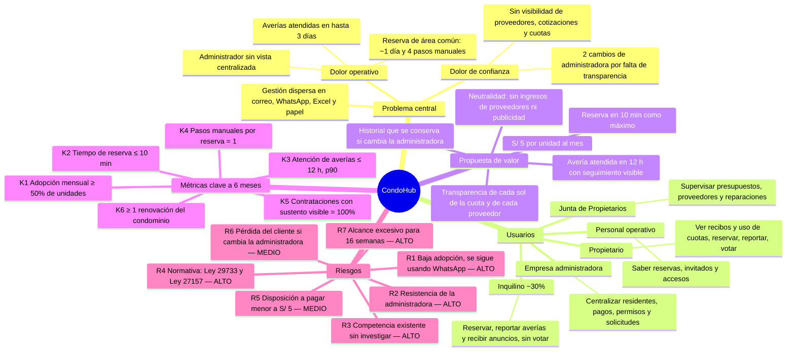

# CondoHub — Mapa visual para Miro

> Fuente: [01-project-brief.md](01-project-brief.md) y [05-preguntas-abiertas.md](05-preguntas-abiertas.md). Fecha: 2026-11-01.

## Opción A — Diagrama Mermaid (recomendada)

En Miro: **barra lateral → Apps/Más → "Mermaid"** (o *Diagramming → Create with code*), pegar el bloque y pulsar *Insert*.



## Opción B — Pegar como sticky notes

Copiar cada bloque y pegarlo en el tablero con **Ctrl+V**: Miro crea un sticky por línea. Colores sugeridos por columna entre paréntesis.

**Problema central** (rojo)
```
Gestión dispersa en correo, WhatsApp, Excel y papel
Reserva de área común: ~1 día y 4 pasos manuales
Averías atendidas en hasta 3 días
Administrador sin vista centralizada
Propietarios sin visibilidad de proveedores, cotizaciones y cuotas
2 cambios de administradora por falta de transparencia
```

**Usuarios** (azul)
```
Empresa administradora: centralizar residentes, pagos, permisos y solicitudes
Personal operativo: saber reservas, invitados y accesos
Junta de Propietarios: supervisar presupuestos, proveedores y reparaciones
Propietario: ver recibos y uso de cuotas, reservar, reportar, votar
Inquilino (~30%): reservar, reportar averías, recibir anuncios; no vota
```

**Propuesta de valor** (verde)
```
Reserva completa en 10 minutos como máximo
Avería atendida en 12 h como máximo, con seguimiento visible
Transparencia: en qué se gasta cada sol y por qué se eligió cada proveedor
Neutralidad: sin ingresos de proveedores ni publicidad
Historial del condominio que sobrevive al cambio de administradora
S/ 5 por unidad al mes (~2.5% de la cuota)
```

**Métricas clave — 6 meses** (amarillo)
```
K1 Adopción mensual ≥ 50% de unidades (hoy 0%)
K2 Tiempo de reserva ≤ 10 min (hoy ~24 h)
K3 Atención de averías ≤ 12 h, p90 (hoy hasta 72 h)
K4 Pasos manuales por reserva: 1 (hoy 4)
K5 Contrataciones con sustento visible: 100%
K6 ≥ 1 renovación del condominio a los 6 meses
```

**Riesgos** (naranja)
```
R1 Baja adopción: vecinos siguen en WhatsApp — Prob. alta / Impacto alto
R2 Resistencia de la administradora — Media / Alto
R3 Competencia existente sin investigar — Desconocida / Alto
R4 Incumplimiento Ley 29733 (datos) y Ley 27157 (votaciones) — Media / Alto
R5 Disposición a pagar menor a S/ 5 — Media / Medio
R6 Pérdida del cliente si cambia la administradora — Media / Medio
R7 Alcance excesivo para 16 semanas, proyecto individual — Alta / Alto
```

Layout sugerido: "Problema central" al centro y las otras cuatro columnas alrededor (Usuarios a la izquierda, Propuesta de valor a la derecha, Métricas abajo y Riesgos arriba), con conectores desde el centro.
