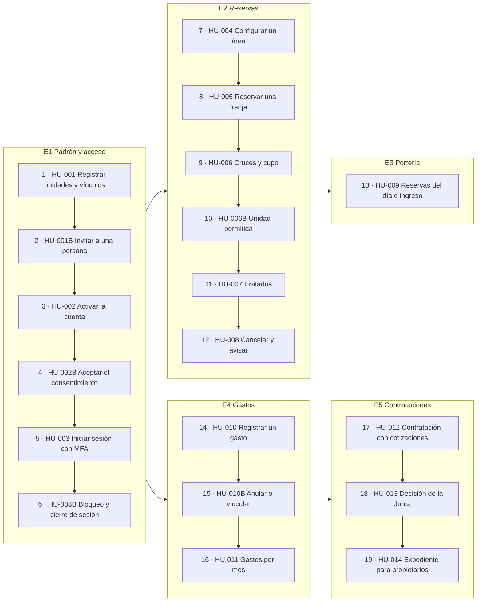

# CondoHub — Story map para Miro

> **Versión:** v0.4 (2026-11-04)
> **Fuente:** [06-user-stories.md](../06-user-stories.md) (19 HU), [02-alcance.md](../02-alcance.md) (S1–S5, C1–C4, W1–W13), [ADR-0010](adr/0010-defer-arco-and-complaints-book.md) y [ADR-0020](adr/0020-defer-account-self-service-and-handover.md).
> **Cómo leerlo:** las columnas son las actividades del usuario (épicas), en el orden en que se usa el sistema. Las filas son los niveles de prioridad. Dentro de la fila Must, el número es el campo **Orden** de cada HU.

## Estructura del tablero

| Prioridad | E1 Padrón y acceso | E2 Reservas | E3 Portería | E4 Gastos | E5 Contrataciones | E6 Comunicación y operación |
|---|---|---|---|---|---|---|
| **Must · Release 1 (MVP)** | 1 HU-001 Registrar unidades y vínculos · 2 HU-001B Invitar a una persona · 3 HU-002 Activar la cuenta · 4 HU-002B Aceptar el consentimiento · 5 HU-003 Iniciar sesión con MFA · 6 HU-003B Bloqueo y cierre de sesión | 7 HU-004 Configurar un área · 8 HU-005 Reservar una franja · 9 HU-006 Evitar cruces y respetar el cupo · 10 HU-006B Reservar solo con una unidad permitida · 11 HU-007 Registrar invitados · 12 HU-008 Cancelar y avisar | 13 HU-009 Reservas del día e ingreso | 14 HU-010 Registrar un gasto · 15 HU-010B Anular o vincular un gasto · 16 HU-011 Consultar gastos por mes | 17 HU-012 Contratación con cotizaciones · 18 HU-013 Decisión de la Junta · 19 HU-014 Expediente para propietarios | — |
| **Should · Release 2** | S5 Importación CSV del padrón | — | — | S2 Pagos y estado de cuenta | S4 Panel de indicadores | S1 Averías · S3 Anuncios y convocatorias |
| **Could · si sobra tiempo** | — | — | C3 Solicitudes de videovigilancia | C4 Historial exportable | C2 Consultas no vinculantes | C1 Notificaciones por correo |
| **Diferido · antes de datos reales** | Perfil del titular · Cambio de correo · Recuperación de contraseña · Regeneración de códigos · Aviso de TLS 1.2 · Traspaso de administradora (ADR-0020) · ARCO (ADR-0010) | — | — | — | Log de auditoría para la Junta (ADR-0020) | Libro de Reclamaciones (ADR-0010) |
| **Won't** | W10 Consola multicondominio · W11 Migración real | W4 Biometría y hardware | W5 Videovigilancia · W12 Registro general de visitantes | W2 Cobro en línea · W9 Contabilidad SUNAT | W3 Votaciones vinculantes · W6 Portal de proveedores · W7 Marketplace | W1 App nativa · W8 Chat de vecinos · W13 Otros idiomas |

La línea de release está entre la fila Must y la fila Should: lo que queda por encima es el MVP que se entrega el 2027-02-20.

## Opción A — Pegar como sticky notes (recomendada)

En Miro, copia cada bloque y pégalo en el tablero con **Ctrl+V**: Miro crea un sticky por línea. Pon los bloques en una cuadrícula: las épicas como encabezados de columna y las prioridades como filas. Usa el color indicado para cada fila.

**Fila 0 · Backbone (épicas)** (gris oscuro)
```
E1 Padrón y acceso
E2 Reservas
E3 Portería
E4 Gastos
E5 Contrataciones
E6 Comunicación y operación
```

**Must · E1 Padrón y acceso** (verde)
```
1 · HU-001 Registrar unidades y vínculos en el padrón
2 · HU-001B Invitar a una persona del padrón
3 · HU-002 Activar la cuenta por invitación
4 · HU-002B Aceptar el consentimiento informado
5 · HU-003 Iniciar sesión con MFA como Administrator o BoardMember
6 · HU-003B Bloquear la cuenta ante intentos fallidos y cerrar sesiones
```

**Must · E2 Reservas** (verde)
```
7 · HU-004 Configurar las reglas de un área común
8 · HU-005 Reservar una franja válida con confirmación automática
9 · HU-006 Evitar cruces de reservas y respetar el cupo de la unidad
10 · HU-006B Reservar solo a nombre de una unidad permitida
11 · HU-007 Registrar a los invitados de una reserva
12 · HU-008 Cancelar una reserva y avisar al residente
```

**Must · E3 Portería** (verde)
```
13 · HU-009 Ver las reservas del día y marcar el ingreso en portería
```

**Must · E4 Gastos** (verde)
```
14 · HU-010 Registrar un gasto con su comprobante
15 · HU-010B Anular un gasto o vincularlo a una contratación
16 · HU-011 Consultar los gastos por categoría y por mes
```

**Must · E5 Contrataciones** (verde)
```
17 · HU-012 Registrar una contratación con cotizaciones y enviarla a la Junta
18 · HU-013 Aprobar o rechazar una contratación como Junta Directiva
19 · HU-014 Consultar el expediente de una contratación como propietario
```

**Should · Release 2** (amarillo)
```
S5 Importación del padrón desde CSV (E1)
S2 Registro de pagos y estado de cuenta (E4)
S4 Panel de indicadores del piloto (E5)
S1 Reporte y seguimiento de averías (E6)
S3 Anuncios y convocatorias (E6)
```

**Could** (azul)
```
C3 Registro de solicitudes de videovigilancia (E3)
C4 Historial exportable del condominio (E4)
C2 Consultas no vinculantes a propietarios (E5)
C1 Notificaciones por correo (E6)
```

**Diferido · bloqueante para datos reales** (gris claro)
```
Perfil del titular: DNI y teléfono (ADR-0020)
Cambio del correo de acceso (ADR-0020)
Recuperación de contraseña (ADR-0020)
Regeneración de códigos de recuperación (ADR-0020)
Aviso de TLS 1.2 al iniciar sesión (ADR-0020)
Traspaso de administradora (ADR-0020)
Log de auditoría para la Junta (ADR-0020)
Solicitudes ARCO (ADR-0010)
Libro de Reclamaciones virtual (ADR-0010)
```

**Won't** (rojo)
```
W1 App móvil nativa
W2 Cobro en línea (prohibido, PRINCIPIO-007)
W3 Votaciones vinculantes
W4 Biometría y hardware de acceso
W5 Videovigilancia (prohibido, PRINCIPIO-004.4)
W6 Portal de proveedores
W7 Marketplace y publicidad
W8 Directorio o chat de vecinos (prohibido, PRINCIPIO-006)
W9 Contabilidad y facturación SUNAT
W10 Consola multicondominio
W11 Migración del historial real
W12 Registro general de visitantes
W13 Otros idiomas
```

## Opción B — Diagrama Mermaid

En Miro: **barra lateral → Apps → "Mermaid"** (o *Diagramming → Create with code*), pegar el bloque y pulsar *Insert*. Muestra solo el MVP (Must) por épica, en el orden de entrega.



## Trazabilidad del mapa

| Épica | Funcionalidad del alcance | Beneficio o KPI |
|---|---|---|
| E1 Padrón y acceso | M1, M2 | Frontera de acceso propietario–inquilino; PRINCIPIO-004, 005 y 006 |
| E2 Reservas | M3 | Beneficio 1 · K2 ≤ 600 s · K4 = 1 |
| E3 Portería | M4 | K4 = 1 |
| E4 Gastos | M5 | Beneficio 2 |
| E5 Contrataciones | M6 | Beneficio 2 · K5 = 100 % |
| E6 Comunicación y operación | S1, S3, C1 (después del MVP) | K3 |
